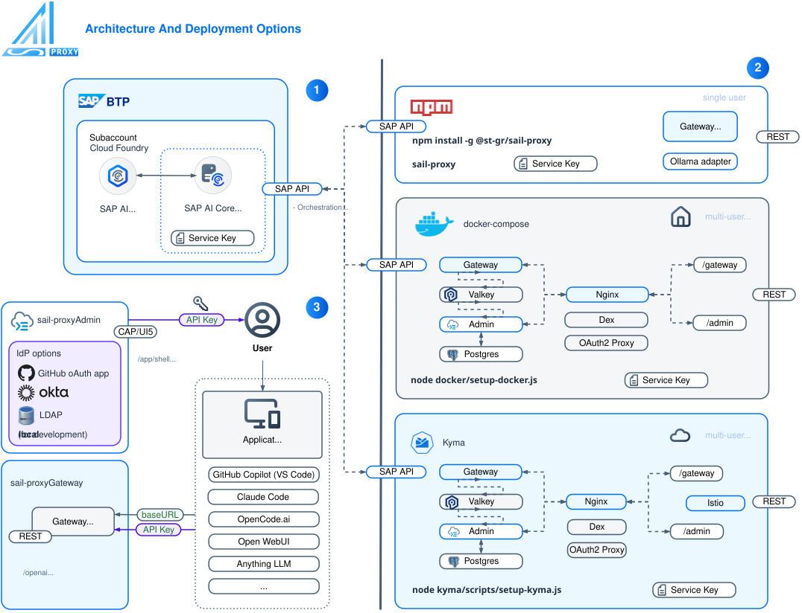

# SAP AI Core LLM Proxy - Multi-Provider API Gateway

[](https://www.youtube.com/channel/UCt0ji51UVF7cRjHLmanP_vg)
[](https://github.com/st-gr/sail-proxy/actions/workflows/ci.yml) [](LICENSE) [](https://st-gr.github.io/sail-proxy/)

<a href="README.md#sap-ai-core-multi-provider-api-gateway">
<!--
Logo in docs/assets
-->

</a>

<!--
Don't let the text wrap too narrowly to the left of the above image.
The `div` reduces the vertical height. The `picture` prevents autolinking.
-->
<div><picture></picture></div>

This project provides a unified API gateway that lets applications use familiar API formats (OpenAI, Anthropic, AWS Bedrock, OpenRouter, Ollama, etc.) while routing all requests through **SAP AI Core Foundation Models**.

Instead of maintaining multiple provider-specific integrations, this gateway standardizes incoming requests, converts them into SAP AI Core’s orchestration API, and forwards them securely to deployed foundation models.


## TL;DR

Keep your **SAP AI Core service** key secret 🔐, have users create their own API keys 🗝 , use AI Apps 💻 like agentic coding, see token usage 📈 per key (application), user, model, provider and cost 💰.


## Documentation

The full documentation lives at **[st-gr.github.io/sail-proxy](https://st-gr.github.io/sail-proxy/)**.

| | |
|---|---|
| [Guide](https://st-gr.github.io/sail-proxy/guide/) | introduction, quick start, features, clients, the Admin Cockpit |
| [Deploy](https://st-gr.github.io/sail-proxy/deploy/) | standalone CLI, Docker Compose, SAP BTP Kyma |
| [Reference](https://st-gr.github.io/sail-proxy/reference/) | endpoints, examples, configuration, environment variables |
| [Developer](https://st-gr.github.io/sail-proxy/developer/) | architecture, services, testing, plugins, release |
| [Changelog](https://st-gr.github.io/sail-proxy/changelog) | versions and what changed |
| [Videos](https://st-gr.github.io/sail-proxy/guide/videos) | screencasts per deployment option and client |

## Highlights

- 🔄 Leverage client apps that require OpenAI/Anthropic/Ollama/Bedrock/OpenRouter formats 
- 🖥️ Drop-in for self-hosted chat UIs such as [Open WebUI](https://github.com/open-webui/open-webui) via the OpenAI-compatible `/openai/v1` endpoint (see the [Open WebUI guide](https://st-gr.github.io/sail-proxy/guide/clients/open-webui))
- 🎯 Route all model calls through SAP AI Core Foundation Models with [plugin support](https://st-gr.github.io/sail-proxy/developer/plugins)
- 🧩 Exposes SAP AI Core deployed models for bare-metal API calls
- 🔒 SAP privacy guarantees - No direct connections to external model providers
- 🛡  Enterprise-grade security (multi-user key management), auditing, and cost control

## Architecture Overview and Deployment Options

<a href="docs/assets/sail-proxy-deployment-options.drawio.png">
<!--
The original draw.io file can be found here: docs/assets/sail-proxy-deployment-options.drawio
-->

</a>

**Key Point**: This gateway does __not__ connect directly to OpenAI, Anthropic, AWS Bedrock, or other AI providers. Instead, it translates various API formats and routes everything through SAP AI Core's unified orchestration layer or direct to the endpoint of a deployed foundation model.

The [deployment options](https://st-gr.github.io/sail-proxy/deploy/overview) page compares the standalone CLI, Docker Compose and SAP BTP Kyma.

## Quick start

**Standalone CLI** ([details](https://st-gr.github.io/sail-proxy/deploy/cli)): the first `sail-proxy` starts the interactive setup.

```bash
npm install -g @st-gr/sail-proxy
sail-proxy
sail-proxy run                    # start the gateway in the background
sail-proxy apikey create laptop   # prints a new API key
```

**Docker Compose** ([details](https://st-gr.github.io/sail-proxy/deploy/docker)): run from the root of a checkout.

```bash
git clone https://github.com/st-gr/sail-proxy.git
cd sail-proxy
node docker/setup-docker.js
docker compose -f docker/docker-compose.yml pull
docker compose -f docker/docker-compose.yml up -d
```

**SAP BTP Kyma**: see [Deploy on Kyma](https://st-gr.github.io/sail-proxy/deploy/kyma).

## Works with

[Claude Code](https://st-gr.github.io/sail-proxy/guide/clients/claude-code) · [Codex CLI](https://st-gr.github.io/sail-proxy/guide/clients/codex) · [opencode](https://st-gr.github.io/sail-proxy/guide/clients/opencode) · [GitHub Copilot](https://st-gr.github.io/sail-proxy/guide/clients/github-copilot) · [Gemini CLI](https://st-gr.github.io/sail-proxy/guide/clients/gemini) · [pi](https://st-gr.github.io/sail-proxy/guide/clients/pi) · [Open WebUI](https://st-gr.github.io/sail-proxy/guide/clients/open-webui) · [AnythingLLM](https://st-gr.github.io/sail-proxy/guide/clients/anythingllm) · [any OpenAI, Anthropic, Bedrock, OpenRouter or Ollama client](https://st-gr.github.io/sail-proxy/guide/clients/other-clients)

## Support

- Questions about setting up or using sail-proxy: [Discussions Q&A](https://github.com/st-gr/sail-proxy/discussions/categories/q-a)
- Ideas and proposals: [Discussions Ideas](https://github.com/st-gr/sail-proxy/discussions/categories/ideas)
- Reproducible bugs and concrete feature requests: [open an issue](https://github.com/st-gr/sail-proxy/issues/new/choose) with its template
- Security vulnerabilities: never in public, see the [Security Policy](SECURITY.md)

More in the [Support Guide](SUPPORT.md).

## Buy me a coffee ☕

Help support maintaining this repo.

[](https://ko-fi.com/L3L11KQN5D)

## Disclaimer

This project is neither developed by nor endorsed by SAP SE.
SAP® and SAP AI Core® are registered trademarks of SAP SE in Germany and in several other countries.
This is not a product of the Stanford Artificial Intelligence Laboratory (SAIL).

## Trademark Attribution Statement

SAP®, SAP AI Core®, SAP BTP®, SAP Generative AI Hub™, SAP AI Launchpad™, and SAP HANA®
are registered trademarks or trademarks of SAP SE (or its affiliates) in Germany and other countries.

OpenAI®, ChatGPT®, GPT-5™, GPT-4®, GPT-4o™, GPT-3.5™, and Codex™
are trademarks or registered trademarks of OpenAI OpCo, LLC.

Anthropic®, Claude™, Claude 3™, Claude Sonnet™, Claude Haiku™, and Claude Code™
are trademarks or registered trademarks of Anthropic PBC.

Amazon Web Services®, AWS®, Amazon Bedrock®, AWS Bedrock™, AWS CLI™,
and AWS Signature Version 4 (SigV4)™ are trademarks of Amazon.com, Inc.
or its affiliates in the United States and/or other countries.

Node.js® is a registered trademark of the OpenJS Foundation.

Ollama™ is a trademark of Infra Technologies, Inc.

OpenRouter™ is a trademark of its respective owner.

Google®, Gemini™, and related marks are trademarks of Google LLC.

Microsoft®, Azure®, Windows®, Visual Studio Code®, GitHub®,
and GitHub Copilot™ are trademarks of Microsoft Corporation
or its affiliates in the United States and/or other countries.

SUSE®, Rancher®, and Rancher Desktop™ are trademarks or registered trademarks
of SUSE LLC and/or Rancher Labs, Inc.

Docker™ is a trademark of Docker, Inc.

Kubernetes® is a registered trademark of The Linux Foundation.

Linux® is the registered trademark of Linus Torvalds.

All other product names, logos, and brands are the property of their
respective owners. Use of these names, logos, and brands does not imply endorsement.

## In Memory

This repository is dedicated to my father, who recently passed away.  
May he rest in peace.

## License

This project is licensed under the GNU AGPLv3 License - see the LICENSE file for details.
