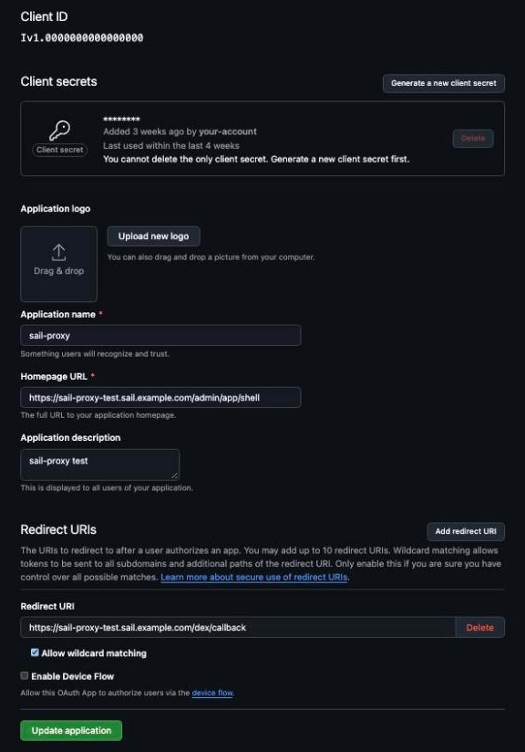

# GitHub sign-in

This page sets up sign-in to the Admin Cockpit with a GitHub OAuth App. Access follows the teams of one GitHub organization: members of the administrator team become cockpit administrators, members of the user team become cockpit users. [Authentication providers](./authentication) explains how sign-in works and compares the providers.

## Before you start

- A GitHub organization where you can create an OAuth App and teams, or an owner who does it for you.
- The base URL of the deployment, for example `https://sail.example.com`, or `http://localhost:8080` for a local Docker installation. GitHub calls back to `<base URL>/dex/callback`.

## 1. Create the OAuth App

1. In the organization, open **Settings → Developer settings → OAuth Apps → New OAuth App**.
2. Enter an application name and the **Homepage URL** (the base URL).
3. Set the **Authorization callback URL** to `<base URL>/dex/callback`, for example `https://sail.example.com/dex/callback`.
4. Register the app, then note the **Client ID** and generate a **Client secret**.



A second deployment, for example a test namespace on Kyma, has a host of its own and needs its own callback URL. Register it in the same OAuth App or in another one.

## 2. Create the teams

In the organization, create a team for administrators and a team for users, and add the members. The setup asks for the two team names; the defaults are `admins` and `users`. Use the team names as GitHub shows them.

## 3. Run the setup

On Docker, run `node docker/setup-docker.js` and choose **GitHub OAuth**. On Kyma, run `node kyma/scripts/setup-kyma.js` and choose the same ([Kyma deployment](./kyma)). Both ask the same five questions:

| Question | Meaning |
|---|---|
| GitHub OAuth App Client ID | From step 1 |
| GitHub OAuth App Client Secret | From step 1 |
| GitHub Organization name | The organization that owns the teams, for example `your-org` |
| Admin team name | The team's name inside that organization, without the organization prefix: `admins`, not `your-org/admins`. Default `admins` |
| User team name | Same rule. Default `users` |

The setup also asks for the base URL (Docker: the local address or your domain; Kyma: the host it derives from the cluster). It must be the URL people type in the browser, because the callback URL is built from it.

The setup writes the connector into the Dex configuration with the callback `<base URL>/dex/callback`. Dex lets in only members of the two teams in that organization. Start the stack as described in [Docker deployment](./docker), or deploy as described in [Kyma deployment](./kyma).

## 4. Allow the organization

GitHub shows an authorization page at the first sign-in. Under **Organization access**, grant the app access to your organization. If the organization restricts OAuth Apps, an organization owner must approve the app first, under the organization's **Settings → Third-party Access → OAuth application policy**. Without that approval, Dex cannot read the team memberships and the sign-in fails.

## Roles

The setup writes this role mapping for the admin service:

```json
{"your-org:admins":"admin","your-org:users":"user"}
```

Dex reports a user's teams as `<org>:<team>`. A member of the administrator team gets the admin role, a member of the user team the user role. A signed-in user whose teams map to no role gets the user role. To make someone an administrator, add them to the administrator team on GitHub; the new role applies at their next sign-in. What each role may do: [Roles](/guide/roles).

To change the organization or the team names, run the setup again with the new answers and recreate the services. Restart the admin service after any change to `ROLE_MAPPING`.

## Troubleshooting

- **403 Forbidden from Dex after the GitHub redirect**: the app has no access to the organization (step 4), or the organization restricts OAuth Apps and the app is not approved. Check **Settings → Applications** in your own GitHub account: the app must show organization access granted.
- **Signed in on GitHub but refused**: you are not a member of either team, or the team names in the setup differ from GitHub's. Check them in the organization's team list and run the setup again.
- **GitHub reports a redirect URI mismatch**: the callback URL of the OAuth App must equal `<base URL>/dex/callback` exactly, including scheme and port.
- **Redirect loop after sign-in**: the base URL given to the setup differs from the URL in the browser.

Read the Dex log for the exact error:

```bash
# Docker
docker compose -f docker/docker-compose.yml logs dex
# Kyma
kubectl -n sail-proxy logs deploy/dex
```

More: [Sign-in problems](/guide/troubleshooting#sign-in-problems-docker-and-kyma).
