# SAP Cloud Identity Services sign-in

This page sets up sign-in to the Admin Cockpit with an OpenID Connect application in SAP Cloud Identity Services - Identity Authentication (IAS). Dex is the OpenID Connect client; IAS sends the user's groups, and two of them become the cockpit's administrator and user roles. [Authentication providers](./authentication) explains how sign-in works and compares the providers.

## Before you start

- An administrator of the IAS tenant who can create applications and user groups. The administration console is at `https://<tenant host>/admin`.
- Two user groups in IAS, for example `sap-llm-gateway-admin` for administrators and `sap-llm-gateway-user` for users, with the members added. Group names must not contain spaces or commas.
- The base URL of the deployment, for example `https://sail.example.com`, or `http://localhost:8080` for a local Docker installation.
- The Dex container or pod must reach the tenant over HTTPS.

A free SAP BTP trial account can subscribe to one Cloud Identity Services trial tenant (up to 50 users, for the trial period). It is enough to try this sign-in.

## 1. Create the application in IAS

The numbers in the steps below match the numbered markers in the screenshots. The screenshots use stand-in values: the tenant is shown as `my-tenant`, and the IDs, the user and the host names are placeholders.

### Create the application

1. In the administration console, open **Applications & Resources**.
2. Choose **Applications**.
3. Choose **Create**.

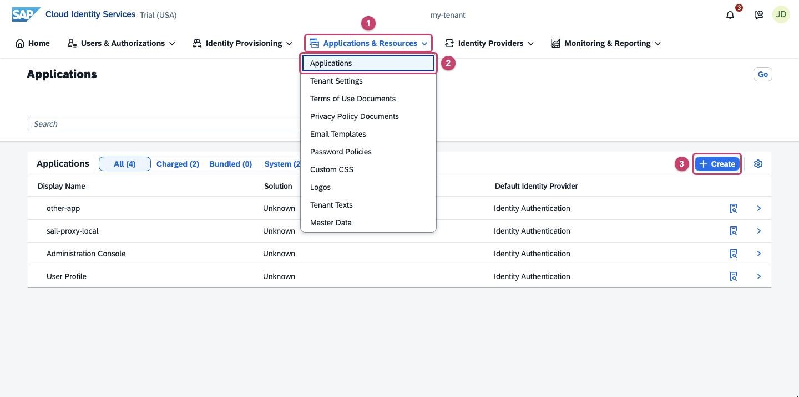
*The Applications list and the Create button.*

1. Enter a **Display Name**, for example `sail-proxy`.
2. Under **Protocol Type**, select **OpenID Connect**. **SAML 2.0** is preselected.
3. Choose **Create**.

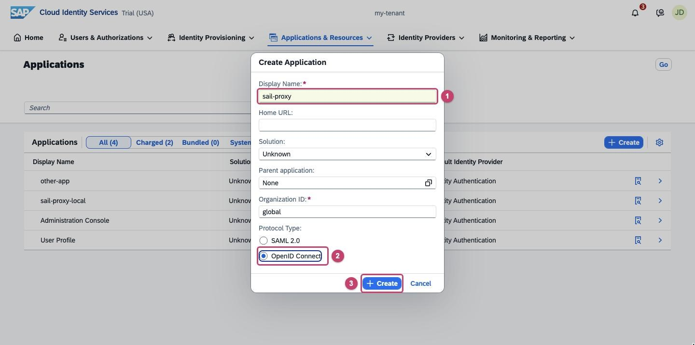
*Creating the application with the protocol type OpenID Connect.*

The next steps are on the page of the application. To open it, choose the application in the **Applications** list.

### Set the redirect URI and the grant types

1. Stay on the **Trust** tab of the application.
2. Under **Single Sign-On**, choose **OpenID Connect Configuration**. On a new application, IAS asks for a name for the configuration first.

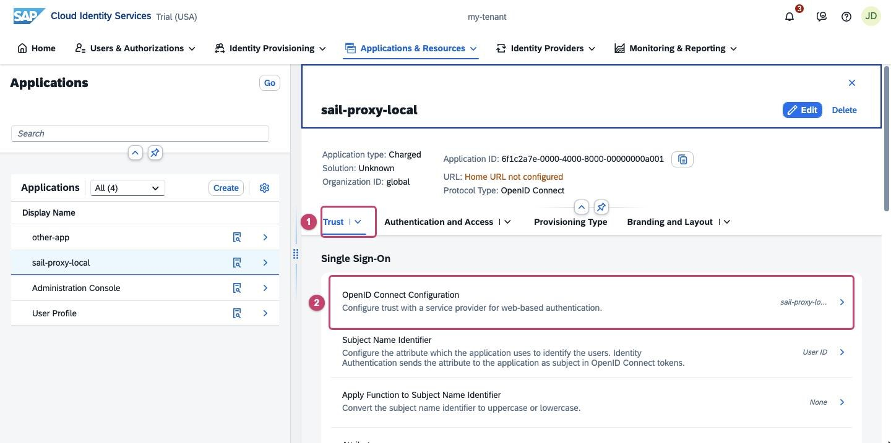
*OpenID Connect Configuration on the Trust tab.*

The configuration opens in a column on the right.

1. Stay on the **URIs** tab.
2. Under **Redirect**, choose **Add**. A new row appears at the top of the list.
3. Enter `<base URL>/dex/callback` in the new row, for example `https://sail.example.com/dex/callback`. IAS accepts `http://` only for `localhost`, so `http://localhost:8080/dex/callback` works for a local Docker installation.
4. Choose **Save**.

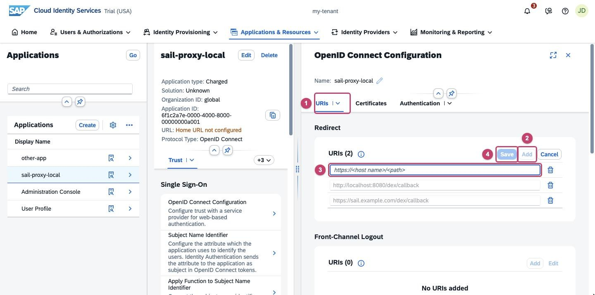
*The new row after Add. The two rows below it are redirect URIs that were added before.*

1. Open the **Authentication** tab.
2. Next to **Grant Types**, choose **Edit**. **Save** and **Cancel** take the place of **Edit**.
3. Keep **Authorization Code** selected and deselect every other grant type. A new application also has Password, Client Credentials, Refresh and JWT Bearer selected.
4. **Enforce PKCE (S256)** can be selected as well; the sign-in works with it. Then choose **Save**.

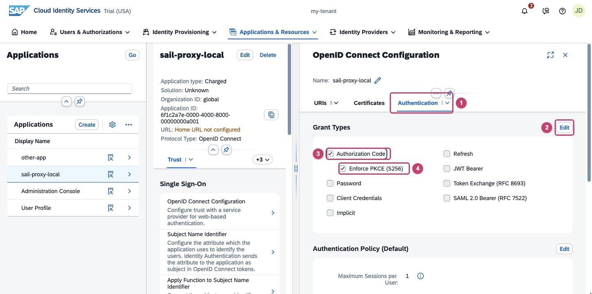
*The grant types after the change.*

### Note the client ID and add a secret

1. Go back to the **Trust** tab of the application.
2. Scroll down to **Application APIs** and choose **Client Authentication**.

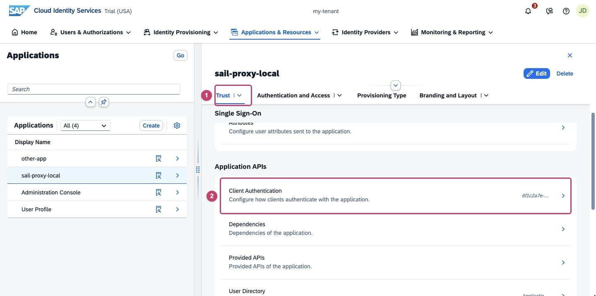
*Client Authentication on the Trust tab, below Single Sign-On.*

1. Note the **Client ID**. It is not the **Application ID** shown at the top of the application page.

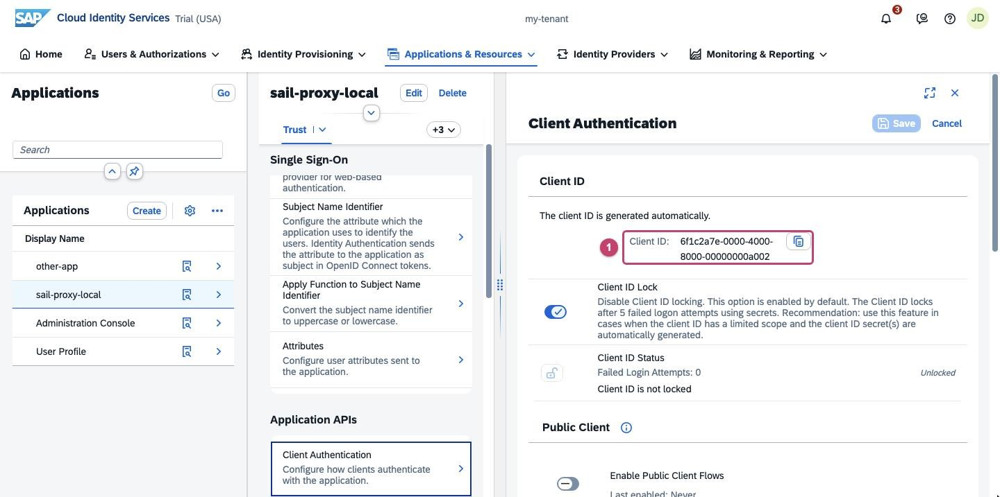
*The client ID of the application.*

1. On the same page, scroll down to **Secrets** and choose **Add**.

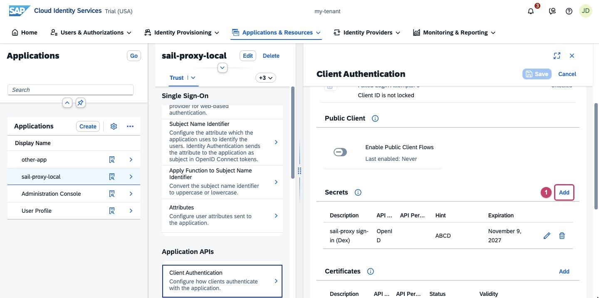
*The Secrets section.*

1. Enter a **Description**, for example `sail-proxy sign-in (Dex)`.
2. Choose an expiry under **Expire in**. **1 year** is preselected.
3. Under **API Access**, select **OpenID**. The dialog asks for at least one API access.
4. Choose **Save**. IAS shows the secret once, when you save; copy it then.

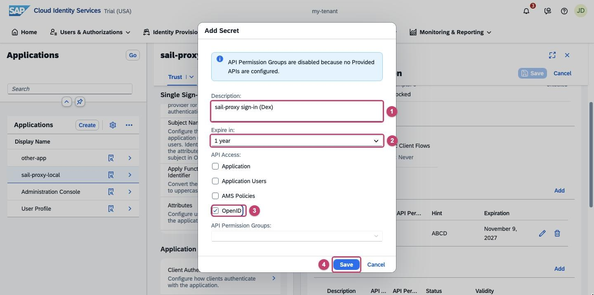
*Adding the client secret. IAS shows the secret after Save, once.*

When the secret expires, sign-in stops until you run the setup again with a new one.

### Create the groups and add the members

1. Open **Users & Authorizations**.
2. Choose **Groups**.
3. Choose **Create**.

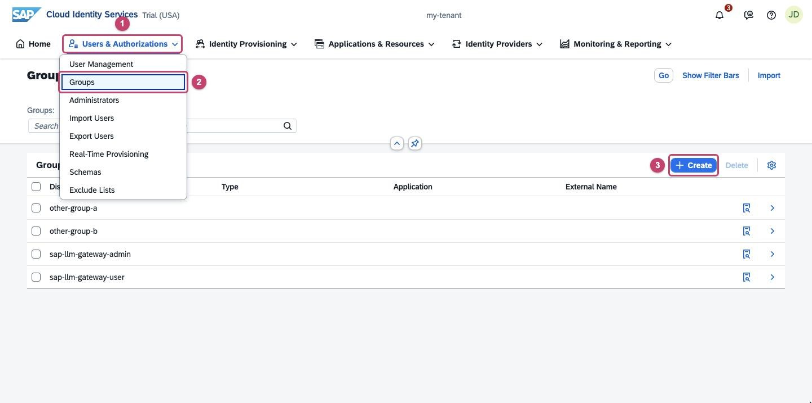
*The Groups list and the Create button.*

1. Enter the **Name** of the group, for example `sap-llm-gateway-admin`.
2. Enter the **Display Name**.
3. Choose **Next Step**.

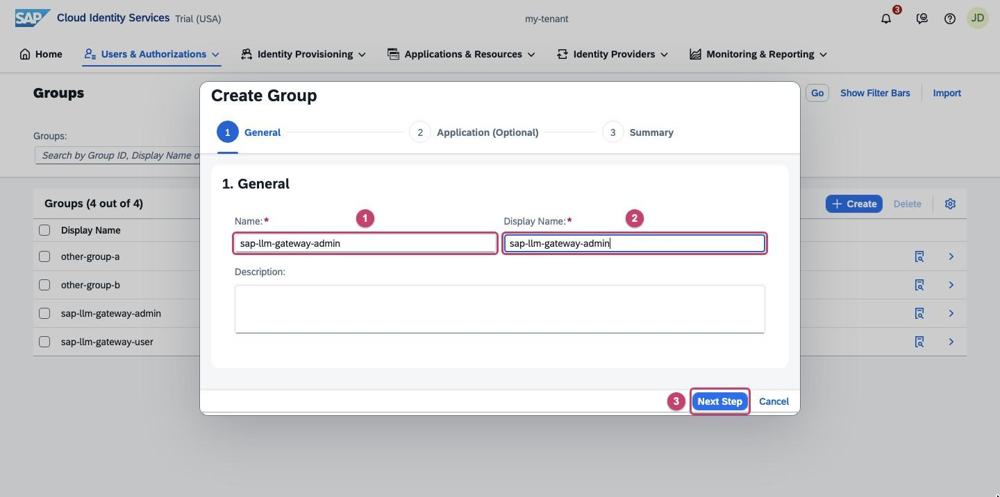
*The General step of the group wizard.*

1. The step **Application (Optional)** can be skipped: select no application and choose **Next Step** again.

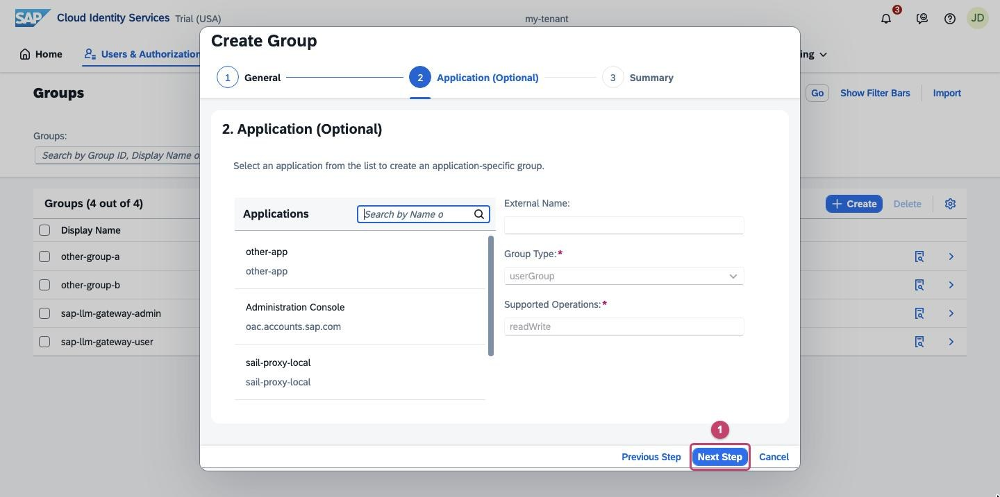
*The optional application step.*

1. On the **Summary** step, choose **Finish**.

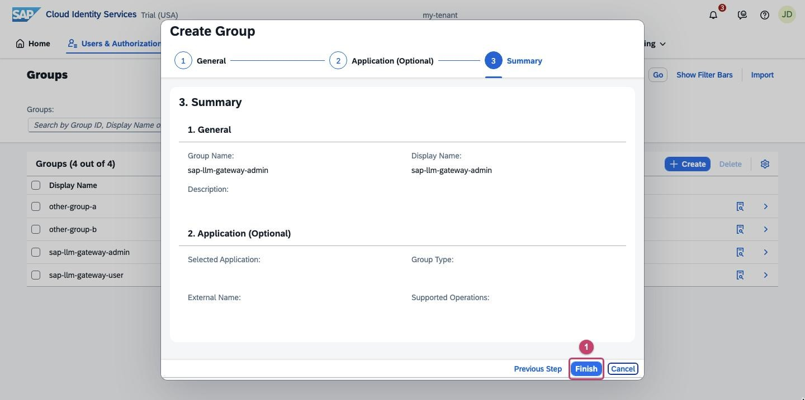
*The Summary step.*

Create the second group, for example `sap-llm-gateway-user`, the same way. Then add the members to each group:

1. In the **Groups** list, choose the arrow of the group.
2. Stay on the **User Members** tab.
3. Choose **Add**. The **Add Users** dialog lists the users of the tenant: select the members and choose **Add**.

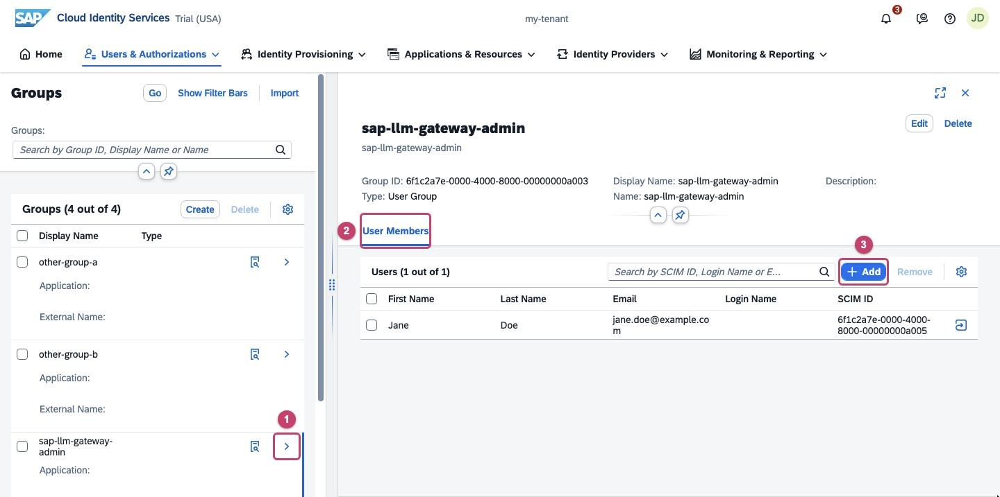
*The group page with its members.*


The application needs no `groups` attribute: the setup asks IAS for the `groups` scope, and the ID token then lists the names of the user's groups.

The tenant's issuer is the URL in the `issuer` field of `https://<tenant host>/.well-known/openid-configuration`, usually `https://<tenant host>`. Dex compares it character by character, so copy it from there.

A second deployment, for example a test namespace on Kyma, has a host of its own: add its redirect URI to the application, or create another application for it.

## 2. Run the setup

On Docker, run `node docker/setup-docker.js` and choose **SAP Cloud Identity Services (OpenID Connect)**. On Kyma, run `node kyma/scripts/setup-kyma.js` and choose the same ([Kyma deployment](./kyma)). The questions:

| Question | Meaning |
|---|---|
| IAS tenant issuer URL | The issuer from step 1, for example `https://my-tenant.accounts.ondemand.com`: `https`, no trailing slash, not the address of the discovery document |
| Client ID of the IAS application | The **Client ID** from "Note the client ID and add a secret" |
| Client secret of the IAS application | The secret you added there; it is not shown while you type |
| IAS user group for administrators | Default `sap-llm-gateway-admin` |
| IAS user group for users | Default `sap-llm-gateway-user` |
| Logout redirect URL | Default `auto-shell`, which returns to the cockpit start page |

What the setup writes differs between the deployments:

- **Docker**: the connector goes to `docker/dex.config.yaml`. Start the stack as described in [Docker deployment](./docker).
- **Kyma**: the connector goes to the Secret `dex-config`. Deploy as described in [Kyma deployment](./kyma).

A later run of the setup shows the current answers and keeps the client secret when you press Enter.

## Roles

The setup writes this role mapping for the admin service:

```json
{"sap-llm-gateway-admin":"admin","sap-llm-gateway-user":"user"}
```

The names are the group names given to the setup, matched exactly against the `groups` claim of the ID token. A user whose groups map to no role, or who is in no group at all, gets the user role. A group that is itself named `admin` or `user` always maps to the role of that name; keep that in mind on a tenant you share with other applications. To make someone an administrator, add them to the administrator group in IAS; it applies at their next sign-in, and a session lasts up to seven days. What each role may do: [Roles](/guide/roles). Restart the admin service after any change to `ROLE_MAPPING`.

Signing out of the cockpit ends the cockpit session. The IAS session stays, so the next sign-in may pass without a password prompt.

## Troubleshooting

- **Dex does not start and reports that the issuer did not match**: the issuer URL given to the setup differs from the tenant's own. Open `https://<tenant host>/.well-known/openid-configuration` and use its `issuer` value exactly.
- **Dex cannot fetch the provider configuration**: the Dex container or pod cannot reach the tenant, or the tenant requires a client ID on the discovery request (**Enforce Compliant OIDC Issuer**).
- **IAS reports an invalid redirect URI**: the redirect URI of the application must equal `<base URL>/dex/callback` exactly, including scheme and port.
- **IAS reports an unauthorized client**: the client ID or secret is wrong, or the secret has expired. Add a new secret in IAS and run the setup again.
- **Signed in but with the wrong role**: the ID token carries no `groups` claim, or the group names differ from the setup's answers.
- **Redirect loop after sign-in**: the base URL given to the setup differs from the URL in the browser.

Read the Dex log for the exact error:

```bash
# Docker
docker compose -f docker/docker-compose.yml logs dex
# Kyma
kubectl -n sail-proxy logs deploy/dex
```

More: [Sign-in problems](/guide/troubleshooting#sign-in-problems-docker-and-kyma).
