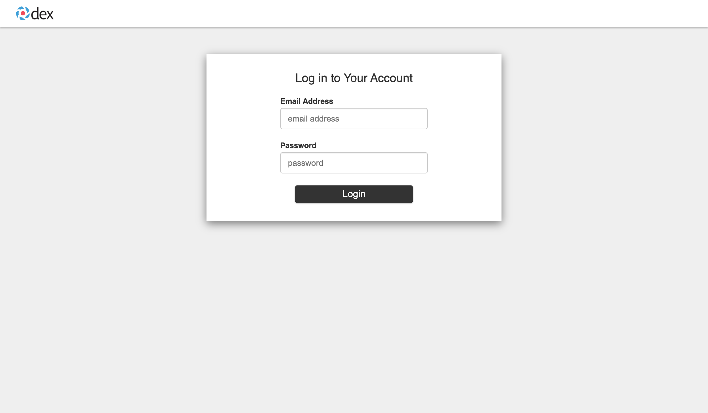
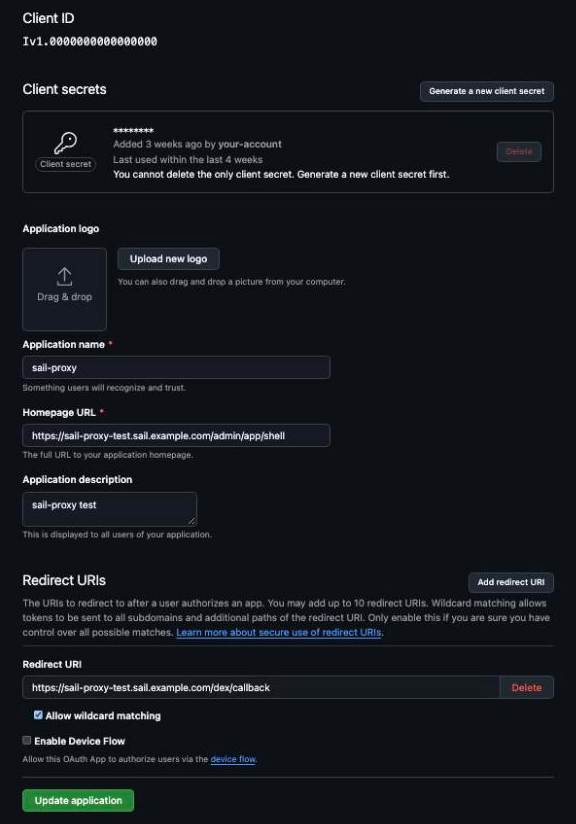

# Authentication providers

On the Docker and Kyma deployments, people sign in to the Admin Cockpit through single sign-on. This page covers that sign-in. API clients do not sign in this way: they send an API key or an AWS SigV4 signature, which the gateway checks itself ([API authentication](/reference/authentication) describes the gateway's checks). The standalone CLI has no cockpit and no sign-in.

## How sign-in works

Three components handle it:

- **nginx** is the entry point. For a cockpit request it asks oauth2-proxy whether the browser has a valid session; without one it redirects to the sign-in.
- **oauth2-proxy** manages the session cookie. It signs the user in at Dex.
- **Dex** connects to the identity provider: its own local accounts, GitHub, LDAP/Active Directory or Okta (SAML).

After a sign-in, nginx passes the user to the admin service in these headers, taken from oauth2-proxy's answer:

| Header | Content |
|---|---|
| `X-Auth-Request-Email` | The user's email address; the admin service identifies the user by it |
| `X-Auth-Request-Groups` | The user's groups at the identity provider, separated by commas or spaces |
| `X-Auth-Request-User` | The user name |
| `X-Auth-Request-Preferred-Username` | The preferred user name |

The admin service trusts these headers. That is why, on Docker, its port 4004 is published on the loopback interface only: only nginx may reach it.

A page on another site cannot act with a signed-in user's session. The session cookie is `SameSite=Lax`, so the browser leaves it off a request another site's page sends, and the admin service refuses any change (POST, PUT, PATCH, DELETE) that the browser marks as coming from another site, including another host under the same domain, with 403. Reads and clients that are not browsers are not affected.

Requests to `/gateway/` that carry an API key (`x-api-key`, or `Authorization: Bearer sk-…`) or an AWS SigV4 signature pass nginx without a sign-in. A browser without either is sent to the sign-in.

## Choosing a provider

The setup script asks for the provider: `docker/setup-docker.js` on Docker, `kyma/scripts/setup-kyma.js` on Kyma. Both offer the same four.

| Provider | For | Groups come from |
|---|---|---|
| Local Development | Evaluation and tests only | None; roles come from the email address |
| GitHub OAuth | Teams that use a GitHub organization | Teams of the organization, as `<org>:<team>` |
| LDAP/Active Directory | A corporate directory | LDAP groups |
| Okta SAML | Okta single sign-on | The `groups` attribute of the SAML assertion |

Every external provider calls back to Dex at `<base URL>/dex/callback`, for example `https://sail.example.com/dex/callback`. Register that URL with the provider. A second deployment, for example a test namespace on Kyma, has a host of its own and needs its own callback URL registered.

### Local Development

Two fixed accounts, stored in the Dex configuration:

| Email | Password | Role |
|---|---|---|
| `admin@example.com` | `admin123` | admin |
| `user@example.com` | `user123` | user |

The passwords are public. Never use this provider for an installation others can reach. `setup-docker.js --ci` and `setup-kyma.js --ci` choose it.

*The Dex sign-in page that the local accounts use.*

### GitHub OAuth

1. In GitHub, create an OAuth App (organization **Settings → Developer settings → OAuth Apps**). Set the **Authorization callback URL** to `<base URL>/dex/callback`, for example `http://localhost:8080/dex/callback` for a local Docker installation.

   

2. In the organization, create a team for administrators and one for users, and add the members.
3. Run the setup and choose **GitHub OAuth**. It asks for the OAuth App's client ID and client secret, the organization name, and the admin and user team names (default `admins` and `users`).

Dex lets in only members of the organization's teams named there. The setup maps `<org>:<admin team>` to the admin role and `<org>:<user team>` to the user role.

The [GitHub sign-in page](./auth-github) has the full steps and troubleshooting.

### LDAP/Active Directory

Run the setup and choose **LDAP/Active Directory**. It asks for the server type, the admin and user group names (default `sap-llm-gateway-admin` and `sap-llm-gateway-user`), and for an external server:

- the server (`host:port`) and whether an unencrypted connection is allowed (default `false`);
- the bind DN and password of a service account;
- the user search: base DN, filter (default `(objectClass=person)`) and the attributes for user name, ID, email, display name and preferred user name (defaults `sAMAccountName`, `sAMAccountName`, `mail`, `displayName`, `sAMAccountName`);
- the group search: base DN, filter (default `(objectClass=group)`), name attribute (default `cn`) and member attribute (default `member`).

On Docker, the server type can also be `local`: a test OpenLDAP server with sample users and groups, started as an extra Compose service. Kyma supports external servers only.

The [LDAP sign-in page](./auth-ldap) has the full steps and troubleshooting.

### Okta SAML

1. In Okta, create a SAML 2.0 application. Set the **Single sign-on URL** to `<base URL>/dex/callback` and the **Audience URI (SP Entity ID)** to `<base URL>/dex`. Send the user's groups in a SAML attribute named `groups`, and assign the users and groups to the application.
2. Run the setup and choose **Okta SAML**. It asks for the Okta SAML metadata URL and SSO URL, the SAML signing certificate (by default fetched from the metadata), and the admin and user group names (default `sap-llm-gateway-admin` and `sap-llm-gateway-user`).

The [Okta sign-in page](./auth-okta) has the full steps and troubleshooting.

## Roles

The admin service maps each of the user's groups to a cockpit role with `ROLE_MAPPING`, a JSON map from group to role. The setup writes it for the chosen provider:

| Provider | `ROLE_MAPPING` the setup writes |
|---|---|
| Local Development | `{"admin@example.com":"admin","user@example.com":"user"}` (the local accounts have no groups; `LOCAL_USER_MAPPING` maps their email addresses to roles) |
| GitHub OAuth | `{"<org>:<admin team>":"admin","<org>:<user team>":"user"}` |
| LDAP/Active Directory | `{"<admin group>":"admin","<user group>":"user"}` |
| Okta SAML | `{"<admin group>":"admin","<user group>":"user"}` |

The groups `admin` and `user` always map to the roles of the same name. A user whose groups map to no role gets the user role. On Docker, `ROLE_MAPPING` is in `docker/.env.auth` and `services/admin/.env`; the value in `docker/.env.auth` wins. Restart the admin service after a change. What each role may do is described in [Roles](/guide/roles).

To make someone an administrator, add them to the admin group (or team) at the identity provider. The cockpit has no role editor.

## Sign-out

The cockpit's sign-out ends the oauth2-proxy session and redirects to the logout redirect URL the setup asked for. The default, `auto-shell`, returns to the cockpit start page, which leads to a new sign-in.

A session lasts up to seven days. oauth2-proxy does not ask the identity provider again during that time, so a change at the provider, such as removing someone from a group, applies at that person's next sign-in. Running the setup again with a different provider signs everyone out.

## Troubleshooting

- **Redirect loop after sign-in**: the base URL in the setup must match the URL in the browser exactly, including scheme and port.
- **Signed in with the wrong role**: check the user's groups at the identity provider and `ROLE_MAPPING`.
- **GitHub, Okta or LDAP refuses the sign-in**: see [Sign-in problems](/guide/troubleshooting#sign-in-problems-docker-and-kyma).
