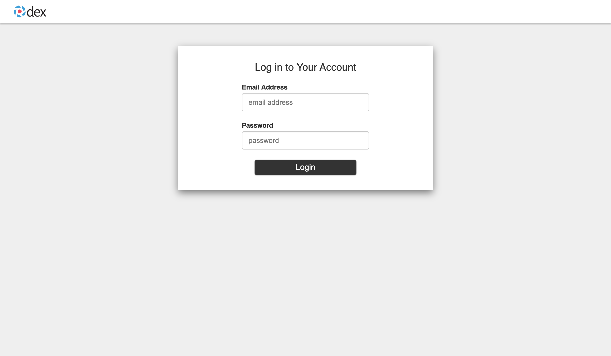

# Docker Compose

The Docker deployment runs the gateway together with the Admin Cockpit, nginx, single sign-on (oauth2-proxy and Dex), PostgreSQL and Valkey, on hosts you operate. It is meant for teams: every user signs in to the cockpit and manages their own API keys.

Video: [Deploy with Docker Compose](/guide/videos#deploy-with-docker-compose), four minutes with chapters.

## Architecture

```
          browser / API client
                   │
                   ▼
            nginx :8080 ──────► oauth2-proxy ──────► Dex ──────► identity provider
            │           │                                       (local, GitHub, LDAP, Okta)
  /gateway/ │           │ /admin/
            ▼           ▼
        gateway ───► admin
            │           │
            ▼           ▼
          Valkey    PostgreSQL (pgvector)
```

nginx is the single entry point. It sends browsers through oauth2-proxy and Dex to sign in, passes the signed-in user to the admin service, and forwards `/gateway/` to the gateway. Requests with an API key or an AWS SigV4 signature go to the gateway without a sign-in; the gateway checks the credential itself.

## Prerequisites

- A Docker runtime with Docker Compose 2.24 or later, for example Docker Desktop, Rancher Desktop on Windows, Colima on macOS, or Docker Engine on Linux.
- **Node.js 20 or later** and **git**, for the setup script.
- The **service key** of your SAP AI Core instance as JSON, and an orchestration deployment in SAP AI Core.
- For a sign-in other than the local test accounts: an OAuth app in GitHub, an Okta SAML application, or an LDAP/Active Directory server (see [Authentication providers](/deploy/authentication)).

## Install

Run everything from the root of a checkout:

```bash
git clone https://github.com/st-gr/sail-proxy.git
cd sail-proxy
node docker/setup-docker.js
docker compose -f docker/docker-compose.yml pull
docker compose -f docker/docker-compose.yml up -d
```

<TerminalFrame video="03-docker-compose" name="up" title="docker compose up">The first start of the stack: compose starts the seven services, `ps` shows them running, and the health endpoint behind nginx answers.</TerminalFrame>

The setup script is required before the first start: it writes the `.env` files the services read. If the `inquirer` package is missing, it offers to install it. It asks, in this order:

1. **Database**: the PostgreSQL user name and password (leave the password empty to generate one).
2. **SAP AI Core**: paste the service key JSON, enter the values by hand, or skip.
3. **Sign-in**: the authentication provider (local test accounts, GitHub, LDAP/Active Directory or Okta SAML) and its settings.
4. **Base URL**: `http://localhost:8080` for a local installation, or the URL your users open.
5. **Image mode**: pull pre-built images from a registry (`ghcr.io/st-gr` by default) or build them locally.
6. **Plugins**: whether administrators may install gateway plugins from the cockpit (default yes). An installed plugin is code that runs inside the gateway, which holds the SAP AI Core credentials. Answering no writes `INSTALLED_PLUGINS_ENABLED=false` into `services/admin/.env`; see [Plugins in the cockpit](/guide/cockpit/plugins#switching-installation-off). `--ci` and `--config` do not ask and can return the setting to on, so check it after such a run.

When configuration files exist already, it offers to copy them to `docker/backup-<timestamp>/` first. When Docker volumes exist already, it offers to delete them, which deletes their data. The default is to delete them when the database user or password changed (the existing volumes would not accept the new ones), and to keep them when both are unchanged. In registry mode it offers to pull the images.

When everything runs, open `http://localhost:8080/admin/app/shell/` (or your base URL), sign in, and create an API key under **[API Keys](/guide/cockpit/api-keys)**. The gateway answers on `http://localhost:8080/gateway/` through nginx and on `http://localhost:3000/` directly; the [Quick start](/guide/quick-start#verify-the-installation) shows the first requests.


*The sign-in page of the Docker Compose stack: the local provider asks for an e-mail address and a password.*

### Setup options

```
node docker/setup-docker.js [options]

  --help, -h     Show the help text
  --version, -v  Show the version
  --force, -f    Overwrite existing .env files
  --ci           Use defaults without prompts: local test accounts, no backup,
                 http://localhost:8080, locally built images
  --config JSON  Pass the whole configuration as JSON instead of answering prompts
```

For unattended runs, set the service key in `SAP_AI_CORE_SERVICE_KEY`; the setup then reads it from there instead of asking (and falls back to the prompts when it is not valid JSON):

```bash
export SAP_AI_CORE_SERVICE_KEY="$(cat /secure/path/service-key.json)"
node docker/setup-docker.js --ci --force
```

### Going back, reviewing and running again

The interactive setup lets you correct yourself and changes nothing until you confirm.

- **Going back**: press the Up arrow on a text or password question to return to the previous question. List questions have a **← Back** choice. Questions that open an editor offer **Open editor** and **← Back**, plus **Keep current** when the question already has a value. Your earlier answers are remembered and offered as defaults.
- **Review screen**: after the last question the setup lists all answers. Choose any of them to change it, or **Write configuration**. Nothing is written, deleted, pulled or applied before you choose **Write configuration**. Secrets are never shown there; they appear as `set`, `new` or `generated`.
- **Running again**: When configuration files from an earlier run exist, the setup reads them and offers their values as defaults, including the database user, the sign-in provider and its settings, the base URL and the image mode. Existing generated secrets are kept unless you choose to generate new ones. Press Enter to keep a current value. The SAP AI Core questions are asked only while `services/gateway/.env` does not exist; to change those values later, edit that file or run the setup with `--force`. `--force` ignores the current values and starts from the defaults, as a first run would.
- **Secrets**: a secret that is already set is never shown. For the database password you choose **Keep current** or **Enter new**. Other secrets you type, such as a client secret or a bind password, are marked `(set — Enter keeps it)`: press Enter to keep the value or type a new one. Secrets the setup generated (such as encryption keys, sign-in session secrets or a generated database password) are kept; to replace one, choose **Regenerate a key…** under **Generated keys**. The setup names what stops working before you confirm (for example, stored credentials that become unreadable, or users who are signed out). The setup never prints secret values.
- **Billing currency**: the setup asks for the currency in which you are billed for SAP AI Core. The default is USD and needs no further input. For another currency you can enter the price of a productive and of a non-productive capacity unit. Without prices, SAP cost shows as not priced until you enter the rates in the SAP Rates app of the Admin Cockpit. Changing the prices in a later setup run adds new rates valid from that day; rates you edit in the SAP Rates app are kept until you change the prices in setup again.

## Services

| Service | Image | Published port | Purpose |
|---|---|---|---|
| `nginx` | `sail-proxy-nginx` | `8080` (`NGINX_PORT`) and `443` | Entry point: sign-in, `/admin/` and `/gateway/` |
| `gateway` | `sail-proxy-gateway` | `3000` | The API gateway |
| `gateway-migrate` | `sail-proxy-gateway` | none | One-shot step before the gateway starts: sets up the file search tables and the gateway's restricted database role, then exits |
| `admin` | `sail-proxy-admin` | `127.0.0.1:4004` | Admin service and Admin Cockpit; updates its database schema on every start |
| `oauth2-proxy` | `oauth2-proxy` v7.6.0 | `127.0.0.1:4180` | Sign-in sessions |
| `dex` | `dex` v2.46.1 | `127.0.0.1:5556` | Identity provider hub with connectors for GitHub, LDAP and SAML |
| `postgres` | `pgvector/pgvector:pg16-trixie` | `127.0.0.1:5432` | Database of the admin service, Dex and file search |
| `valkey` | `valkey/valkey:8` | `127.0.0.1:6379` | Cache and event bus between gateway and admin |
| `ollama` | `sail-proxy-ollama` | `11434` | Optional, profile `ollama`: an Ollama-compatible API |
| `minio` | MinIO | `127.0.0.1:59100` | Optional, profile `minio`: S3-compatible storage to try the S3 [file storage](/deploy/file-storage) |

The admin service trusts the user headers nginx sets after a sign-in, so its port and those of the internal services are bound to the loopback interface only. Start the optional services with their profile:

```bash
docker compose -f docker/docker-compose.yml --profile ollama up -d
```

The data lives in the named volumes `postgres_data` and `valkey_data` (Compose prefixes them with the project name, `docker_` by default). The gateway and admin logs are written to `logs/gateway/` and `logs/admin/` in the checkout.

Day-to-day commands:

```bash
docker compose -f docker/docker-compose.yml ps                 # state of the services
docker compose -f docker/docker-compose.yml logs -f gateway    # follow a log
docker compose -f docker/docker-compose.yml restart gateway    # restart one service
docker compose -f docker/docker-compose.yml down               # stop everything
```

## Configuration

### Files the setup writes

| File | Content |
|---|---|
| `services/gateway/.env` | Gateway: SAP AI Core credentials (`SAP_AI_CORE_URL`, `AUTH_URL`, `CLIENT_ID`, `CLIENT_SECRET`, `SAP_AI_REGION`, `SAP_AI_RESOURCE_GROUP`) and the shared keys |
| `services/admin/.env` | Admin service: the shared keys, `AWS_SECRET_ENCRYPTION_KEY`, `ROLE_MAPPING` |
| `services/ollama/.env` | Optional Ollama service |
| `docker/.env` | Read by Compose itself: `POSTGRES_USER`, `POSTGRES_PASSWORD` and the image settings `DOCKER_REGISTRY`, `DOCKER_ORGANIZATION`, `DOCKER_TAG` |
| `docker/.env.docker` | The image settings, as used by the setup script |
| `docker/.env.auth` | oauth2-proxy and sign-in settings, including `IDENTITY_PROVIDER` and `ROLE_MAPPING` |
| `docker/.env.postgres` | The admin service's database connection and the privileged file search migration connection (`FILE_SEARCH_MIGRATION_DATABASE_URL`), used only by `gateway-migrate` |
| `docker/.env.filesearch-runtime` | The gateway's restricted file search connection (`FILE_SEARCH_DATABASE_URL`) |
| `docker/.env.nginx` | nginx: base URL, logout redirect, request timeout (900 seconds) |
| `docker/dex.config.yaml` | Dex: the identity provider connector and its clients |
| `docker/okta-saml-ca.pem` | The Okta SAML certificate (a placeholder for other providers) |

None of these files belong in version control. nginx reads its settings from environment variables when the container starts, so a change of provider or base URL needs a restart, not a rebuild.

### Security keys

The setup generates the keys and writes them where they are needed:

- `VALIDATION_TOKEN_SECRET` signs the tokens between gateway and admin; both must have the same value. The admin and gateway refuse publicly known values (the built-in default and the `.env.sample` placeholder) outside development, and the setup replaces such a value in an existing `.env` with a generated one.
- `METADATA_ENCRYPTION_KEY` encrypts stored metadata.
- `AWS_SECRET_ENCRYPTION_KEY` encrypts the secret access keys of the AWS credentials the admin stores. If it is missing or still the sample value, the admin starts but logs a security warning: the secrets are then encrypted with a publicly known key. Set a generated key, then enter the stored AWS secret access keys again, because keys stored under the old value cannot be read with the new one.

Keep a copy of these keys with your backups: a database backup is unreadable in parts without them (see [Backup, restore and upgrade](/deploy/backup-and-upgrade)).

### Roles

The setup writes a `ROLE_MAPPING` for the chosen provider, which maps its groups to the cockpit roles. How roles are assigned is described in [Authentication providers](/deploy/authentication#roles) and [Roles](/guide/roles).

## Images

The services `gateway`, `gateway-migrate`, `admin`, `nginx` and `ollama` use images named `<registry>/<organization>/sail-proxy-<service>:<tag>`. Compose takes the three parts from `DOCKER_REGISTRY` (default `ghcr.io`), `DOCKER_ORGANIZATION` (default `st-gr`) and `DOCKER_TAG` in `docker/.env`; the setup sets the tag to the version in the checkout's `package.json`.

**Registry mode** pulls the published images: no build tools needed and the fastest start. Run `docker compose ... pull` before `up`; otherwise Compose may build missing images locally. To make building impossible, add the registry overlay:

```bash
docker compose -f docker/docker-compose.yml -f docker/docker-compose.registry.yml up -d
```

**Local build mode** builds the images from the checkout, for example to test a change. The setup then writes `docker/docker-compose.override.yml`, which makes Compose build instead of pull:

```bash
docker compose -f docker/docker-compose.yml up -d --build
```

Switch between the modes after the setup with `pnpm docker:use-local` and `pnpm docker:use-registry` (from the repository root, after `pnpm install`).

To publish images of your own, the repository has build and push scripts that honour the same three variables: `pnpm docker:build` (tags the version and `latest`), `pnpm docker:buildx` (multi-architecture images for `linux/amd64` and `linux/arm64`, pushed with buildx), `pnpm docker:push` and `pnpm docker:pull`.

### Apple Silicon

The images are built for `linux/amd64` and `linux/arm64`, so Apple Silicon Macs run them natively with the standard commands. The setup script reports the detected architecture.

### Windows: Rancher Desktop with WSL2

Rancher Desktop on WSL2 mounts single files as directories, and the services then fail with `EISDIR: illegal operation on a directory, read` ([Rancher Desktop issue #5632](https://github.com/rancher-sandbox/rancher-desktop/issues/5632)). Run the setup and the `docker compose` commands from a Windows shell (PowerShell or CMD), not from a WSL2 distribution, or use Docker Desktop. The setup script detects WSL2 with Rancher Desktop and warns. Directory mounts, named volumes and environment variables are not affected.

## Production

- **HTTPS**: the bundled nginx serves HTTP only. Put a TLS-terminating reverse proxy or load balancer in front of it, enter the HTTPS URL as the base URL in the setup, and set `OAUTH2_PROXY_COOKIE_SECURE=true` in `docker/.env.auth` so the session cookie is sent over HTTPS only.
- **Sign-in**: the local test accounts are for evaluation only; use GitHub, LDAP or Okta (see [Authentication providers](/deploy/authentication)).
- **Database**: the compose file runs its own PostgreSQL; the setup has no option for an external database. Back it up regularly ([Backup, restore and upgrade](/deploy/backup-and-upgrade)).
- **Timeouts**: nginx allows requests up to 900 seconds (`REQUEST_TIMEOUT_SECONDS`); WebSocket connections of the Realtime API up to an hour.
- **Health**: nginx answers `/health` itself; `/gateway/health` and `/admin/api/health` reach the gateway and the admin service. The gateway also answers `/health` on port 3000.
- **Logs**: rotate the files under `logs/` or collect them centrally.

## Security

- Keep the `.env` files readable by their owner only, and never commit them:

  ```bash
  chmod 600 services/gateway/.env services/admin/.env docker/.env*
  ```

- Feed `SAP_AI_CORE_SERVICE_KEY` from a secret store or a file, not from a command line that ends up in the shell history.
- The internal ports are bound to `127.0.0.1`. The gateway's port 3000 and nginx's ports are published on all interfaces; restrict them with a firewall where clients should only come through nginx.
- Update the images regularly with `sail-proxy upgrade docker` ([Upgrade on Docker](/deploy/upgrade-docker)); `git pull` is no longer the way to update.

## Production checklist

Some hardening is in place without further work: the setup generates random values for the database password, the oauth2-proxy cookie secret, the Dex client secret and the security keys; Dex keeps its data in PostgreSQL, allows cross-origin requests only from the base URL and its own local address, and logs at `info` level; the gateway and admin containers run as a non-root user; and every long-running service restarts unless it was stopped. The rest is up to you:

- [ ] The stack runs behind a TLS-terminating proxy, the base URL is the HTTPS URL, and `OAUTH2_PROXY_COOKIE_SECURE=true` is set (see [Production](#production)).
- [ ] The TLS proxy sends a `Strict-Transport-Security` header; the bundled nginx does not.
- [ ] If the TLS proxy runs on the same host and needs port 443, the `"443:443"` mapping of the `nginx` service is removed from `docker/docker-compose.yml`. The bundled nginx listens on `NGINX_PORT` only.
- [ ] Ports `3000` (gateway), `8080` (`NGINX_PORT`) and, with the `ollama` profile, `11434` are reachable only from the TLS proxy, or are closed by a firewall (see [Security](#security)).
- [ ] A real identity provider is configured, not the local test accounts. For GitHub, the organization requires two-factor authentication. For LDAP, the server is an external one (not the `local` test server), the connection is encrypted (answer `false` to "Allow insecure connection", for example with LDAPS on port 636), and the bind account can only read users and groups (see [Authentication providers](/deploy/authentication)).
- [ ] Optionally, `OAUTH2_PROXY_EMAIL_DOMAINS` in `docker/.env.auth` is narrowed from `*` to your e-mail domain.
- [ ] The `.env` files are readable by their owner only (the setup writes them with default permissions; see [Security](#security)).
- [ ] The images are pinned to a version tag (`DOCKER_TAG` in `docker/.env`, not `latest`) and updated regularly.
- [ ] Container logs are rotated. The compose file sets no log options, so Docker's default `json-file` driver grows without limit; set `"log-opts": {"max-size": "10m", "max-file": "3"}` in the Docker daemon's `daemon.json` (it applies to containers created afterwards). The files under `logs/` are rotated or collected as well.
- [ ] Monitoring checks `/health`, `/gateway/health` and `/admin/api/health` (see [Production](#production)).
- [ ] Rate limits are set in the cockpit, per API key and per user; nginx applies none (see [API keys](/guide/cockpit/api-keys#rate-limiting)).
- [ ] Database and configuration backups run regularly and are stored with the security keys (see [Backup, restore and upgrade](/deploy/backup-and-upgrade#docker-compose)).
- [ ] A restore has been tested on a separate host.

## Troubleshooting

**"VALIDATION_TOKEN_SECRET does not match"**: gateway and admin have different keys. Copy the value from `services/admin/.env` to `services/gateway/.env`, then restart both services.

**Signed in as user instead of admin**: your identity provider groups do not map to the admin role. Check `ROLE_MAPPING` in `docker/.env.auth` (the admin service reads it after `services/admin/.env`, so its value wins) and your group membership, then restart the admin service (see [Authentication providers](/deploy/authentication#roles)).

**Sign-in redirect loops**: the base URL in the setup must be exactly the URL the browser opens, including scheme and port. Run the setup again with the right base URL and restart the services.

**Images are built instead of pulled**: check `DOCKER_REGISTRY`, `DOCKER_ORGANIZATION` and `DOCKER_TAG` in `docker/.env`, remove `docker/docker-compose.override.yml` (or run `pnpm docker:use-registry`), and run `docker compose ... pull` before `up`.

**Dex fails with "password authentication failed", EISDIR errors, port conflicts, 502 Bad Gateway**: see [Troubleshooting](/guide/troubleshooting#docker-specific-issues).

Useful commands:

```bash
docker compose -f docker/docker-compose.yml logs --tail 50 oauth2-proxy dex
docker compose -f docker/docker-compose.yml exec postgres sh -c 'psql -U "$POSTGRES_USER" -d "$POSTGRES_DB" -c "SELECT 1"'
docker compose -f docker/docker-compose.yml exec valkey valkey-cli ping
curl http://localhost:8080/health
docker compose -f docker/docker-compose.yml config | grep image:   # the images Compose resolves
```
