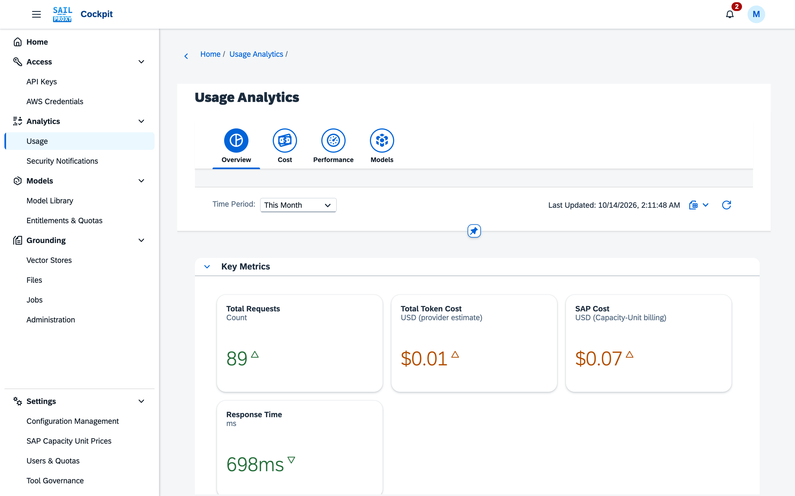

# Claude Code

Claude Code is Anthropic's command-line coding agent. Pointed at the gateway, it runs on the Claude models of your SAP AI Core tenant, and every request is authenticated, metered and governed like any other gateway call.

Claude Code can reach the gateway two ways: through the Anthropic Messages API route (`/anthropic`, the usual setup) or through the AWS Bedrock route (`/aws-bedrock`).

## Prerequisites

- A running gateway (see [Quick start](/guide/quick-start)).
- A gateway API key.
- Claude Code installed.

## Configuration

Set the base URL to the gateway's `/anthropic` path (Claude Code appends `/v1/messages` itself) and pass a gateway API key:

```bash
export ANTHROPIC_BASE_URL="http://localhost:3000/anthropic"
export ANTHROPIC_AUTH_TOKEN="sk-demo-your-key"
export CLAUDE_CODE_DISABLE_NONESSENTIAL_TRAFFIC=1
claude
```

On a Docker or Kyma deployment behind nginx, the gateway sits under `/gateway`:

```bash
export ANTHROPIC_BASE_URL="https://sail.example.com/gateway/anthropic"
```

`ANTHROPIC_AUTH_TOKEN` is sent as `Authorization: Bearer <key>`; `ANTHROPIC_API_KEY` (sent as `x-api-key`) works as well — the gateway accepts the key in either header. Without either variable, Claude Code sends the Anthropic key from its own login, which the gateway does not know.

`CLAUDE_CODE_DISABLE_NONESSENTIAL_TRAFFIC=1` stops Claude Code's telemetry and auto-update calls, which would otherwise go to Anthropic directly and bypass the gateway.

To keep the settings, add the `export` lines to your shell profile (`~/.bashrc`, `~/.zshrc`).

The standalone `sail-proxy` CLI also offers a launcher for Claude Code (`sail-proxy claude`). It sets the base URL and the key for the session, and sets Claude Code's model and its Opus, Sonnet and Haiku defaults to the newest Claude models the gateway lists. Claude Code's own default model is Anthropic's newest release, which SAP AI Core may not serve yet. A `--model` you pass, or a model variable you exported, takes precedence.

<TerminalFrame video="06-clients" name="claude" title="sail-proxy claude">The launcher sets the base URL and the key for the session and answers one prompt headless.</TerminalFrame>

## Models

Claude Code asks for Anthropic model names. The shipped `api_config.json` maps 14 of them to SAP AI Core deployments, among them (the full mechanism is described under [Model substitution](/reference/configuration#model-substitution)):

| Claude Code model | SAP AI Core model |
|---|---|
| `claude-sonnet-4-5-20250929` | `anthropic--claude-4.5-sonnet--deployed` |
| `claude-haiku-4-5-20251001` | `anthropic--claude-4.5-haiku--deployed` |
| `claude-opus-4-5-20251101` | `anthropic--claude-4.5-opus--deployed` |
| `claude-sonnet-4-20250514` | `anthropic--claude-4-sonnet--deployed` |
| `claude-opus-4-20250514` | `anthropic--claude-4-opus--deployed` |
| `claude-3-5-haiku-20241022` | `anthropic--claude-4.5-haiku--deployed` |

The mapping lives under `api_config.providers.anthropic.substitute_models`; an administrator can change it. When a target is not deployed in your SAP AI Core resource group, the gateway serves the same model through SAP orchestration. Pick a model with Claude Code's `--model` flag:

```bash
claude --model claude-sonnet-4-5-20250929
```

`sail-proxy models list` lists the models the gateway can serve.

### With or without a deployment

Claude Code runs without any deployed Claude model: tools, subagents, images, web search and prompt caching all work through SAP orchestration, which only needs an orchestration deployment. A deployment adds two things:

- **Thinking.** Orchestration returns no thinking blocks.
- **Finer streaming.** Text arrives in small groups of characters through orchestration, and in much smaller pieces from a deployment.

`sail-proxy claude` tells you at launch when no Claude model is deployed.

## The AWS Bedrock route

Claude Code's Bedrock mode signs its requests with AWS SigV4 credentials. The gateway's `/aws-bedrock` route accepts them, so this works too:

```bash
export CLAUDE_CODE_USE_BEDROCK=1
export ANTHROPIC_BEDROCK_BASE_URL="http://localhost:3000/aws-bedrock"
export AWS_ACCESS_KEY_ID="<access key id>"
export AWS_SECRET_ACCESS_KEY="<secret access key>"
claude
```

The credentials are issued by the gateway, not by AWS. With the standalone CLI, create them with `sail-proxy awscred create <user-id>`, which prints both values. On a Docker or Kyma deployment, they are managed in the Admin Cockpit under **AWS Credentials**.

Claude Code signs with `host: localhost` (no port) instead of `host: localhost:3000`; the gateway accepts both forms.

The gateway streams Bedrock answers in AWS's binary event stream, as Bedrock does. Gateways before this change streamed server-sent events, which Claude Code 2.1.308 and later refuses with `API Error: Bedrock streaming response has content-type "text/event-stream"; expected "application/vnd.amazon.eventstream"`. Until such a gateway is updated, switch the check off:

```bash
export CLAUDE_CODE_DISABLE_BEDROCK_CONTENT_TYPE_GUARD=1
```

## Web search

Claude Code's **Web Search** tool works through the gateway. On Anthropic's own API it is a server-side tool that Anthropic runs; SAP AI Core has no such tool and rejects the request. The gateway's web search plugin turns it into an ordinary tool, runs the query itself on Perplexity `sonar-pro` on SAP AI Core (a `sonar-pro` deployment when one exists, otherwise SAP orchestration), and hands Claude Code the results in Anthropic's format, so Claude answers with its sources as usual.

The search goes out under your SAP AI Core tenant, not from the user's machine, and carries nothing that identifies the user: only the query. With [pseudonymization](/guide/cockpit/configuration) on, the query is masked before it leaves the gateway. Claude Code asks once before it searches; one request may run at most three searches by default (`capabilities.web_search.max_searches_per_request`, see [Configuration](/reference/configuration#web-search)).

## Prompt caching and cost

Claude models on SAP AI Core support prompt caching: Claude Code marks the stable part of its prompt with `cache_control`, and later requests read that part from the cache instead of paying the full input rate for it again.

- **Which models get `cache_control`.** For Anthropic models the gateway forwards `cache_control` by default. Setting `supports_prompt_caching: false` on a model under `api_config.models.overrides` makes the gateway strip the `cache_control` blocks for that model.
- **How cached tokens are priced.** SAP AI Core does not return cache token prices. Cache read and cache creation rates come from a `cachePricing` entry on the model (`cacheReadInputCostPer1K`, `cacheCreationInputCostPer1K`) or from the Model Library. A model without cache rates prices cache read and cache creation tokens at 100% of its regular input rate, so the recorded cost of a cached session is too high until the rates are maintained.

The [configuration reference](/reference/configuration#cache-token-pricing) describes `cachePricing` and the tiered form for models whose rates depend on the prompt size.

## Usage tracking

Every Claude Code request through the gateway is recorded with its model, tokens and cost. On a Docker or Kyma deployment the Admin Cockpit's usage analytics show them per user, model and time period:


*The Overview tab shows requests, tokens and cost for the selected period.*

With the standalone CLI, `sail-proxy logs gateway --follow` streams the gateway log.

## Troubleshooting

### `invalid beta flag`

Claude Code sends Anthropic beta flags in the `anthropic-beta` header, and SAP AI Core rejects flags it does not support with:

```json
{ "error": { "message": "undefined: invalid beta flag", "type": "api_error" } }
```

The gateway drops the flags listed under `api_config.providers.anthropic.excluded_beta_headers`; the shipped `api_config.json` already lists the known ones, for example `prompt-caching-scope-2026-01-05`. When SAP AI Core rejects a flag that is not on the list, the gateway also sets that flag aside for the model for 30 minutes and logs a hint to add it to the list.

To add a flag permanently, extend the list (the Admin Cockpit's configuration editor applies it without a restart):

```json
{
  "api_config": {
    "providers": {
      "anthropic": {
        "excluded_beta_headers": ["prompt-caching-scope-2026-01-05", "<new-flag>"]
      }
    }
  }
}
```

### Authentication errors

Check that the key works and that the variables are set in the shell that starts Claude Code:

```bash
curl http://localhost:3000/v1/models -H "x-api-key: sk-demo-your-key"
echo "$ANTHROPIC_BASE_URL"
```

### Connection errors

Check that the gateway answers, then send a minimal message:

```bash
curl http://localhost:3000/health

curl -X POST http://localhost:3000/anthropic/v1/messages \
  -H "x-api-key: sk-demo-your-key" \
  -H "Content-Type: application/json" \
  -H "anthropic-version: 2023-06-01" \
  -d '{"model": "claude-sonnet-4-5-20250929", "max_tokens": 10, "messages": [{"role": "user", "content": "test"}]}'
```

With the standalone CLI, `sail-proxy status` shows whether the gateway is running.

For other problems, see [Troubleshooting](/guide/troubleshooting) and the [FAQ](/guide/faq).
