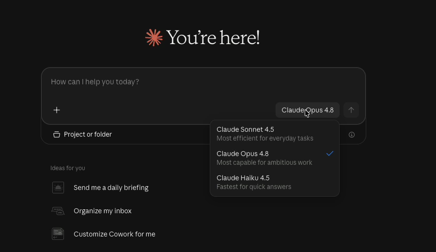
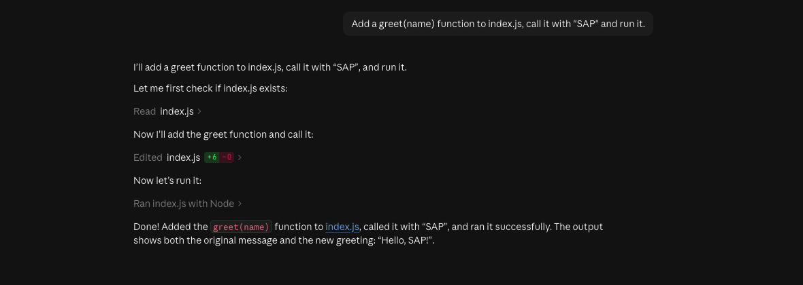

# Claude Desktop

Claude Desktop, Anthropic's desktop app for macOS and Windows, can use a company's own inference gateway instead of a Claude.ai account. Pointed at the gateway, its chat, Cowork and Code tabs run on the Claude models of your SAP AI Core tenant, and every request is authenticated, metered and governed like any other gateway call. Nobody needs a Claude.ai account.

The app calls the gateway's Anthropic Messages API route (`/anthropic`) with streaming and tool use, the same route [Claude Code](/guide/clients/claude-code) uses.

## Prerequisites

- A running gateway (see [Quick start](/guide/quick-start)).
- A gateway API key.
- Claude Desktop, from [claude.com/download](https://claude.com/download) or `brew install --cask claude` on macOS.

## Configuration

On one machine, configure it in the app:

1. Open Claude Desktop without signing in.
2. In the menu bar, choose **Help → Troubleshooting → Enable Developer Mode**, then **Developer → Configure Third-Party Inference…**. Once Developer Mode is on, the **Developer** menu stays in the menu bar.
3. In **Connection**, set:

| Field | Value |
|---|---|
| Inference provider | Gateway |
| Gateway base URL | the gateway's `/anthropic` path, for example `https://sail.example.com/gateway/anthropic` (behind nginx) or `http://127.0.0.1:3000/anthropic` (the CLI) |
| Auth scheme | `x-api-key` (`bearer` works as well; the gateway accepts the key in either header) |
| API key | a gateway API key |

4. Under the model settings, list the models the app offers, the first one being the default (see [Models](#models)).
5. **Test Connection**, then **Apply Changes**. The app restarts in gateway mode; its welcome screen says that no Claude.ai account is needed.


*The model picker lists the configured models under their Claude names.*

The configuration window also exports the same settings for a fleet: a `.mobileconfig` profile for Jamf or another macOS device management, a `.reg` file for Intune or Group Policy, or a JSON file. Anthropic's [gateway guide](https://claude.com/docs/third-party/claude-desktop/gateway) and [configuration reference](https://claude.com/docs/third-party/claude-desktop/configuration) describe every key.

## Models

List the gateway's model IDs exactly as the gateway's model list names them, for example:

```
anthropic--claude-4.5-sonnet--deployed
anthropic--claude-4.8-opus--deployed
anthropic--claude-4.5-haiku--deployed
```

`GET /anthropic/v1/models` returns every Claude model your key may use, so you can also switch on the app's model discovery; an explicit list keeps the picker short. Claude Desktop sends the same large system prompt and tool list on every turn and relies on prompt caching to keep that cheap. Prompt caching works on the models served by your own SAP AI Core deployments (the `--deployed` entries), so list those.

## Chat, Cowork and Code

The **Chat** tab answers through the gateway like any chat client. The **Code** tab runs Claude Code on a folder of your machine: it reads, edits and runs files and shows each step.


*The Code tab edits `index.js`, runs it with Node and reports the result.*

Each conversation, including the app's own short requests for titles, appears in Usage Analytics under the key in the configuration.

## Notes

- **One key per configuration**: everyone using the configuration shares its key, so usage, quotas and entitlements apply to them together. Give each team its own configuration and key for separate accounting.
- **Switching back**: the app keeps a library of configurations. **Developer → Configure Third-Party Inference…** switches between them, and the welcome screen's **Or sign in with Claude.ai** returns to a Claude.ai account.
