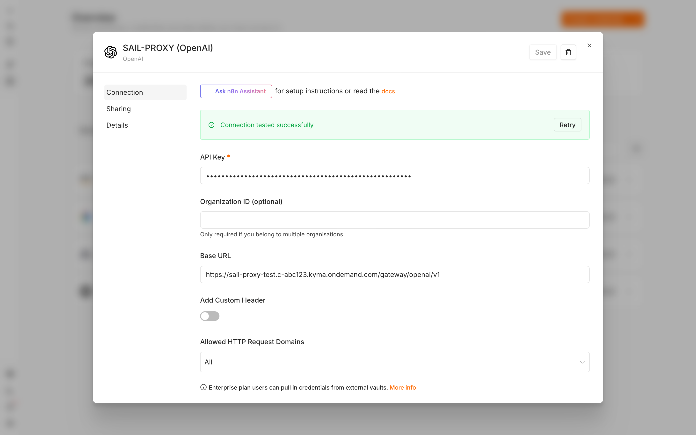
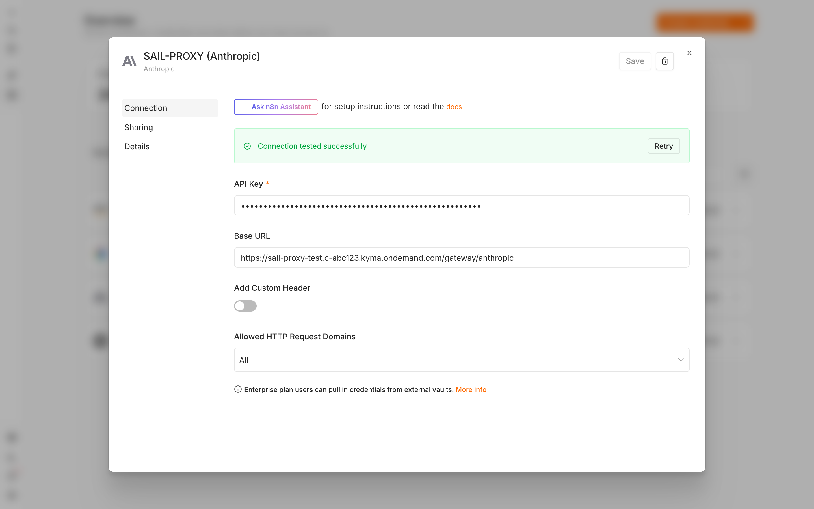
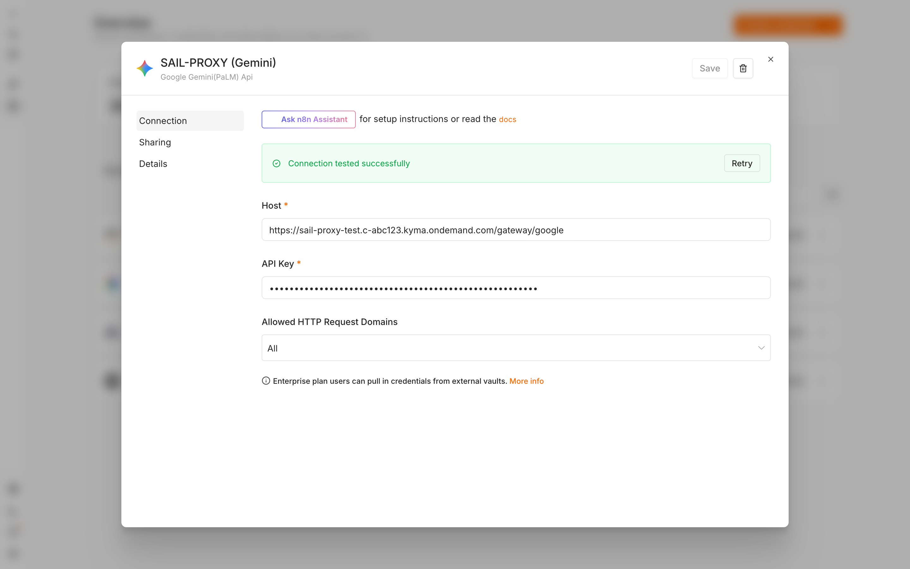
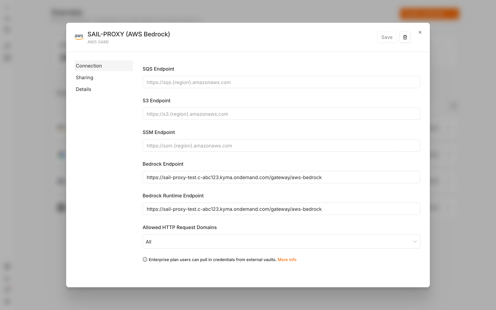
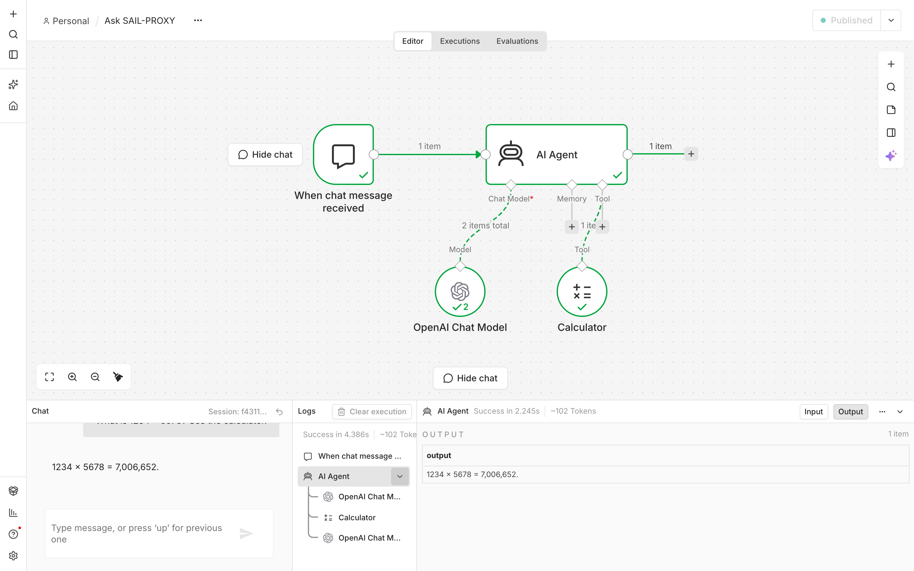

# n8n

[n8n](https://n8n.io) is a workflow automation tool. Its AI nodes (AI Agent, Basic LLM Chain and the chat model nodes) reach a model through a credential. Four of n8n's credential types take a custom address, so each can point at the gateway: **OpenAI**, **Anthropic**, **Google Gemini (PaLM) API** and **AWS**. Pick the one whose chat model node you want to use; all four run AI Agent tool calls through the gateway.

Checked with n8n 2.44.6.

In the settings below, `<root>` is the gateway root: `http://localhost:3000` for the standalone CLI, `https://<your-domain>/gateway` behind the nginx of a Docker or Kyma deployment (see [Other clients](/guide/clients/other-clients#base-urls)).

## OpenAI

Create an **OpenAI** credential:

- **API Key**: a gateway API key
- **Base URL**: `<root>/openai/v1`

The **OpenAI Chat Model** node then lists the gateway's models; pick one such as `gpt-5-mini`. The credential's **Test** button works.

## Anthropic

Create an **Anthropic** credential:

- **API Key**: a gateway API key
- **Base URL**: `<root>/anthropic`

The **Anthropic Chat Model** node lists the Claude models the key may use, for example `anthropic--claude-4.5-haiku`. The credential's **Test** button works.

## Google Gemini

Create a **Google Gemini(PaLM) API** credential:

- **Host**: `<root>/google`
- **API Key**: a gateway API key

The **Google Gemini Chat Model** node then lists the gateway's models; pick one such as `models/gemini-2.5-flash`. The node's default model is not one the gateway serves, so pick one from the list. The credential's **Test** button works.

## AWS Bedrock

Create an **AWS (IAM)** credential with a gateway-issued AWS credential (in the Admin Cockpit under **AWS Credentials**, or `sail-proxy awscred create` with the standalone CLI):

- **Region**: `us-east-1`
- **Access Key ID** and **Secret Access Key**: the gateway-issued values
- **Custom Endpoints**: on, with **Bedrock Runtime Endpoint** and **Bedrock Endpoint** both set to `<root>/aws-bedrock`

Two things differ from the other credentials:

- The credential's **Test** button always fails. n8n tests an AWS credential against AWS's own STS service, which does not know gateway-issued keys. Save the credential anyway.
- The **AWS Bedrock Chat Model** node's model list comes from AWS, so it stays empty. Switch the **Model** field to **Expression** and type the gateway's model ID, for example `anthropic--claude-4.5-haiku` or `amazon--nova-pro`.

## Example: an AI Agent with a tool

A minimal workflow that answers with a tool call:

1. Add a **Chat Trigger** (or a **Webhook**) and an **AI Agent** node.
2. Attach a chat model node with one of the credentials above to the agent's **Chat Model** input.
3. Attach the **Calculator** tool to its **Tool** input.
4. Ask: "Use the calculator to compute 1234 * 5678".

The agent calls the tool and answers "7,006,652" on every route above. Usage appears in the Admin Cockpit under the key or AWS credential the credential uses.

## n8n in Docker or on Kubernetes

- **n8n in Docker, gateway on the host**: use `http://host.docker.internal:3000` (standalone CLI) or `http://host.docker.internal:8080/gateway` (Docker deployment) as `<root>`. On Linux, start n8n with `--add-host=host.docker.internal:host-gateway`.
- **n8n in the same Kyma cluster**: use the gateway's in-cluster address as `<root>`, for example `http://gateway.<namespace>.svc.cluster.local:8080`. Internal cluster DNS avoids the ingress and its IP allowlist.
