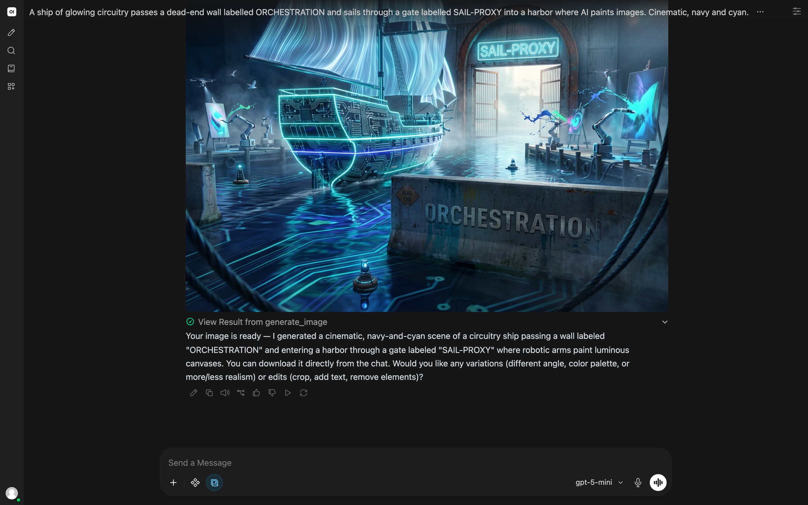

# Open WebUI

[Open WebUI](https://github.com/open-webui/open-webui) is a self-hosted web chat interface for OpenAI-compatible backends. Point it at the gateway's **`/openai/v1`** base URL, which serves both the model list and chat completions under one path — what Open WebUI's single "OpenAI API" connection expects.

## Connection settings

- **Base URL**: `<gateway>/openai/v1`
- **API Key**: a gateway API key
- **Configure in**: Open WebUI → *Settings → Connections → OpenAI API* (or *Admin Panel → Settings → Connections* for a connection shared across users). The model selector then populates from the gateway automatically.

## Image generation

Open WebUI's image engine can use the gateway's [OpenAI Images API](/guide/features#openai-images-api), which a deployed Gemini image model (Nano Banana) serves. SAP AI Core's orchestration service answers with text only; image models run as deployments of their own, and the gateway calls the deployment directly.

- **Configure in**: *Admin Panel → Settings → Images*: engine **OpenAI**, base URL `<gateway>/openai/v1`, a gateway API key, model `gemini-3.1-flash-image--deployed`
- **Or with environment variables**: `ENABLE_IMAGE_GENERATION=true`, `IMAGE_GENERATION_ENGINE=openai`, `IMAGES_OPENAI_API_BASE_URL=<gateway>/openai/v1`, `IMAGES_OPENAI_API_KEY=<gateway-key>`, `IMAGE_GENERATION_MODEL=gemini-3.1-flash-image--deployed`, `IMAGE_SIZE=1536x1024`
- **In a chat**: switch on **Image** in the message box's integrations menu, then describe the picture.

The model must be deployed in your SAP AI Core resource group. Usage is booked like any other call; an administrator sets the image price in the Model Library, since SAP AI Core publishes none for image models.



## Local test

With Docker Desktop and the gateway running on the host at port 3000:

```bash
docker run -d --name openwebui -p 3001:8080 \
  -e ENABLE_OPENAI_API=true \
  -e OPENAI_API_BASE_URL=http://host.docker.internal:3000/openai/v1 \
  -e OPENAI_API_KEY=<gateway-key> \
  ghcr.io/open-webui/open-webui:main
```

Then open `http://localhost:3001` and pick a model. On macOS and Windows Docker Desktop, `host.docker.internal` reaches the gateway on the host; on Linux, use the host IP or `--add-host=host.docker.internal:host-gateway`.

## Kubernetes and Kyma

Deploy the official Open WebUI image and set its `OPENAI_API_BASE_URL` to the gateway's in-cluster address (for example `http://gateway.<namespace>.svc.cluster.local:8080/openai/v1`). Internal cluster DNS avoids external routing and IP allowlisting.
