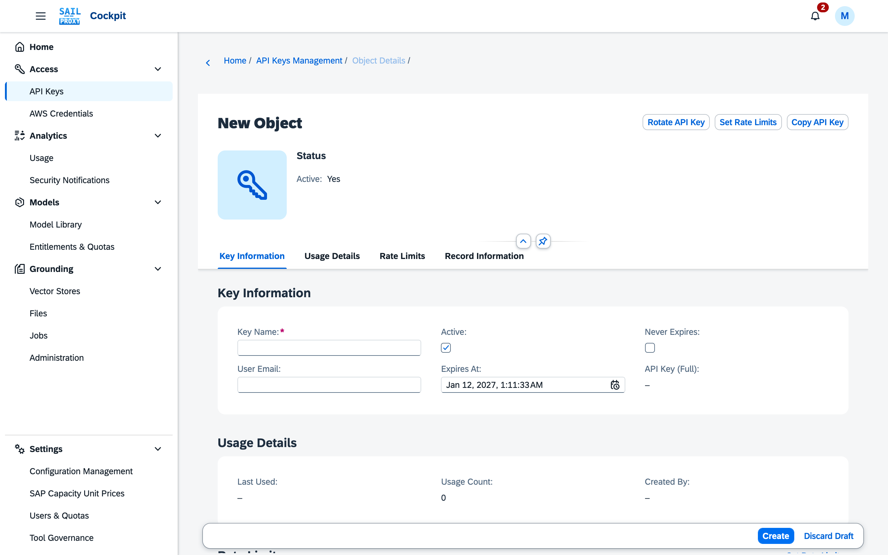
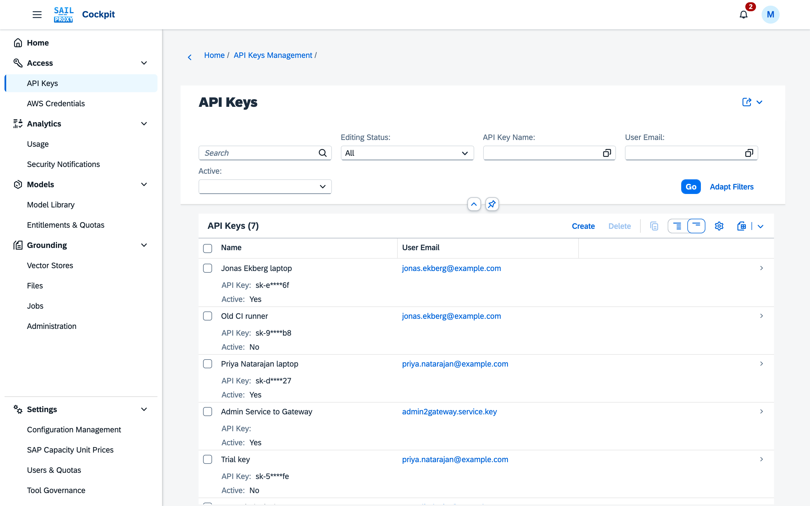
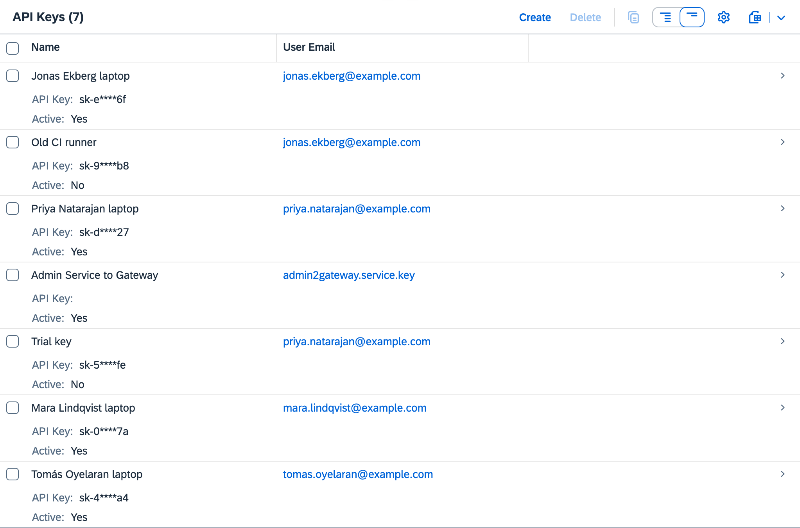

# API keys

The **API Keys** application (Access → API Keys) manages the keys clients send to the gateway. Every user manages their own keys; administrators see and manage the keys of every user.

## Creating API Keys

Choose **Create** and supply:

```
API Key Name:  Development key
User Email:    alex@example.com
```

A user can only create keys for their own e-mail address; an administrator can create keys for anyone. Expires At is filled in with the standard period (see [Expiration](#expiration)).


*The new key opens as a draft with Expires At already filled in; Create saves it and Discard Draft drops it.*

The gateway generates the key: `sk-` followed by 64 hexadecimal characters, both when you create it here and after a rotation. A key created through the admin OData action `createApiKey` instead has 48 hexadecimal characters. The list shows only a masked form (for example `sk-1****9f`). The key's own page shows the full value as **API Key (Full)** to its owner and to administrators, with **Copy API Key** to copy it.

## Managing Existing Keys

The list shows each key's **Name**, **User Email**, masked **API Key**, **Active**, **Expires At**, **Never Expires**, **Last Used** and **Created**. A key's page adds **Usage Count**, **Created By**, its rate limits, its tool policy and the record information.


*Keys appear with a masked value; the full value is on the key's own page.*

Operations on a key:

- **Rotate API Key**: generate a new key value while keeping the record and its settings.
- **Set API Key**: replace the key value with one you enter, for example a key you already use elsewhere. It must start with `sk-` and may be up to 256 characters long.
- **Active**: an administrator deactivates or reactivates a key by editing this field; the key stays in place.
- **Delete**: remove the key.

Administrators can also deactivate every key of one e-mail address in a single call through the admin service's `disableApiKeysByEmail` action; the application has no button for it.

Only administrators change the Active state, the expiration date or the Never Expires flag of a key. Key owners cannot, not even on their own keys. Owners may rename, rotate and delete their own keys and set their rate limits.


*Active is Yes or No on each row; the disabled "Old CI runner" key and the expired "Trial key" show No.*

## Expiration

The standard period is 90 days, unless an administrator has configured a different one (**Credential
Expiration (days)** under Platform → Security in the gateway configuration). It applies to API keys
and AWS credentials alike. When you start creating a key, Expires At is already filled in with that
standard period, so you can accept it as it stands or, as an administrator, pick another date. A key
past its expiration date is rejected the next time it is presented on any route, once any cached
validation for it has lapsed (a few minutes at most); an administrator's changes to a key take effect
immediately.

An expiration date can only ever be set forward: a date in the past is rejected ("Expires At must be
in the future"), on creation and when editing an existing key.

**Never Expires**: an administrator can mark a key as never expiring. A key with the flag set
ignores Expires At entirely: the date is cleared and shown read-only, the key is never rejected
for age on any route, and rotating it leaves it without a date. Turning the flag off gives the
key the standard expiration period again: the date reappears in the form as soon as you clear the
checkbox, counted from that moment, and you can overwrite it before saving. Only an administrator
can set or clear the flag; key owners see it but cannot change it. Keys that predate this flag and
carried no expiration date were migrated to it, so they keep working exactly as before, now visibly
rather than implicitly.

Rotating a key issues a new key value and moves the expiration date forward by the standard period,
whether the owner or an administrator does it. A key that is already inactive or already past its
expiration date cannot be rotated by its owner; an administrator can still rotate it, which brings it
back with a fresh expiration date. This administrator override is specific to API keys: an inactive
AWS credential cannot be rotated by anyone, administrators included; it must be re-enabled first (see
[AWS credentials](/guide/cockpit/aws-credentials)).

## Rate Limiting

Each key (and each AWS credential) carries its own requests-per-minute, -hour and -day limit,
enforced by the gateway. The owner or an administrator sets these with **Set Rate Limits** on the
key; the dialog opens with the current values, and clearing a value removes that limit. A user-level
requests-per-minute limit applies in addition, so a request has to pass both the key's limit and its
owner's. The Rate Limits section shows that second layer as **Owner's Limit per Minute**: the owner's
own constraint, else their quota profile, else the platform default, or "unlimited". It is changed in
[Users & Quotas](/guide/cockpit/users-quotas) or
[Entitlements & Quotas](/guide/cockpit/model-library#entitlements-quotas), never here.

## Tool Policy

A key's page shows the **Tool Policy** that narrows its owner's policy for this key, where one is
assigned. Administrators assign it in [Tool Governance](/guide/cockpit/tool-governance); empty means
the owner's policy alone applies.
