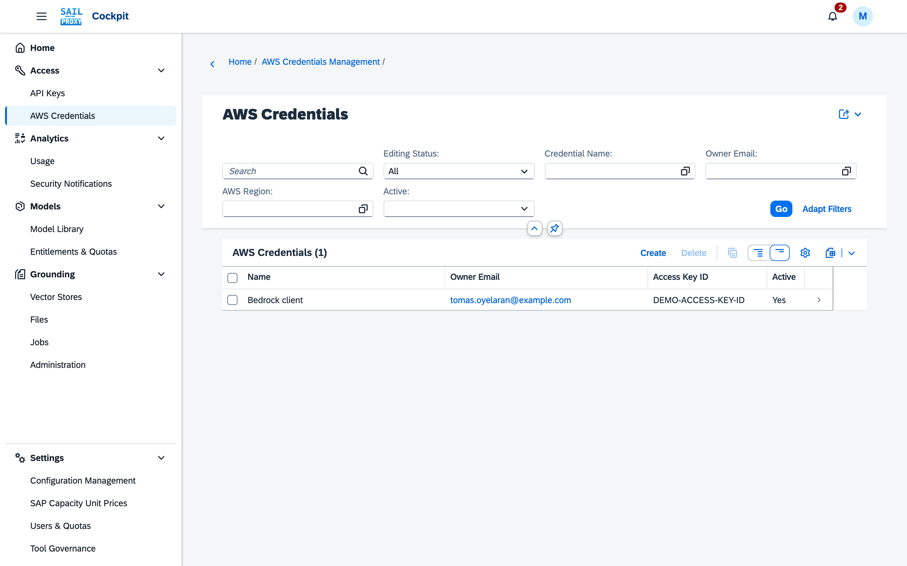

# AWS credentials

The **AWS Credentials** application (Access → AWS Credentials) issues credentials for the gateway's **Bedrock-compatible route**, which accepts AWS SigV4-signed requests, for example from AWS SDKs and Claude Code in Bedrock mode.

These credentials are **issued by the cockpit**. They are not your AWS account credentials, and the cockpit does not accept an existing AWS access key. Clients use the issued credentials to sign requests to sail-proxy; sail-proxy verifies the signature.

Every user manages their own credentials; administrators see and manage the credentials of every user.


*The list shows the credential by name and owner; the secret is on its own page.*

## Issuing Credentials

Choose **Create** and supply a **Credential Name**, the **Owner Email** and optionally a **Description**
and **AWS Region** (`us-east-1` by default). A user can only create credentials for their own e-mail
address. As with API keys, Expires At is preset to the standard period (90 days, unless an
administrator has configured a different one); accept it as it stands or, as an administrator, pick
another date. A date in the past is rejected, on creation and when editing an existing credential.
The cockpit generates:

```
Access Key ID:     AKIA... (20 characters)
Secret Access Key: 40 hexadecimal characters
AWS Region:        us-east-1
Expires At:        ...
```

The credential's page shows the Access Key ID and the Secret Access Key to its owner and to
administrators; **Copy Credentials** copies them.

## Credential Operations

- **Rotate Credentials**: issue a new access key ID and secret for the record, and move Expires At
  forward by the standard period, whether the owner or an administrator does it. Rotate only works on
  an active credential: an inactive one must be re-enabled first, by an administrator. This differs
  from API keys, where an administrator can rotate an inactive key directly.
- **Active**: an administrator enables or disables a credential by editing this field.
- **Set Rate Limits**: requests per minute, hour and day for this credential, set by the owner or an
  administrator; the owner's own per-minute limit applies in addition, shown as **Owner's Limit per
  Minute**. See [API keys](/guide/cockpit/api-keys#rate-limiting).
- **Delete**: remove the credential; the usage it produced stays on record and keeps counting
  against the owner's quota.

A credential past its expiration date is rejected the next time it is presented on any route, once
any cached validation for it has lapsed (a few minutes at most); an administrator's changes take
effect immediately.

**Never Expires**: as with API keys, an administrator can mark a credential as never expiring. The
flag clears Expires At and shows it read-only, the credential is never rejected for age, and a
rotation leaves it without a date. Turning the flag off gives the credential the standard expiration
period again: the date reappears in the form as soon as you clear the checkbox, counted from that
moment, and you can overwrite it before saving. Only an administrator can set or clear it; credential
owners see it but cannot change it.

AWS credentials follow the tool policy of their owning user; see
[Tool governance](/guide/cockpit/tool-governance#limitations).

## Security Features

**Signature verification**: the gateway implements AWS Signature Version 4 verification for inbound requests on this route.

**Encryption at rest**: the secret access key is encrypted with AES-256-CBC before storage, using a key derived from the configured encryption secret. It is decryptable by the service because signature verification requires the original secret.

**Auditing**: credential usage, rotations and security events are recorded per credential.
