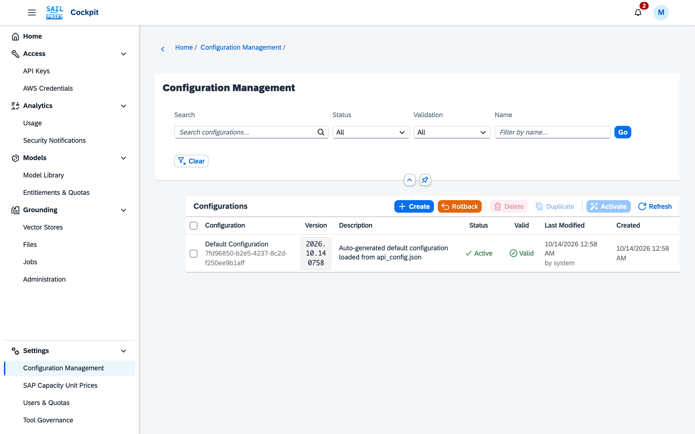
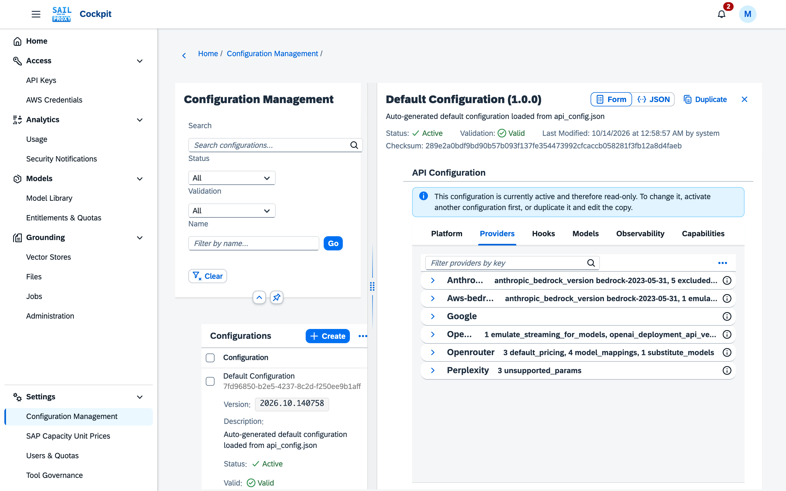

# Gateway configuration

The **Configuration Management** application (Settings → Configuration Management) manages the
gateway configuration (`api_config`) as **versioned records**:

- **Create** a new configuration
- **Validate** a configuration before activating it
- **Activate** a configuration, making it the live configuration
- **Rollback** to the previous configuration, with a mandatory reason; the gateway restarts with the
  restored configuration
- **Duplicate** and **Delete** configurations

Every signed-in user can read the configurations; only an administrator changes them. The service
records each activation and rollback in its configuration history.

## Opening and Selecting Configurations

The list offers two ways to pick a configuration, and they do not affect each other:

- **Pressing a row opens it** in the detail column. The open row is marked with the list's navigation
  indicator. Opening a configuration does not tick it.
- **Ticking a row's checkbox selects it for the toolbar.** **Delete**, **Duplicate** and **Activate**
  above the list act on the ticked rows only — never on the open configuration unless it is ticked too.
  Delete takes one or more ticked configurations and is unavailable while any of them is active;
  Duplicate and Activate take exactly one, and Activate only an inactive, valid one. A ticked row that
  a filter hides is not acted on. Closing the detail column leaves the ticks as they are.

*The list shows each configuration's status and validity; the active one is marked Active.*

To act on the open configuration without ticking it, use **Activate** and **Duplicate** in its title
bar. Activate is offered there only while the open configuration is inactive. Duplicate copies what the
detail shows, including changes you have not saved yet; in the Form view those changes are checked
first, and changes that fail the check are marked on their fields and no copy is made.

If a filter hides the open configuration's row, its title-bar actions and Save say so instead of
acting: clear the filter, or open the configuration again.

## Configuration Details

Opening a configuration shows, above the form or the JSON editor, its **status** (active or
inactive), whether it is **valid**, when and by whom it was **last modified**, its **checksum**, and
its description. Any validation errors or warnings stored with the configuration appear below that
line as messages. This information is the same in the Form and the JSON view, and it is read-only.

*The detail opens beside the list, here on the Providers tab.*

**When the open configuration's status changes.** The detail follows its configuration's status
without reopening it. When the open configuration becomes active — through Activate, Rollback, or an
activation in another session once the list is refreshed — it turns read-only at once; when another
configuration is activated, it becomes editable again. Changes you have not saved stay on screen
either way; while the configuration is active they cannot be saved.

**Activating a configuration with unsaved changes.** Activation uses the saved version of a
configuration. Activating the open configuration while it has unsaved changes therefore asks first:

- **Save** saves the changes, and continues to the activation confirmation only once they are stored.
  If they could not be saved, a message says so and nothing is activated.
- **Discard** drops the changes and continues with the saved version.
- **Cancel** stops; nothing is activated and your changes stay.

Activating a configuration other than the open one never asks.

**What a save checks.** A save is checked twice. Before anything is sent, the configuration is checked
against the schema; a configuration that fails is not sent, and the Form view marks the fields at
fault. The service then checks again and refuses:

- a document that is not valid JSON;
- a configuration that fails validation — the message lists the errors;
- any change to the active configuration.

A refused save shows the reason, and your changes stay in the editor. A save that is accepted
recomputes the configuration's checksum and validity and replaces its stored validation messages; the
detail shows the new values without reopening.

**Why an active configuration cannot be edited.** The active configuration is the one the gateway
runs. Changing it in place would change the running gateway without the activation step — the
confirmation, the restart, the record of who deployed it, and Rollback to return to the previous
version. There is no Deactivate: a configuration stops being active only when another one is
activated, or by Rollback. To change the active configuration, **duplicate** it, edit the copy and
**activate** the copy; or activate another configuration first, after which this one is editable
again. Which configuration is active, and when and by whom it was deployed, changes only through
Activate and Rollback — never by editing a configuration. SIEM sink credentials are the one exception,
described under *SIEM Sinks and Credentials in the Form*.

## Form View

A configuration's detail page carries a **Form / JSON** toggle in its title bar. **Form** is the
default view: a configuration opens in it as soon as it passes the check described below. It shows
the whole `api_config` document as typed controls — six tabs, one per top-level group — instead of
raw JSON. The JSON editor is never taken away: the toggle switches to it at any time, and it stays
the way to make a change the form does not offer.

**The gate.** Form is enabled only while the configuration's **whole document** passes the same
schema the backend enforces on save. The check runs in the browser, for **every role** — not only
admins — so an admin and a non-admin get the same verdict on the same document. While it does not
pass, the configuration opens in the JSON editor, the toggle is disabled and its tooltip names the
failing JSON pointer, for example:

> This configuration does not pass schema validation and cannot be shown as a form. Use the JSON editor.
> Schema validation error at '/api_config/platform/timeouts/default': must be integer

The form is a faithful view or it is not offered at all — that is what the gate is for. Fix the
document in the JSON editor and the toggle enables again.

**The tabs.** Six, alphabetical: **Capabilities**, **Hooks**, **Models**, **Observability**,
**Platform**, **Providers** — the six groups the `api_config` schema allows and no others. Each tab
holds one collapsible panel per section that group declares, also alphabetical: the Platform tab
carries Billing, Logging, Maintenance, Quotas, Rate Limit Handling, Security, Timeouts and Tool
Governance. The tab you were last on
survives a redraw of the form.

**Sections the document does not carry.** Such a section shows the notice *Not present in this
configuration.* rather than an empty panel — showing a section's fields at their schema defaults
would invite you to read defaults as configured values. Below the notice is **Add section**, whose
tooltip reads *Add this section to the configuration, empty, so its settings can be filled in here*.
Pressing it writes the empty container — `{}`, or `[]` for a list — at that section's own place in
the document and redraws the panel with its fields, its own **[+]**, or both; a toast confirms
*Section added. It is not saved yet.* Nothing reaches the database until you save.

This is what makes the form usable on a configuration that carries only a handful of settings. Before
it, a section the document lacked was a dead end: the JSON editor was the only way to bring one into
existence.

**Fields.** Every field carries an **information icon** beside its label. Pressing it opens a popover
holding the schema's own description of that setting — what reads it, what it does, and what happens
if it is wrong. The same description remains available as the control's hover tooltip; the icon is
there because a tooltip nobody hovers is a description nobody reads. Sections carry the same icon
next to their title where the schema describes them. A field the schema requires is marked with the
standard required-field indicator. Enumerations render as dropdowns over exactly the values the
schema allows, numbers as numeric fields carrying their own minimum and maximum, booleans as
switches. A value that genuinely cannot be represented as a typed control is shown as JSON in place,
with a notice saying why, rather than being silently dropped.

**Provider panels.** Each of the six providers the gateway reads — Anthropic, AWS Bedrock, Google,
Openai, Openrouter, Perplexity — shows only the settings its own request path reads, not the union of
all six. Six settings are common to most providers: Emulate Streaming For Models, Substitute Models,
Unsupported Params, Param Renames, Supports Responses API and Supports Prompt Caching. **Google** is
the exception and the narrowest panel: it holds Substitute Models alone, because that is the only one
its route reads. Anthropic Bedrock Version,
Excluded Beta Headers and Supported Beta Headers appear on **Anthropic** and **AWS Bedrock** only,
because only the Anthropic request path reads them; Openai adds its Azure api-version, Openrouter its
fallback prices and model mappings. A setting written under a provider that does not read it is
refused by the gate rather than kept as a value that quietly does nothing — so a beta-header list
belongs under Anthropic, not under Openai. A provider key the gateway does not read yet is still
accepted, with the six common settings and no restriction on what else it carries.

**Tuning masking, under Observability → Pseudonymization.** Four fields decide precision, and each
one is also available per endpoint (**Hooks → Defaults**) and per model (**Models → Overrides**).
`min_confidence` (0 to 1, default 0.5) is how much evidence a value needs before it is masked, and
`thresholds` overrides it for one category at a time. **Leave both alone unless you have measured
the effect.** A plain name — no honorific, no mail address beside it — scores exactly 0.5, so one
step up to 0.55 stops roughly three quarters of the names in ordinary prose being masked, whether
you take that step globally or only for `profile-person`. Mail addresses, IBANs, card numbers and
credentials are unaffected up to 0.8, so raising the bar is a reasonable way to quieten one of
*those* categories and never a way to quieten names. To stop one particular value being masked,
name it in the allow-list below — that is what it is for.
`allowlist` names what must never be masked here: `terms` are literals,
compared case-sensitively against the whole detected value, and `patterns` are regular expressions
the gateway anchors to the whole value for you, so write `Z[A-Z0-9_]+` rather than `^Z[A-Z0-9_]+$`.
An entry in either list wins over every score. The allow-lists of the three layers are added
together rather than replaced, so a per-model list extends the global one and can never cancel it.
`saturation_warn` (default 40) only reports: above that many distinct masked values in one request,
the gateway logs one line with the counts per category and the value shapes — letters as `X`, digits
as `9`, never a value — and the request's usage SIEM event says `saturated: true`. The masking
itself is unchanged by it; a request that trips the number still masks everything it found.

**Keyed maps.** Some places in the schema are open-ended maps rather than a fixed set of
fields — among them the per-provider map under **Providers**, the per-model map under **Models →
Overrides**, the endpoint and subpath maps under **Hooks → Defaults**, `hooks.definitions`, each
provider's and each model override's `param_renames`, the `entities` and `thresholds` maps of every
pseudonymization block, `platform.logging.components`, and the two delay maps under **Platform →
Rate Limit Handling**. Every one of them carries the same affordances:

- **[+]** to add a key, on an editable form. The dialog rejects an empty key, a key whose spelling
  the map does not allow, and a key already present — naming the clash: *The key "anthropic" is
  already configured here. Choose a different key, or edit the existing "anthropic" panel.* Where
  the schema constrains the spelling, the dialog says so and enforces it over the **whole** key, not
  a fragment of it: `bad key` in `platform.logging.components` is refused with *The key must match
  this section's own rule: `^[a-zA-Z0-9_-]+$`*, and the dialog stays open. A new key is created with
  a schema-valid empty entry — for a map of plain values, at the value the schema defaults to, so a
  new `components` entry starts at `INFO` — and is not stored until you save;
- **[-]** to remove one key, after a confirmation that names it and says everything under it goes
  with it;
- a **filter** above the entries, which hides and reveals panels without changing the document, and
  stays usable on a read-only configuration — a two-dozen-entry override list is no easier to read
  for someone who may not edit it. A **top-level** map — Providers, Model Overrides, Hook
  Definitions, Hook Defaults — always shows its filter, so the row above the entries does not appear
  and vanish as entries are added. A map **nested inside a section** shows one only once it holds
  **more than eight** entries: a search box over two delay overrides is an affordance for a problem
  nobody has.

**Lists.** A list the form renders as panels rather than a table carries **[+]** to append an entry.
For a hook list under **Hooks → Defaults → *endpoint* → *subpath***, **[+]** appends an entry
carrying every field the schema *requires* and nothing else, so it starts valid in shape and empty in
content; a toast confirms *Entry #0 added. It is not saved yet.* Such entries are numbered `#0`,
`#1`, … and open collapsed. The SIEM sink list is the one whose entries pick their fields by their
`type`, so its **[+]** opens the sink dialog described under *SIEM Sinks and Credentials in the Form*
instead; the sink's remaining required fields are filled on its panel afterwards.

**Editability.** JSON-backed fields are editable only for an **admin** on an **inactive**
configuration — two independent conditions:

| Role | Configuration | Fields | Save / Cancel |
|---|---|---|---|
| admin | inactive | editable | shown |
| admin | **active** | read-only | hidden |
| non-admin | inactive | read-only | hidden |
| non-admin | active | read-only | hidden |

An active configuration additionally shows the same message the JSON editor already shows for one:
"This configuration is currently active and therefore read-only. To change it, activate another
configuration first, or duplicate it and edit the copy." **Add section**, the map and list **[+]**/**[-]** and the SIEM sink affordances follow the
same rule and are absent altogether on a read-only configuration — the information icons stay, so the
schema's descriptions remain readable by anyone who can see the configuration at all.

**Minimal documents.** The form does not require a complete configuration. A document carrying only,
say, `platform.timeouts` and `platform.logging.defaultLevel` opens in the form like any other: every
group the schema declares gets its tab, every section it lacks gets its notice and its **Add
section**, and an edit made in it lands at that setting's own place in the document rather than at
the document root. Turning on **Platform → Rate Limit Handling → Enabled** on such a document adds
`platform.rate_limit_handling.enabled` and touches nothing else; adding `Gateway` under **Logging →
Components** adds `platform.logging.components.Gateway` at `INFO`; adding a model under **Models →
Overrides** adds that one key. Building `hooks.defaults.anthropic.invoke[0]` from an empty Hooks tab
is four presses — **Add section**, then **[+]** for the endpoint, the subpath and the entry — and
places the entry at exactly that path; the entry itself is completed by filling `callback.id` and
adding at least one `match` rule (typing a value and pressing Enter adds the token).

**Saving.**

- A save that would fail schema validation is refused **client-side**, without contacting the
  server, and the fields at fault are marked in place with the reason on the field — a value of
  `500` in `platform.timeouts.default` is refused with *must be >= 1000* on that field, while the
  neighbouring Streaming field is left alone. The whole document is checked, not only the tab you
  are on.
- A save that passes is not treated as saved until the stored configuration says so. The form sends
  the document, then **reads the configuration back** and compares it with what it sent; only then
  does it clear the unsaved state. The form stays open after a save; a save chosen while switching
  to the JSON editor continues to that editor. A save the server did not persist leaves the form
  open with your changes still in it.
- **Cancel** discards every unsaved edit in the form, after a confirmation, and returns to the
  stored configuration.
- Leaving the form with unsaved changes — switching back to the JSON editor, selecting a different
  configuration, or closing the detail column — prompts to **Save**, **Discard**, or **Cancel**. No
  route out of the form drops an edit silently.
- Fields you did not touch are written back exactly as they were: the form never materialises a
  schema default into a document that did not carry one. Saving does re-indent the stored JSON to
  two spaces, which is what the JSON editor's own save has always done — a version diff will show
  that reformatting on the first save of a configuration created before it.

**Known limitations.** Things the form shows that are worth reading with care. The first two are
settings the form renders because the schema declares them, but which the gateway does not act on;
the rest are gaps in the form itself, each with the JSON editor as its way round:

- The three Anthropic settings on the **AWS Bedrock** panel — Anthropic Bedrock Version, Excluded
  Beta Headers, Supported Beta Headers — are **inert there**. The Anthropic-shaped request path is
  what reads them, and it reads them from `providers.anthropic` alone, whichever of the two
  providers the request was routed to. They are shown on both panels because both are served by
  that path; set them under **Anthropic**. Each field's tooltip says so.
- `capabilities.file_search.tool.enabled` is read but **not acted on** — nothing gates on the
  resolved value. The field's tooltip says so. (`capabilities.file_search.chunking.*` applies to
  vector stores created after the change; existing stores keep the chunking they were created with.)
- Per-entry panels under **Hooks** are numbered `#0`, `#1`, … rather than named, because a hook
  entry carries no name to label with. The numbering restarts within each endpoint's list, so
  several unrelated panels on the tab read `#0`.
- The **Form / JSON** toggle lives in the detail page's title bar and is not reachable below roughly
  **600 px** of viewport width — on a phone a configuration opens in the JSON editor, the detail
  page offers that editor only, and no overflow control exposes the toggle. The form is a desktop
  and tablet affordance.

## Daily Maintenance Run

Once a day the service corrects the recorded cost of recent usage, rebuilds the usage figures the
quota checks read, and refreshes every user's quota status. Left alone, that run starts five minutes
after the service starts and repeats every 24 hours from then — so a deployment at midday pins the
heaviest job of the day to the middle of the working day, until the next restart moves it again.

**Platform → Maintenance → Daily Run At (UTC)** fixes the time of day instead. Enter a 24-hour time
as `HH:MM` — `02:30`, `23:00`. The first run after a start still happens five minutes in, because
that is the pass that repairs whatever was missed while the service was down; every run after it
starts at the time you entered.

The value is UTC and is never adjusted for daylight saving. To run at midnight Pacific Time, enter
`08:00` while Pacific Standard Time is in effect (UTC-8), or `07:00` during Pacific Daylight Time
(UTC-7), and change it when the clocks change.

Leave the field empty for the default: a run five minutes after the service starts and every
24 hours from then. Activating a configuration, or rolling one back, takes a changed time into use
immediately without starting a run; clearing a previously set time starts a fresh 24-hour cadence
from that moment.

**Tool usage retention.** Two settings under Platform decide how long tool activity is kept:
**Tool usage retention (days)** (default 30) is how long each per-request row of declared and
invoked tools is kept before the nightly maintenance run purges it; **Tool usage aggregate
retention (days)** (default 400) is how long the daily totals behind the Tool Inventory page and a
user's Tools used section are kept. Raising either only keeps history longer; lowering one purges
history older than the new value on the next run.

## SIEM Event Export

The gateway can export its own security and audit events — not LLM prompts or responses, except
where explicitly opted in — to an external SIEM. The export is configured under the
configuration's `siem` section and covered in operational and security detail in
the pseudonymization security assessment, §12;
this section documents only what an operator sets and meets in the cockpit.

**The export ships available but off.** The master switch (`enabled`) and all six sink types the
shipped configuration lists — webhook, OTel, Datadog, Azure Sentinel, GCS Pub/Sub, S3 — ship with
their own `enabled: false`, and the shipped `categories` list is `["security", "audit"]`, without
`usage`. Nothing is exported until an operator turns on the master switch, turns on at least one
sink, and — for the one category that can carry conversation content — adds `usage` to
`categories`.

## SIEM Sinks and Credentials in the Form

The Observability tab's **SIEM** section carries the sink list, with two affordances beyond the
ordinary fields:

- **[+]** on the Sinks section opens a dialog asking for a sink **type** and a **name**. The name opens preset to `<type>_<YYYYMMDD>_<HHMMSS>` (UTC) so it is unique by construction, but stays editable; the dialog rejects a name already used by another sink in the configuration, because that name is the key for the sink's delivery rows and would make the two sinks mark each other's events delivered. The type cannot be changed once the sink is created — remove the sink and add a new one to change it.
- **[-]** on a sink removes it after a confirmation. Removing a sink does **not** delete any credential stored for its slots — they stay stored against the configuration, just no longer reachable from the form; the confirmation names them if any are stored.

**SIEM sink credentials** are the deliberate exception to the editability rule above:
- An admin can **Set** or **Clear** a sink's credential even while the configuration is active — rotating a compromised key does not have to wait for an edited copy to be activated. Every other field of an active configuration stays read-only.
- A non-admin gets no credential controls, on any configuration.
- A credential's value can never be read back through the cockpit — not even by an admin. The form shows only whether a value is currently stored, a masked hint once one is (e.g. `abcd…wxyz`), and who set it and when; the credential slot's name is carried in the row's tooltip rather than shown as text.
- Credentials are stored encrypted, scoped to the configuration they were set on, and deleted along with it. There is **no environment-variable fallback** — the credential store is the only source a sink resolves a credential from.
- Rotating the gateway's `SIEM_CREDENTIAL_KEY` master key makes every previously stored credential undecryptable; each one must be re-entered by hand afterward. See the security assessment, §12.5, for why.
- **Duplicating a configuration does not duplicate its credentials.** The duplicate carries the same sink definitions — including the same `*_env` slot names — but starts with no stored values for them; an admin sets each one again through the new configuration's own form.

## SIEM Global Settings

These apply to the whole export and sit directly under `siem` in the configuration:

| Setting | What it does | If you get it wrong |
|---|---|---|
| `enabled` | Master switch. The dispatcher does not start at all while this is off, regardless of any sink's own `enabled`. | Left off, no sink ever sends anything, even if every sink is individually enabled. |
| `batch_size` | Default number of outbox rows a sink reads per dispatch tick. A sink may override it. | Too low under sustained load slows a sink's own backlog drain; the setting does not affect other sinks. |
| `interval_ms` | Default milliseconds between dispatch ticks. A sink may override it; the effective timer period is the shortest interval across every sink in play. | Too low increases dispatch overhead for no throughput benefit once a sink has nothing new to send. |
| `reconcile_lookback_ms` | Bounds the periodic repair pass that backfills a delivery row for an outbox row that is missing one, to rows that **landed in the outbox** (not the event's own timestamp) within this many milliseconds of now. Ships at `86400000` (24 hours). | A newly enabled sink only ever backfills events that landed within this window — **events that landed earlier are never backfilled to it**, silently. This is a deliberate bound (it is also what keeps the repair pass cheap as the outbox grows), but an operator relying on a new sink to pick up older history should know it will not. |
| `categories` | Which event categories are exported: `security`, `audit`, `usage`. Ships as `["security", "audit"]` — `usage` is left out deliberately, since it is the only category that can carry conversation content, so exporting it is an explicit opt-in. | Adding `usage` without also setting a sink's `include_content` exports request-completion metadata (model, endpoint, status) with no prompt or response text; content requires the separate opt-ins below as well. |
| `content_max_bytes` | Caps the prompt and the response of a `usage` event independently, in UTF-8 bytes, before it is written. Ships at `8192`. A cut event carries `content.truncated: true`. | Set high, a large conversation is exported closer to whole; set low, more of it is cut — either way a `truncated` event is flagged, never silently shortened. |

## SIEM Sink Settings

Every sink shares these fields, plus the fields specific to its `type`.

**Common to every sink type:**

| Setting | What it does | If you get it wrong |
|---|---|---|
| `name` | Identifies the sink and keys its per-sink delivery rows and backoff state. Must be unique in the configuration — the form enforces this. | Two sinks sharing a name would mark each other's events delivered, so events meant for one sink are silently treated as sent and never actually exported there. |
| `type` | Which sink implementation this is: `webhook`, `otel`, `datadog`, `azure_sentinel`, `gcs_pubsub`, or `s3`. Fixed at creation. | Not applicable — the form does not allow setting this to the wrong thing after creation; remove and re-add the sink to change it. |
| `enabled` | Ships `false`. The sink is dispatched only when this **and** the global `enabled` are both true. | Left off, the sink is fully configured but never sends. |
| `include_content` | Opt-in: ships the prompt and response of a `usage` event to this sink, in their masked form. Ships `false`. Requires `usage` in the global `categories`. | Left off (the default), this sink never receives conversation content, regardless of `categories`. |
| `allow_unmasked_content` | **Risk.** Only has any effect when `include_content` is also on. Opts in to receiving content that pseudonymization never masked — because masking was disabled or bypassed for that request — as full, raw text: real names, addresses, anything a user pasted. Ships `false`. | Turning this on is a second, separate path for unmasked conversation content to leave the gateway to a third party — the exposure the pseudonymization guarantees exist to prevent. Left off, such a request instead ships metadata only, with `content.omitted: 'not-masked'`. |
| `include_credential_material` | Opt-in: ships the raw presented value of an unresolved credential (e.g. an invalid API key someone tried), for forensic use. Ships `false`. | Left off (the default), an unresolved credential's value is stripped before the event reaches this sink. |
| `batch_size` / `interval_ms` | Per-sink overrides of the global defaults above. | `interval_ms` should exceed this sink's own send timeout, or dispatches to it queue up behind each other. |

**Type-specific fields**, all required unless noted:

| Type | Fields |
|---|---|
| `webhook` | `url` (ingest URL, required); `token_env` (credential slot name, optional) |
| `otel` | `endpoint` (OTLP/HTTP logs endpoint, required); `headers_env` (credential slot name, optional) |
| `datadog` | `site` (host, e.g. `datadoghq.com` or `datadoghq.eu`, required); `api_key_env` (credential slot name, required) |
| `azure_sentinel` | `dcr_endpoint` (Data Collection Endpoint URL); `dcr_immutable_id` (Data Collection Rule immutable id); `stream_name` (e.g. `Custom-SailProxy_CL`); `tenant_id` and `client_id` (Entra ids); `client_secret_env` (credential slot name) — all required |
| `gcs_pubsub` | `project_id`; `topic_id`; `service_account_json_env` (credential slot name) — all required |
| `s3` | `bucket`; `region`; `access_key_id_env` and `secret_access_key_env` (credential slot names) — all required; `prefix` optional. Objects land at `<prefix>/YYYY/MM/DD/HH/<uuid>.ndjson`, in UTC |

A field named `*_env` never holds a credential value — it names a credential **slot**, constrained
to `^[A-Z][A-Z0-9_]*$`. The value itself is entered through the form's credential **Set** control,
described above, never typed into the configuration.
