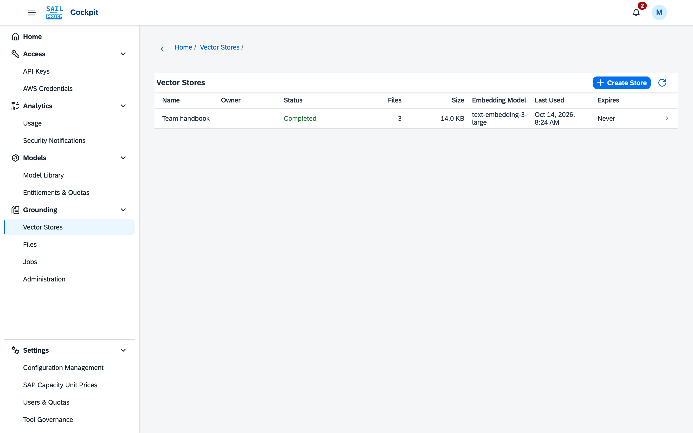
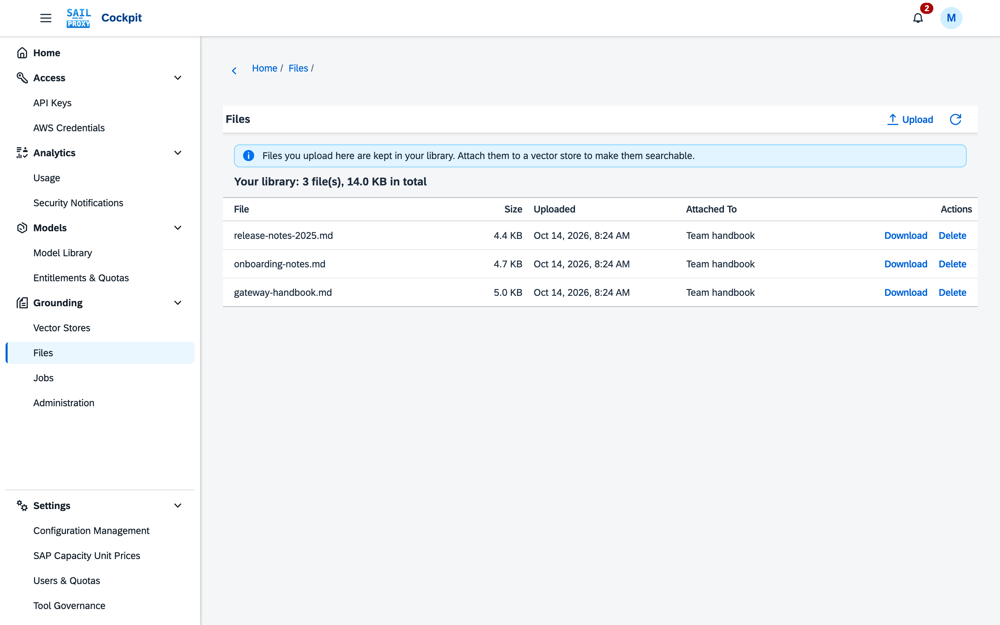

# Grounding

The **Grounding** branch manages the files and vector stores that the `file_search` tool searches.
Every user sees their own files and stores. Other users' stores appear only when an administrator
shares them (see [Shared Vector Stores](#shared-vector-stores)), and administrators see everyone's
data under [Administration](#administration).

Grounding needs a gateway with a file search database (PostgreSQL with the pgvector extension).
When file search cannot run, every Grounding screen shows a page that says why, and applications get
HTTP 503 with the same reason:

| Reason | What to do |
|---|---|
| File search is switched off in the configuration | An administrator enables it under Configuration Management. |
| The gateway has no file search database | Give the gateway a PostgreSQL database with pgvector (`FILE_SEARCH_DATABASE_URL`; the Docker and Kyma setups configure it, the standalone CLI reads it from its `.env`). |
| The configured embedding dimensions are outside 1 to 4000 | An administrator corrects them under Configuration Management, then restarts the gateway. |
| The database is not set up yet, or is older than the gateway and could not be upgraded | Run the file search migration step of your installation as the database owner, then restart the gateway. |
| Setting up the database failed | The gateway log names the cause; fix it, then restart the gateway. |

## Vector Stores

A vector store is a searchable collection of files. The list shows each store's status, the number
of files, its size, when it was last used and when it expires.

*Each store shows its status, file count and size.*

- **Create Store** asks for a name, optionally an expiry, and how the store's files are cut into
  chunks (see [Chunking](#chunking)). The chunking fields start with the installation's default.
- Opening a store shows its files with their ingestion status. A file is searchable once its status
  is **Completed**; a **Failed** file shows the reason next to it. The page refreshes itself while
  files are being ingested.
- **Attach File** adds one or more files you already uploaded. **Upload and Attach** uploads one or
  more files and attaches them in one step. **Detach** removes a file from the store and leaves it in
  your file list.
- When you attach or upload several files at once, they are embedded as one **job**. The page says
  that the job has started, and **View Job** opens it. If one of the uploads fails, none of the files
  is attached; the files that did upload stay in your file list.
- A **Failed** file has a **Retry** button. Retry starts its ingestion again; it is refused while the
  file's job is still running, for a file whose job was cancelled, and in an expired store. PowerPoint,
  Excel and Word .doc files that failed in an earlier version because their type was not supported can be
  read now: **Retry** them, or use **Re-read Files** (see [Reading Files Again](#reading-files-again)).
- **Rename**, **Set Expiry** and **Delete Store** act on the store itself. An expiry is a number of
  days after the store was last used, from 1 to 365; an empty value means it never expires.
  Deleting a store does not delete its files.

The **Test Retrieval** tab shows what the `file_search` tool would find in the store. Enter a
question or a few words and choose **Search**; the table lists the best matching passages with their
file, their pages (for PDF and PowerPoint files, see [Page Numbers](#page-numbers)) and score, best first. You can set **Maximum Results** (1 to 50), a **Score Threshold** between 0
and 1, and whether to **Rewrite the query before searching**. A query can be up to 8192 characters.
While files are still being ingested, a note says that the results do not include them yet.

## Shared Vector Stores

An administrator can share a vector store they own with all users: **Share With All Users** on the
store's page, after a confirmation. **Stop Sharing** takes it back; users lose access with their next
request.

A store shared with you appears in your **Vector Stores** list with a **Shared** badge and its
owner's e-mail address. It is read-only:

- You can open it to see its details and use **Test Retrieval**, and the `file_search` tool can
  search it, like your own stores.
- Its list of files stays private to the owner and administrators: the store page shows the number
  of files, but no **Files** tab. The results of **Test Retrieval** do name the document each passage
  comes from.
- You cannot rename it, set its expiry, attach or detach files, or delete it.

## Embedding Model and Re-embedding

Every vector store is built with one embedding model, the one configured when the store was
created. Its searches and the files you add later always use that model, so a store keeps working
when an operator configures another model. The **Embedding Model** column of the list shows each
store's model, and the store's **Details** tab shows the model, its dimension, the generation (how
many times the store was re-embedded) and the store's embedding state:

| State | Meaning |
|---|---|
| Current | The store uses the configured embedding model. |
| Outdated | The configured model has changed. The store keeps answering with its own model until it is re-embedded. |
| Dimension mismatch | The configured model produces vectors of another size. The store cannot be re-embedded in place; an operator has to migrate it. Until then it cannot be searched and cannot take new files. |

An outdated store shows a note on its page naming the configured model and the model search keeps
using, and the list marks it **Outdated**.

**Re-embed** on the page of an outdated store you own embeds the store's content again with the
configured model. Before anything starts, the cockpit shows an estimate: the number of files and
text chunks and about how many tokens will be embedded. The estimated tokens come from the stored
text; the provider's own count can differ slightly. After you confirm, the re-embed runs as a job:

- The store keeps answering searches with its current vectors the whole time, from the cockpit and
  from applications. It switches to the new model in one step when every file is done, so a search
  never mixes the two models.
- The store page says that the store is being re-embedded, with **View Job**. The job shows the
  progress per file under **Jobs**.
- You can keep working with the store. Files you attach while it runs are included. New uploads
  go first; at most they wait for the file that is being re-embedded at that moment.
- **Cancel Job** on the job stops it. The store stays on its previous model, as if nothing had happened.
- If the re-embed fails, the store also stays on its previous model, and its page points to the
  failed job. **Retry Failed Files** on the job continues where it stopped.
- The configured model is fixed when the re-embed starts. If an operator changes it again while
  the job runs, the store is outdated again after the job has finished and can be re-embedded once
  more.

**Re-embed** is not offered for a current store, an expired store, a store with a dimension
mismatch, a store that is already being re-embedded, or a store someone else shared with you. You
see the state of a shared store, but only its owner or an administrator can re-embed it.

When the model a store was built with is no longer offered at all, the store cannot be searched
any more: a search says that its embedding model is no longer available, and files attached to it
fail for the same reason. Re-embed the store to restore search; the files that failed for this
reason are then ingested again with the new model.

## Chunking

Before a file can be searched it is cut into chunks, and each chunk is embedded. Every vector store has
its own chunking setting, chosen when the store is created; its **Details** tab shows it, for example
"Static (800/400)" or "Structure (800/0), contextual". Stores created before this setting existed show
"Static (800/400)".

| Field | Meaning |
|---|---|
| Strategy | **Static** cuts the text into windows of a fixed number of tokens. **Structure** follows the document: headings, paragraphs, tables and code blocks, and PDF pages. |
| Max Tokens per Chunk | The largest chunk, from 100 to 4096 tokens. |
| Overlap Tokens | How much of the previous chunk is repeated at the start of the next, from 0 to half the maximum. With Structure the overlap applies only within a section. |
| Contextual | Structure only. Before a chunk is embedded, a language model writes a short sentence that places it in its document. Search finds such chunks more easily, but this costs model tokens for every chunk, recorded as usage of the store's owner. |
| Vision Transcription | Shown where the installation offers it. A vision model reads chosen PDF pages as images and writes out their text, tables included. **Off** by default; see [Vision Transcription](#vision-transcription). |

On a new installation, new stores use **Structure** with 800 tokens per chunk, no overlap, and
**Contextual** switched on, unless the operator configured otherwise. An installation upgraded from an
earlier release keeps **Static (800/400)** for new stores until the operator changes the default. In
measurements on this project's own documentation, Structure with Contextual found the right passage more
often than static chunking, especially in PDFs and for questions that combine two
passages. The price is one language-model call for every chunk while files are added (and again when a
store is re-chunked); the cost depends on the model the operator configured and appears in your usage. To
avoid it for a store, choose **Static** (for example 800 tokens with 400 overlap, the setting of earlier
releases) or turn **Contextual** off when you create the store, or later with **Change Chunking**.

With **Structure**, the `file_search` tool can give the model the whole section around a matching
passage instead of the passage alone, up to a size the operator sets. **Test Retrieval** and the
search API show the matching passages themselves.

**Change Chunking** on the page of a store you own changes its setting. Choose the new setting and
**Show Estimate**: the cockpit shows the number of files, the current and estimated number of chunks,
the estimated embedding tokens and, for a contextual setting, the model that writes the contexts and
the estimated tokens it reads and writes. All figures are estimates. **Start Re-chunk** then runs a
**Re-chunk** job:

- Every file of the store is read again, cut with the new setting and embedded again; a contextual
  setting also writes the contexts again.
- Search keeps using the current chunks until every file is done, then switches in one step. The
  store page says that the store is being re-chunked, with the target setting and **View Job**.
- **Cancel Job** on the job, or a failure, keeps the current chunks and setting.
- Files you attach while it runs get both chunkings, so they are searchable before and after the
  switch.

**Change Chunking** is not offered for an expired store, a store with a dimension mismatch, a store
that is being re-embedded or re-chunked, or a store someone else shared with you. When the store's
embedding model is no longer available, the estimate warns about it and the re-chunk is refused;
re-embed the store first. When the model that writes contexts is not available, a re-chunk to a contextual
setting is refused; an administrator has to configure an available context model. If some chunks of a
contextual store were stored without a context (for example because the model was briefly unavailable),
**Show Estimate** for the store's own setting says how many, and **Start Re-chunk** writes them. Administrators can change the chunking of any user's store from the
**Stores** tab of [Administration](#administration); the job then belongs to the store's owner.

Writing the contexts of one file has a time limit and a token limit, both set by the administrator. A
file that reached one of them before every chunk had its context is marked **Context incomplete** in the
store's file list; its chunks without a context are searchable all the same. The mark's tooltip says
what happens next:

- **Time limit**: a re-chunk with the store's own setting (as above) tries the file's missing contexts
  once more, with a new time limit. If it stops again, the file is not offered again.
- **Token limit**: the file is not offered again, because a second try would spend the same tokens and
  stop at the same place.

A re-chunk to another setting, or attaching the file again, starts over with both limits. A re-chunk
that writes every context clears the mark.

Changing the installation's default chunking (in Configuration Management) applies only to stores
created afterwards. A chunking field that is not set there means what the form shows: **static**, with
**contextual** off; to switch **contextual** on, also choose **structure**. Existing stores keep their setting until someone changes it with **Change
Chunking**; stores created before this release stay **Static (800/400)**.

## Vision Transcription

Some PDF pages read badly from their text layer: scans, pages that are mostly a figure, and tables
whose columns come out jumbled. With **Vision Transcription** a vision model of SAP AI Core looks at
such pages as images and writes out their text. It is set per vector store, in **Create Store** and
**Change Chunking**:

| Mode | Pages sent to the model |
|---|---|
| Off | none (the default) |
| Pages without text | pages without a text layer, such as scans |
| Pages without or with little text, and table pages | those, pages with very little text (figures, diagrams) and pages that look like tables |
| All pages | every page |

For scanned documents choose **Pages without text**: it reads the scans and leaves every page with a good text
layer as it is. **Pages without or with little text, and table pages** also replaces the text of table pages and
pages with little text by the model's transcription, even where that text was already correct; use it only for
PDFs whose figures or tables read badly.

- **It costs model tokens for every page.** Each page sent is one model call, recorded as usage of the
  store's owner. At most 50 pages of one file are sent (an administrator can change this); the other
  pages keep their own text or are read by text recognition.
- **The cost repeats.** Pages are sent again whenever the file is read again: when the store is
  re-chunked (any change of its chunking, a size change included), when files are read again with
  **Re-read Files**, and when a failed ingestion is retried. The estimate of **Change Chunking** and of
  **Re-read Files** shows the vision model, the PDF files, and the pages and tokens as an upper bound
  ("up to"), with the cost when the model has a price in the Model Library; the real figures are usually
  lower, because only the selected pages are sent. When the gateway is short of memory for a long time
  while many large files are added, a file waiting for memory is put back and read again later: up to
  three times without counting as a failed attempt, then as a retry. Each round reads the file's pages
  again, so its vision pages are sent (and paid) again; the gateway log notes each such deferral.
- **A page whose call fails** keeps its own text, or is read by text recognition if it has none. The file
  is ingested all the same.
- **Pseudonymization.** Pseudonymization masks text, not images: page images reach the vision model
  unmasked. Where the installation switches pseudonymization on for file search content, the dialog
  shows a warning when you choose a mode other than **Off**. Masking that a single request asks for
  cannot be foreseen and is not warned about. Choose **Off** for documents whose pages must not reach a
  model unmasked.
- When vision transcription is not available (switched off for the installation, or the configured model
  is not available or cannot read images), a change to a vision mode is refused with a message; choose
  **Off** or ask an administrator. The npm standalone CLI never offers it.

The administrator chooses the model (default `gemini-3.5-flash-lite`) and the default mode for new
stores (**Off**) under **Document parsing → Vision transcription** in Configuration Management. SAP's
catalogue prices `gemini-3.5-flash-lite` in the Model Library like other models. A vision model without a
price there is recorded at zero cost; the estimate then names the model and says to add a price for it in
the Model Library.

## Reading Files Again

A new version can read some files better than the version that ingested them. This version reads PDF
files better: it reads pages without a text layer with text recognition (where the installation runs
it), numbers the pages of every passage, and applies the store's vision mode. It also reads PowerPoint
and Excel files, which earlier versions refused. Nothing is read again by itself after an upgrade.

**Re-read Files** on the page of a store you own appears when some of its files would gain from it:

- PDF files an earlier version read. They are read again with the store's current chunking setting.
- PDF files read where text recognition did not run, once it runs.
- PowerPoint, Excel and Word .doc files that failed because their type was not supported. They are queued again
  and read like a new upload.

The dialog shows the files read again, the files kept as they are, PDF files without any text, the
PowerPoint, Excel and Word .doc files queued again, and estimated chunks and tokens (with the contexts of a
contextual store and the vision figures of a store with a vision mode, as upper bounds). **Start
Reading** runs a **Re-read files** job: search keeps using the current chunks until every file is done,
then switches in one step; files that need no new reading keep their chunks unchanged; **Cancel Job** on the
job, or a failure, keeps the current chunks. The dialog also says when text recognition does not run on
this installation, and when the vision model is not available. PowerPoint, Excel and Word .doc files whose upload batch
is still being read (or was cancelled) cannot be queued again yet: the cockpit says how many were left out,
and you retry them in the file list later.

**Re-read Files** is not offered for an expired store, a store with a dimension mismatch, a store that is
being re-embedded, re-chunked or read again, or a store someone else shared with you. When every file was
read by the current version, the store has nothing to read again and the button does not appear.

## Page Numbers

Passages from PDF files carry the pages they come from, and passages from PowerPoint files the slides
(slide 3 is page 3). **Test Retrieval** shows them in the **Pages** column ("4" or "4–5"). Applications
get them as `pages` (`first` and `last`) on vector store search results, on the results of the
`file_search` tool and on `file_citation` annotations; a citation names the pages of the whole passage it
cites. Other file types have no pages. Files ingested before this version have no page numbers until
they are read again (**Re-read Files** or a re-chunk).

## Jobs

A job follows the embedding of several files that were attached together, whether from the cockpit
or by an application through the API, and every re-embed and re-chunk. Each job has a kind: a file
batch, a **Re-embed** of one store, a **Re-chunk** of one store (with its **Target Chunking**), a
**Re-embed of outdated stores** that an administrator started for many stores at once, a **Re-read
files** job (see [Reading Files Again](#reading-files-again)), or a **Blob migration** (administrators
only, see [Blob Storage](#blob-storage)). A job that wrote contexts
also shows the context tokens it used and the **Chunks Without Context**: chunks whose context could
not be written, which are searchable all the same. A job that read PDF pages with text recognition or
a vision model shows those page counts too: **Pages Read with OCR**, **Pages Without OCR Text**,
**Pages Read with Vision** and **Vision Pages That Kept Their Text**.
The list shows each job's store, state, progress, failed files, the embedding tokens it used, and
when it started and finished, 20 jobs at a time; **More** loads the next ones. It refreshes itself
while a job is active (less often while nothing changes, and not while the browser tab is hidden),
and opening a job shows
its details and the files that failed with their reasons. For a re-embed the list shows each
failed file with its error and the number of attempts, 50 at a time with **More**; for a re-embed
of outdated stores it also names each file's store.

| State | Meaning |
|---|---|
| Queued | No file has been picked up yet |
| Running | Files are being embedded |
| Cancelling | A cancel was requested; the file being embedded finishes first |
| Cancelled | Stopped; files embedded before the cancel stay searchable |
| Completed | Every file is searchable |
| Completed with errors | Some files failed; the others are searchable |
| Failed | Re-embeds and re-chunks only: the store stays on its previous model and chunking |

A re-embed or re-chunk of one store succeeds or fails as a whole: it is **Completed** once the store
has switched to the new model or chunking, and **Failed** when a file could not be processed. A re-embed of
outdated stores is **Completed with errors** when some of its stores switched and others failed.

- **Cancel Job** stops a queued or running job after the file that is being embedded. A cancelled
  re-embed or re-chunk leaves its store on the previous model and chunking.
- **Retry Failed Files** starts the failed files of a finished job again. Cancelled files are not
  retried, and nothing is retried in an expired store. A failed re-embed cannot be retried once a
  newer re-embed of the same store has started.

Finished jobs stay in the list for 30 days. When a job leaves the list, its store and files stay as
they are.

## Files

The list shows each uploaded file with its size, upload date and the stores it is attached to.
Above it, a line shows how many files your library holds and their total size.

*Each file shows its size, upload date and the stores it is attached to.*

- **Upload** accepts one or more files. A file larger than the configured limit (32 MB by default)
  is refused before it is sent.
- **Download** returns the original file. If the storage that holds its content cannot be reached
  (for example S3 credentials missing, or the content missing from the bucket), the download fails
  with "The file content storage is unavailable." (HTTP 503 for API clients).
- **Delete** removes the file. If it is attached to stores, the cockpit asks once and then detaches
  it everywhere before deleting it. Applications that delete a file through the API detach it
  everywhere too. A file that a vector store of another user still uses cannot be
  deleted.

Supported file types are plain text, Markdown, JSON, HTML, CSS, TeX and common source code files,
PDF, the document formats DOCX, ODT, EPUB and RST, PowerPoint (`.pptx`), Excel (`.xlsx`), and legacy
Word (`.doc`) on the Docker and Kyma installations. The legacy formats `.ppt` and `.xls` are not
supported, and neither is `.doc` in the npm standalone CLI; a file of an unsupported type uploads, and
fails with that reason when it is attached to a store.

- **PDF.** The text layer is read page by page. Pages without a text layer, such as scans, are read by
  text recognition (OCR) where the installation runs it: the Docker and Kyma installations do, in
  English unless an administrator adds languages; the npm standalone CLI does not, and such pages stay
  empty there. Text recognition reads at most 200 pages of one file and spends at most about five
  minutes on it; pages past that, and pages it cannot read, stay empty, and the file is ingested all
  the same. A store's [Vision Transcription](#vision-transcription) can read hard pages instead.
- **Legacy Word (`.doc`, Word 97–2003).** The text is read paragraph by paragraph; pictures are not
  read. Where `.doc` is not read (the npm standalone CLI) the file fails with "legacy .doc files are not
  supported on this deployment"; save it as `.docx` instead. A `.doc` that cannot be read (password
  protected, damaged, or not really a Word file) fails with "Could not read the Word file". Such a
  failure is final.
- **PowerPoint.** Each slide is read in order: its title, its text, its tables and its speaker notes.
  Hidden slides are read too and marked as hidden. Charts, SmartArt, pictures and comments are not read.
- **Excel.** Each sheet becomes a table whose first row is the header; empty rows and columns are left
  out. Hidden sheets are read too and marked as hidden. Values are read as last saved (formulas are not
  calculated again); dates and percentages are shown as such, other number formats (currency,
  thousands separators) as the plain number. Chart sheets are not read.
- **Office files that cannot be read** fail with "Could not read the PowerPoint file" or "Could not read
  the Excel file" and the reason: a password-protected or damaged file, or one beyond the limits — more
  than 2,000 slides, 1,000 sheets or 500,000 filled cells, a table on a slide with more than 100,000
  rows, a sheet wider than Excel's 16,384 columns, text of more than about 32 million characters, or a
  file that needs more memory to read than the installation allows. Such a failure is final; retrying
  does not help unless the file is changed.
- **Files that make too many chunks.** One file may make at most about 21,800 chunks with the default
  embedding dimension of 1536, and at least as many as the largest file the configuration allows
  (5 million tokens by default) makes at 400 tokens a chunk. With the default chunk sizes no permitted
  file comes close; a store with small chunks (for example 100 tokens) can reach it with a very large
  file. Such a file fails with "The file has N chunks, more than the M a file may have at D embedding
  dimensions. Choose a larger chunk size (max_tokens) or split the file." The failure is final for that
  setting: change the store's chunking to larger chunks, or split the file and upload the parts.
- **Files whose text cannot be cut into chunks within the installation's memory limit** (a few very
  unusual shapes, such as tens of megabytes of two-line sections) fail with a message saying that
  chunking the file needs more memory than the chunker may use. That failure is final too.

## Usage

Grounding usage is recorded and shows in **Usage Analytics**: the embedding of files when they are
ingested, the embedding of a store's files when it is re-embedded, and every search, including the
searches the `file_search` tool makes in the Responses API. A search that reranks its results also
records the reranking.

- **Whose usage it is.** Actions in the Grounding cockpit appear under the user who acted. Ingestion
  and re-embedding appear under the store's owner, also when an administrator attached the file or
  started the re-embedding. A search appears under whoever searched, also when the store is shared with
  them. Calls made with your own API key are recorded under that key. In the per-key tables the cockpit's
  usage shows as **Grounding cockpit (on behalf of users)**.
- **Quotas.** This usage counts toward the quotas of whoever it is recorded for. When their spend or
  token quota is used up, the cockpit refuses new paid work with "Your usage quota is used up. New
  processing and searches can start again once the quota period resets; work already started
  continues." Which quota is checked:
  - Work on a store — attaching files or uploading them into the store, **Retry**, **Retry Failed Files**, re-embedding,
    **Change Chunking**, **Re-read Files**, and creating a store together with files — checks the
    quota of the store's owner, who pays for it.
    With **Upload and Attach**, files that uploaded before the refusal stay in your file list.
  - **Test Retrieval** checks the quota of the user who searches, also on a shared store.
  - Actions under [Administration](#administration), and retrying a **Re-embed of outdated stores**
    or a **Blob migration**, are not checked.
  - Reading lists, estimates, cancelling, editing, detaching, deleting and uploading to your file list
    start no paid work and are never refused.
  - Work that is already queued or running always finishes.

  Calls made with your own API key are checked against your quota like any other request.
- **Page transcriptions.** A store with [Vision Transcription](#vision-transcription) records every page
  call, under the store's owner like the embeddings.
- **Cost.** An embedding, rerank, context or vision model that has no price in the Model Library is recorded at
  zero cost. `gemini-3.5-flash-lite`, the default model that writes chunk contexts and transcribes pages, is
  priced by SAP's catalogue like other models; a model without a price can get one with *Edit price*. Reranking is counted in search units, shown with the unit **Units** where other models show tokens.
- **Earlier files.** Files added before this version record no usage when they are ingested.

## Administration

**Administration** in the Grounding branch is for administrators only; other users do not see the
entry, and a link to it opens their **Vector Stores** instead. It shows the Grounding data of every
user, in six tabs. The lists show 20 rows at a time; **More** loads the next ones. Most lists can be
narrowed to one owner by entering their exact e-mail address.

| Tab | Shows |
|---|---|
| Overview | the number of vector stores and files, the uploaded size, the stored size, the savings from storing identical content only once, the number of failed ingestions and the number of outdated stores; **Re-embed Outdated Stores**; the **Blob Storage** panel |
| Vector Stores | every store with its owner, status, files, size, embedding model and last use; filter by owner, status, whether it is shared and embedding state |
| Files | every file with its owner, size, the number of stores it is attached to and its upload date |
| Failed Ingestions | every file whose ingestion into a store failed, with the store, the owner, the reason and the number of attempts |
| Storage | the number of files and their uploaded size per user |
| Jobs | every user's jobs with their owner, state and progress; refreshes itself while a job is active |

What an administrator can do here, for any user:

- **Delete** a vector store. The cockpit names the store and its owner and asks first; the files stay
  in the owner's file list.
- **Delete** a file. The cockpit asks first; the file is detached from every store of its owner.
- **Retry** a failed ingestion.
- **Re-embed** an outdated store (see [Embedding Model and Re-embedding](#embedding-model-and-re-embedding)).
  The cockpit names the store and its owner, says how many files and chunks it would re-embed and
  about how many tokens that is, and asks first. The job belongs to the store's owner: it
  appears in their **Jobs**, and they can follow, cancel or retry it.
- **Change Chunking** of any store (see [Chunking](#chunking)). The dialog names the store's owner,
  and the re-chunk job belongs to the owner, like a re-embed.
- **Re-read Files** of any store (see [Reading Files Again](#reading-files-again)). The dialog shows the
  estimate first and says when the store has nothing to read again; the job belongs to the owner.
- **Cancel Job** and **Retry Failed Files** on the re-embed jobs of any user, in the **Jobs** tab. The
  cockpit names the job and its owner and asks first.

Other jobs of other users, such as file batches, can be watched, but not cancelled or retried from
here. Opening a job of another user from the **Jobs** tab shows its page with its failed files. Administration shows file names, sizes and error messages only, never the content of a file
or of a search.

**Re-embed Outdated Stores** on the Overview re-embeds the outdated stores of every user in one job.
**Show Estimate** first lists how many stores, files and chunks it would re-embed and about how many
tokens that is, and which stores it would skip and why: stores with a dimension mismatch, expired
stores and stores that are already being re-embedded. Starting it, after a confirmation, creates
one **Re-embed of outdated stores** job in your own **Jobs**, with **View Job**, and lists the stores
it skipped, including any that changed since the estimate; each store also
gets its own re-embed job, which its owner sees and which behaves like one they started
themselves. Cancelling the overall job cancels the stores that are not finished yet; stores that
have already switched keep their new model. When no store qualifies, the panel says so and offers
nothing to start.

Uploaded size counts each user's files in full. Identical content uploaded by several users is
stored once, so the stored size can be smaller; the difference is the deduplication savings.

To share one of your own stores with all users, use **Share With All Users** on its page under
**Vector Stores** (see [Shared Vector Stores](#shared-vector-stores)).

## Blob Storage

The **Blob Storage** panel on the Overview shows where the contents of uploaded files ("blobs") are
stored, and moves them between the database and S3. Setting up S3 is part of the deployment
configuration (see [File storage for file_search](/deploy/file-storage)).

- **Configured Backend** is where new uploads go (**Database** or **S3**). Changing it in the
  configuration moves nothing: every blob stays readable where it is stored.
- **S3 Configuration** says whether S3 is configured and whether its credentials are present, with
  the prefix. The bucket name and the credentials are never shown. An error strip appears when blobs
  in S3 were stored under another prefix: after a prefix change they cannot be read until the
  previous prefix is set again (or they are migrated to the database before the change).
- The table lists, per storage, the blobs and their size, the **Released** blobs (their files were
  deleted; they are removed for good about 15 minutes later) and whether the storage is
  **Reachable**. An error strip appears when blobs sit in a storage that cannot be reached; their
  files cannot be downloaded until the configuration or the credentials are restored.
- **Objects Awaiting Deletion** counts copies left in S3 that are deleted after a grace period, such
  as the S3 copies of blobs migrated to the database. A warning appears when deleting them keeps
  failing; check that the S3 keys may delete objects.
- **Test S3 Connection** writes one small fixed probe object below the prefix and reads it back,
  which checks the bucket, the credentials and the permissions file storage needs. The probe object
  stays in the bucket. "Reachable" in the table reflects the configuration only; the test is what
  detects a wrong bucket or missing permissions.

**Migrate all blobs to** a target, then **Migrate**, moves every blob not yet stored there. The
confirmation names the number of blobs and their size, and warns when the target differs from the
configured backend (new uploads would keep arriving in the old one; change the configuration too).
A migration to S3 first runs the same check and is refused if it fails. Each blob is
copied, verified and then switched; files stay readable throughout, and only one migration runs at
a time. While it runs the panel shows its progress and the failed blobs, with **View Job** for the
job's details and its failed blobs with their reasons.

- **Cancel Job** asks first. The migration then stops at once: blobs already
  moved stay in the target, and every other blob stays where it was, including one that was being
  copied at that moment; everything remains readable. A new migration can be started right away.
  If a blob is being verified in S3 at that moment, the cancel waits for it, up to two minutes.
- **Retry Failed Files** on a finished migration moves its failed blobs again. It is refused once a
  newer migration has been started; start a new one instead.

## Large Stores and Approximate Search

By default every search is exact: its vector part compares the question with every chunk of the
searched stores. That finds the best-matching passages, but takes longer as stores grow. Measured on a
database server with 4 CPUs, 200 tenant stores in the database and the default embedding dimension of 1536 (a single-tenant database is faster): about 0.2 seconds for a store
of 20,000 chunks, 0.5 seconds at 50,000 and 3 seconds at 200,000.

**The full-text part of large searches is limited**, on every installation. A search over more than
20,000 chunks (the **Exact Max Chunks** setting under **Approximate Search** in Configuration
Management, whether or not approximate search is on) leaves out of its full-text query the words that
more than 5 % of all stored chunks contain, unless every word of the question is that common. It then
ranks the passages that contain every word of the question, plus at most 5,000 other full-text
matches, taken in the order they were stored, so older content is favoured there; the vector part
still finds newer passages. On a store of a million chunks this cut the full-text part of a question
with a very common word from several seconds to well under a second. Searches over fewer chunks are
unchanged.

**Approximate search** (**Approximate Search** in Configuration Management, off by default) answers the
vector part of a large search from the vector index instead of comparing every chunk: in the same
measurements about 36 milliseconds instead of 0.2 seconds at 20,000 chunks, and 33 milliseconds instead
of 3 seconds at 200,000. When it is switched on, a search uses the index only when all of these hold;
otherwise it stays exact:

- it searches more than **Exact Max Chunks** chunks (default 20,000) with one embedding model, and at
  least **Min Fraction** of all stored chunks (default 5 %; below that, exact search is faster);
- it has no attribute filter;
- the database has the new vector index (see below) and pgvector 0.8 or later.

When the index returns fewer passages than requested, the search runs exactly instead.

**Measure before you switch it on.** Approximate search can return a full list of passages that still
misses some of the best ones, and nothing then repeats the search exactly. In the project's
measurements on synthetic data, about one question in twenty found almost none of the best passages.
How often that happens depends on the data. Run the recall probe described in the developer guide
(*Measuring approximate search on your data*) against your own database: it only reads,
writes nothing and calls no model. Switch approximate search on only when its recall is good enough for
your users; switching it off again applies to the next search.

**The vector index (operators).** Approximate search needs the new kind of vector index. A new
installation creates it. An upgraded installation keeps its existing index, which approximate search
does not use, until an operator runs `rebuild-index`: it builds the new index while ingestion and
searches go on and then puts it in place in one short step. On a large database the build takes minutes
to hours (measured: about 7.5 minutes for 288,000 chunks at 1536 dimensions on 4 CPUs). It needs the
database owner's credentials, like the migration step. Run it with `--dry-run` first: that prints the
current index, the size and an estimated time, and changes nothing.

- **Docker**: run the migration service's `rebuild-index` command with `--dry-run`, then the same
  without it; the exact command is in the developer guide.
- **Kyma**: run it as a one-off Job from the gateway image, with a label of its own and two network
  policies that let it reach the database; the manifest and the steps are in the developer guide. Do not back up, restore or reset the database while the Job runs: `kyma-db-manager.js`
  refuses to.
- **npm standalone CLI**: `sail-proxy file-search rebuild-index --dry-run`, then without `--dry-run`. It
  uses the database settings of the CLI's `.env` and needs pgvector 0.7 or later on the database
  server (0.8 or later for approximate search).

Ctrl-C (or stopping the container or Job) cancels a running build and removes what it left; the
existing index stays in use. If the build finished but could not be put in place, running the command
again puts it in place without building again.

**Size.** At 1536 dimensions the stored vectors take about 6 GB per million chunks and the new index
about 4 GB more; during a rebuild the old and the new index exist side by side. Kyma's shipped
database sizing (1 GiB of memory, a 20 GiB volume) holds a few hundred thousand chunks at 1536
dimensions; for millions of chunks, raise the database's memory and volume first.
