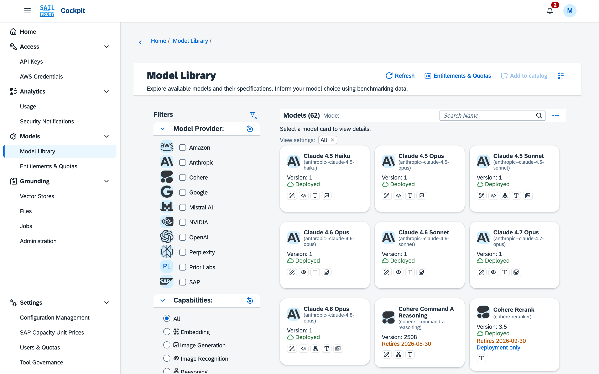
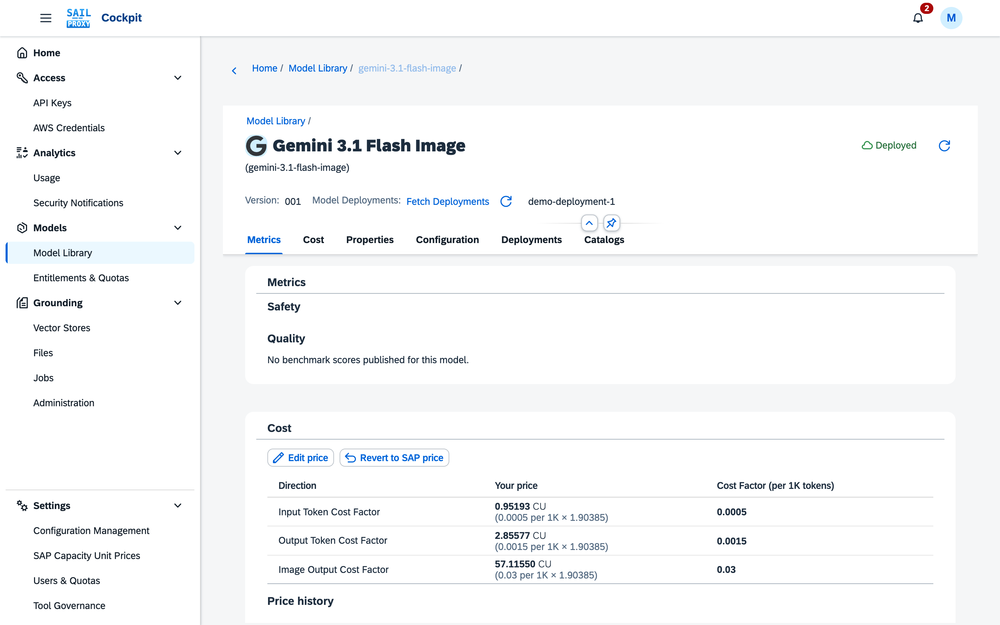
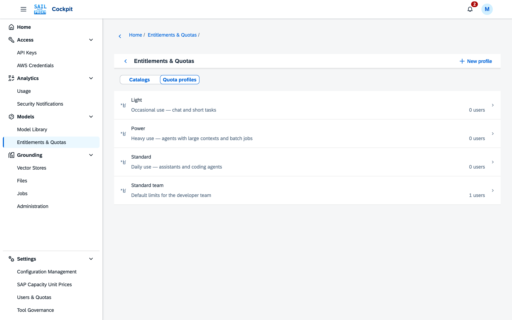

# Model library and entitlements

The Models group of the cockpit holds two applications: the **Model Library**, which shows the models the gateway offers and what they cost, and **Entitlements & Quotas**, which decides who may use which models and how much.

## Model Library

**Model Library** (Models → Model Library) shows the models the gateway currently offers, as SAP AI
Core publishes them. Every user sees the models in their entitlement; administrators see all.

*Models appear as cards; the filter pane narrows them by provider, capability and more.*

- **Filter pane.** Model provider, capabilities (one at a time), input types, model provisioning (SAP
  Hosted, SAP Managed, Remote), access type (LLM Access, Orchestration) and the switches *Latest
  Version Only*, *Streaming Support* and *Show Deployments*. Every group has its own reset, and the
  active settings appear as removable tokens above the cards. The search box matches names and
  identifiers.
- **Card badges.** A card is marked *Deployed* when the model has a deployment of its own,
  *Deployment* when the card is that deployment's entry (visible with *Show Deployments* on), and
  *Retires* followed by the date when SAP has announced a retirement date for the model. A model SAP AI Core
  offers only through a deployment of its own is marked *Deployment only*: the gateway cannot call
  it by name, but once deployed it answers under its `--deployed` id. *Not callable* marks the rare
  model SAP allows neither way.
- **Modes.** *Catalog* shows one card per model; *Leaderboard* lists published benchmark scores;
  *Chart* plots two benchmarks against each other — choose the axes above the chart. Leaderboard and
  chart always list foundation models, never their deployments, which carry the same scores.
- **Model details.** Metrics (safety and quality benchmarks), Cost, Properties, Configuration (the
  model's and its provider's settings in the active gateway configuration), Deployments and Catalogs.
- **Cost.** Prices are shown in SAP capacity units per million tokens, with the SAP Cost Factor (per 1K
  tokens) and the conversion factor in brackets so you can see how the figure is derived. When
  no conversion factor is configured, a warning says the SAP default is used. Administrators can *Edit
  price* to override a published price and *Revert to SAP price* at any time; the price history lists
  every change. SAP publishes no rate for image models, so the price dialog's fifth field, *Image
  output cost per 1K tokens*, lets an administrator enter one; it prices generated-image tokens on
  models with image output. The dialog's sixth and seventh fields, *Audio input cost per 1K tokens*
  and *Audio output cost per 1K tokens*, price the audio tokens of realtime sessions; SAP publishes
  these rates in SAP Note 3437766 rather than in the catalogue, so they are entered by hand (for
  `gpt-realtime` the note lists them beside the text rates). A price entered by hand on either the
  model or its *Deployed* entry applies to both, so you only have to enter it once. *Revert to SAP
  price* clears a manually entered image rate along with the other manual prices — SAP publishes
  none to fall back to, so image tokens go back to being priced like ordinary output tokens; it
  clears the audio rates the same way. For the SAP-RPT tabular prediction models the same fields
  price per 1,000 **cells** rather than per 1,000 tokens, labelled *Cost Factor (per 1K cells)*. The
  large SAP-RPT models each carry an extra, pricing-only Model Library entry named after the model with *(Deep Context)* appended for the higher-priced Deep Context tier (see
  [Tabular prediction](/guide/clients/tabular-prediction#deep-context)); it has its own price but cannot be
  deployed or called directly.
- **Deployments** (administrators). *Fetch Deployments* lists the model's SAP AI Core deployments.
  *Deploy* creates one: it reuses an existing configuration or creates one, starts the deployment and
  waits up to five minutes for it to run. Deployments incur cost until they are stopped in the SAP AI
  Launchpad.
- **Refresh** (administrators) re-reads the model list from the gateway.

*The object page of an image model, with a price entered by hand.*

## Entitlements & Quotas

**Entitlements & Quotas** (Models → Entitlements & Quotas) decides which models a user may call and
how much they may use. A switch at the top of the list chooses between **Catalogs** and **Quota
profiles**.

**Catalogs** decide which models a user may call through the gateway. The gateway lists only entitled
models on `/v1/models` and refuses requests for other models.

- The **Default** catalog applies to everyone without an assignment. It contains every SAP AI Core
  model unless an administrator excludes it (*Exclusions* tab). New models published by SAP are entitled
  automatically until excluded.
- Models from a [Connection](/guide/cockpit/connections) are opt-in: the Default catalog never grants
  them. Only a catalog that lists such a model grants it, so add it to a catalog after publishing it.
- Every change to a catalog — its **name and description**, the **models** in it, the Default
  catalog's **exclusions** and the user **assignments** — is collected and written together with
  *Save*; *Discard* drops all of it. A model or user changed but not yet saved is marked as such in
  its row, the footer counts the unsaved changes, and leaving a catalog with unsaved changes asks
  before dropping them. If part of a save is refused, what was refused stays marked unsaved with the
  reason; the rest is written.
- Administrators create catalogs over all models and **assign** one to a user (*Assignments* tab);
  the assignment takes effect on *Save*. Re-assigning a user trims their personal catalogs to the new
  catalog. Select several users and use *Assign to this catalog* or *Unassign* to change them
  together; the search box narrows the list by e-mail or assigned catalog.
- Every user can create personal catalogs within their assigned catalog: *Add models* offers only
  models the assigned catalog contains. Removing a model from a parent catalog also removes it from
  the catalogs below it.
- The Default catalog cannot be deleted. A catalog that is assigned to a user or has child catalogs
  cannot be deleted until those are reassigned or removed.

**Quota profiles** decide how much a user may use. A profile is a named set of seven limits —
requests per minute; tokens per day, week and month; and spend per day, week and month — that an
administrator assigns to a user. A user's effective limit for each of the seven values is, in order:
their own constraint if one is set, else the assigned profile's value, else the platform default from
the configuration, else unlimited. An administrator can still set a user's own constraint above the
assigned profile.

*The switch at the top of the list selects Catalogs or Quota profiles; here the Standard team profile is listed.*

- A profile carries a **name**, a **description** and the seven limits; the *Assignments* tab assigns
  it to users. As with catalogs, every change — name, limits, assignments — is collected and written
  together with *Save*, and *Discard* drops it; leaving a profile with unsaved changes asks first. An
  assignment marked **(unsaved)** does not take effect until *Save*.
- Deleting a profile that still has users assigned is refused, naming them; reassign or unassign those
  users first.
- The first time the cockpit starts with no profiles, it creates three starter profiles:

  | Profile | Requests/min | Tokens/day | Tokens/week | Tokens/month | Spend/day | Spend/week | Spend/month |
  |---|---|---|---|---|---|---|---|
  | Light | 30 | 500,000 | 2,000,000 | 5,000,000 | 25 | 75 | 150 |
  | Standard | 60 | 5,000,000 | 20,000,000 | 60,000,000 | 250 | 1,000 | 3,000 |
  | Power | 200 | 25,000,000 | 100,000,000 | 300,000,000 | 1,500 | 6,000 | 12,000 |

  Spend figures are in the billing currency shown on the page. These three are starting points
  derived from a real deployment's usage, meant to be tuned from the home tiles and Usage Analytics
  once you see your own traffic. After that first creation they are ordinary profiles like any other
  you create yourself: edit or delete them freely. If every profile is deleted, the three are created
  again the next time the cockpit starts.
