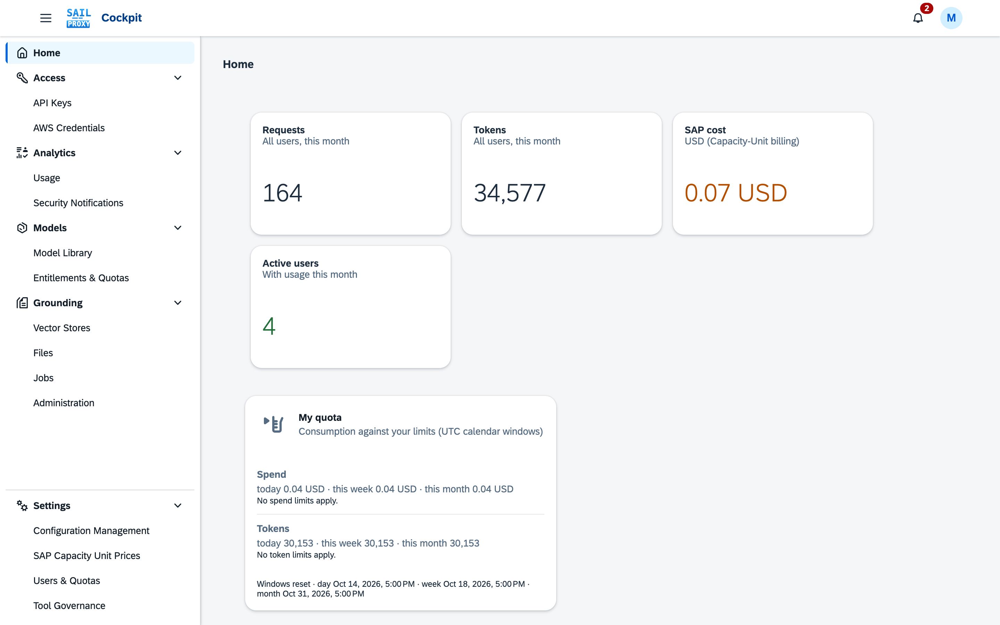
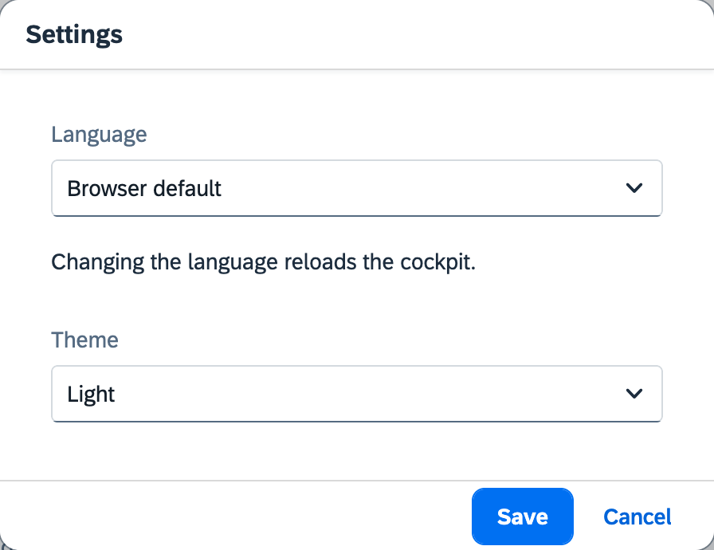
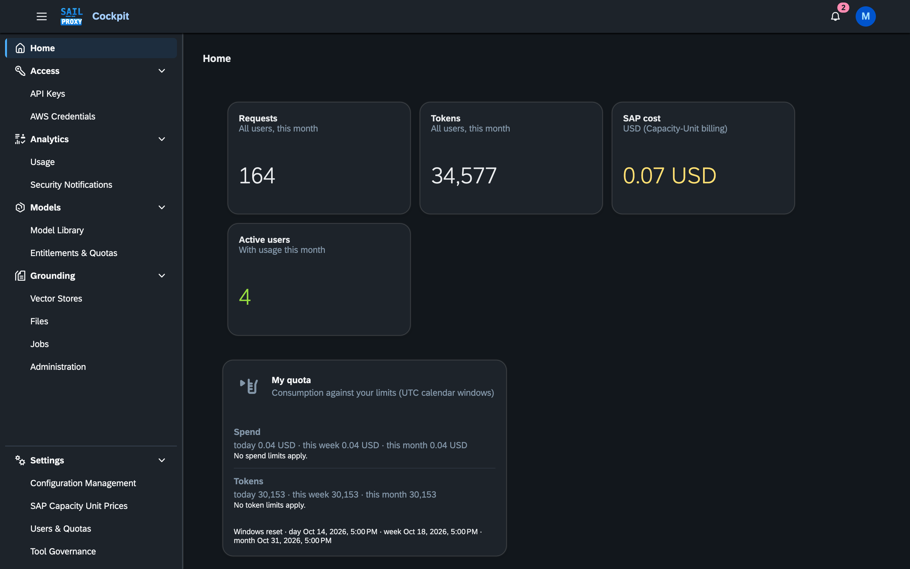

# Admin Cockpit

The Admin Cockpit is the web interface of a sail-proxy deployment. It covers API keys, gateway-issued AWS SigV4 credentials, usage analytics, security notifications, the model library with entitlements and quotas, grounding data, users, tool governance, external provider connections and the gateway configuration.

The cockpit runs in the Docker and Kyma deployments. The npm standalone CLI has no cockpit.

## Accessing the Admin Cockpit

### Prerequisites

- A **Docker or Kyma deployment** of sail-proxy with sign-in configured.
- A **user account** with your identity provider.
- A **role**: every signed-in person has the `user` or the `admin` role. A user manages their own API keys and AWS credentials and sees their own usage and notifications; other users' data, users, quotas, tool policies and configuration changes are for the `admin` role. See [Roles](/guide/roles).

### Signing in

1. Open `https://sail.example.com/admin/`, or `http://localhost:8080/admin/` for a local Docker setup.
2. Without a session, nginx sends you to oauth2-proxy (`/oauth2/start`), which signs you in through the configured identity provider (Dex in the Docker setup).
3. After sign-in, `/admin/` redirects to the cockpit shell at `/admin/app/shell/`, which hosts the individual applications.

Roles come from your identity provider and are evaluated as CDS `@restrict` rules on the admin service. The cockpit does not assign or edit roles; see [Roles](/guide/roles).

## The Applications

The side navigation groups the applications. Entries marked *admin* appear only for administrators.

| Group | Entry | Purpose |
|---|---|---|
| Access | [API Keys](/guide/cockpit/api-keys) | Create, rotate, rate-limit and delete gateway API keys; administrators activate, deactivate and set expiry |
| Access | [AWS Credentials](/guide/cockpit/aws-credentials) | Issue and manage SigV4 credentials for the Bedrock-compatible route |
| Analytics | [Usage](/guide/cockpit/usage-analytics) | Requests, tokens, cost and response times by provider, model, user, key and credential |
| Analytics | [Security Notifications](/guide/cockpit/security-notifications) | Review, snooze, pin, dismiss and delete security notifications |
| Models | [Model Library](/guide/cockpit/model-library) | The models available through the gateway, their benchmarks and prices; administrators maintain prices and create deployments |
| Models | [Entitlements & Quotas](/guide/cockpit/model-library#entitlements-quotas) | Which models a user may use (catalogs) and how much (quota profiles) |
| Grounding | [Vector Stores, Files, Jobs, Administration](/guide/cockpit/grounding) | The files and vector stores the `file_search` tool searches; Administration (*admin*) shows every user's grounding data |
| Settings | [Configuration Management](/guide/cockpit/configuration) | Versioned gateway configuration with validation, activation and rollback |
| Settings | SAP Capacity Unit Prices (*admin*) | The price of one SAP capacity unit per usage type and validity period, which turns capacity units into SAP cost; see [Usage analytics](/guide/cockpit/usage-analytics#sap-cost) |
| Settings | [Users & Quotas](/guide/cockpit/users-quotas) (*admin*) | Constrain, deactivate and reactivate users and reset their quotas |
| Settings | [Connections](/guide/cockpit/connections) (*admin*) | External provider accounts (Azure OpenAI, AWS Bedrock, OpenAI, Anthropic): credentials, tests, models and prices |
| Settings | [Tool Governance](/guide/cockpit/tool-governance) (*admin*) | Which tools a user or an API key may declare and invoke, and an inventory of every tool seen |
| Settings | [Plugins](/guide/cockpit/plugins) (*admin*) | Install, enable and remove gateway plugins from a zip package, with their status and settings |

Service operations without a page of their own, backups and the audit trail are described in [Operations and audit trail](/guide/cockpit/operations).

## The Home Page

The home page shows this month's key metrics as tiles: requests, tokens and SAP cost in the billing
currency, for your own usage or, as an administrator, for all users (plus the number of active users,
those with usage this month). Each tile opens Usage Analytics. A separate Connections cost tile shows what requests to Connection models cost, apart from SAP cost; it appears only when there is such spend.

*The side navigation groups the applications under Access, Analytics, Models, Grounding and Settings.*

The **My quota** card shows the signed-in user's own consumption against their limits. It has a
Spend and a Tokens group, each opening with the figures for today, this week and this month. Under a
window that has a limit, a horizontal bullet chart follows: the bar is what has been used, the marker
is the limit, and the bar turns amber at 75 % and red at 90 % of the limit. A window without a limit
gets no chart, and a group whose windows are all unlimited says so in one line. The card ends with
the times the day, week and month windows reset, in your local time.

The per-minute request limit is a rate guard rather than a budget: it shows as a line of text in the
profile popover and on the Users & Quotas page, not as a chart. The profile popover also names your
own effective tool policy and its mode; see [Tool governance](/guide/cockpit/tool-governance).

## Language

The cockpit is available in English, German, French, Portuguese, Italian,
Spanish and Dutch. By default it follows your browser's language: if that is one
of the seven it is used, otherwise the cockpit is shown in English.

To choose a language yourself, open the profile menu in the top-right corner and
select **Settings**. The **Language** list offers **Browser default** (follow
the browser) and each of the seven languages under its own name: English,
Deutsch, Español, Français, Italiano, Nederlands, Português. Pick one and the
cockpit reloads in that language. If the choice cannot be saved, for example
because the connection dropped, the cockpit says so and stays in its current
language; try again later.

The same dialog offers the theme: **Light**, **Dark** or **System**.

*The Settings dialog sets the language and the theme.*

*The same home page in the dark theme.*

Everything follows the chosen language, the configuration form included: its
field names, help texts and validation messages. Dates and numbers are written
the way the language writes them, so German shows `1.234` and `5.10.2026` where
English shows `1,234` and `10/5/2026`. Product and model names stay as they are.

The choice follows your account and stays until you change it again. It applies
immediately in the browser you made it in; when you sign in from another
browser, the cockpit picks it up after sign-in and reloads once in your
language. Until you choose a language for the first time, each browser follows
its own language.

## What the Admin Cockpit Does Not Do

These are commonly expected but are not part of the cockpit:

- **Role administration**: no role assignment, user import or password management. Roles come from your identity provider; see [Roles](/guide/roles). Users & Quotas manages a user's status and limits, not their role.
- **Cost planning**: no cost allocation, forecasting or spend alerts. Spend is limited per user through quotas.
- **Alerting**: no alert rules, thresholds or notification routing for error rates, traffic anomalies or downtime. Security and audit events can be exported to an external SIEM; see [Gateway configuration](/guide/cockpit/configuration#siem-event-export).
- **Automated incident response**: no automatic account lockout, automatic key suspension or IP blocking.
- **Scheduled reporting**: usage is exported manually as CSV; there are no scheduled or emailed reports and no PDF output.
- **Log and database administration**: no log search or download, no backup, restore or maintenance queries. Log levels are set in the gateway configuration.
