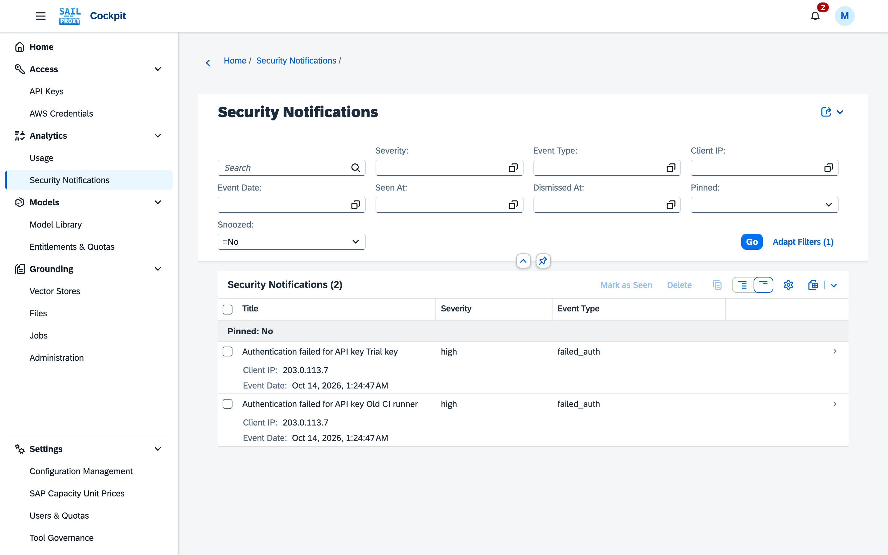

# Security notifications

The **Security Notifications** application (Analytics → Security Notifications) lists the security events the gateway raised about API keys and AWS credentials.

## What Raises a Notification

The gateway raises a notification when a request with a key or credential fails authentication
(**Failed Authentication**), when a credential is rotated, and when a request is refused because the
model is not in the caller's entitlement, because a quota is used up or because a tool policy does not
permit a tool. A tool policy refusal reads "not permitted by tool policy" (see
[Tool governance](/guide/cockpit/tool-governance)). The **Event Type** column names the cause.

*Two `failed_auth` events, one per key name, each with the client address the gateway saw.*

Each notification shows the client IP, user agent, endpoint and request ID of the event it reports.
Whether the IP is the caller's or the proxy's depends on the `trust_forwarded_for` platform setting
(Configuration Management → Platform → Security): off (the default) records the proxy in front of
the gateway; switch it on behind nginx or the Istio ingress to record the caller.

## Who Sees a Notification

A notification belongs to the owner of the key or credential it concerns (**Owner Email**). A user
sees the notifications about their own keys and credentials; an administrator sees all of them.

The bell in the shell bar counts the unseen notifications and updates while the cockpit is open. Its
popover offers **Mark all notifications as seen**, **Clear All** and **Go to security
notifications**.

Security events can also leave the gateway through the SIEM export; see
[Gateway configuration](/guide/cockpit/configuration#siem-event-export).

## Working with Notifications

The application offers these operations:

- **Mark as Seen** / **Mark as Unseen**
- **Dismiss**
- **Snooze**: hide the notification for 24 hours
- **Pin** / **Unpin**
- **Delete**
- **Mark as Seen** and **Delete** on several selected notifications at once

Seen, dismissed, snoozed and pinned are kept per user: each user sees their own notification state.
