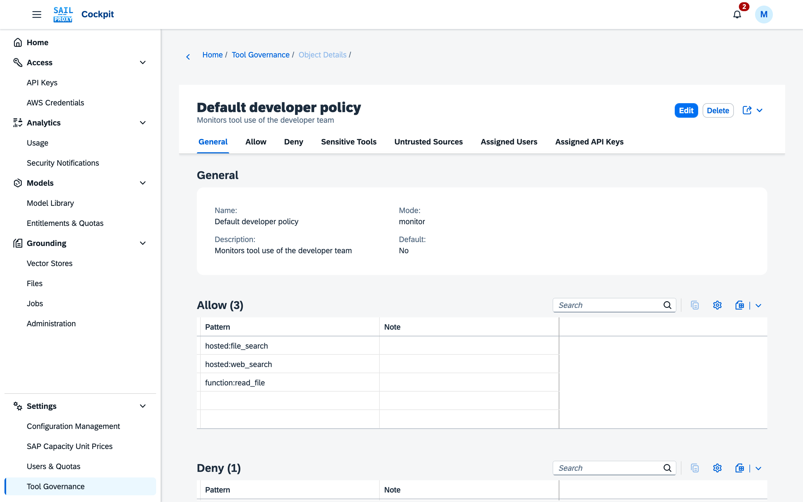

# Tool governance in the cockpit

Administrators use the **Tool Governance** application (Settings → Tool Governance) to decide which
tools a user, or one of their API keys, may declare and invoke when calling the gateway — function tools, a provider's own hosted tools (such
as web search), and tools reached through an MCP server.

## Policies

A policy carries a name, an **allow list**, a **deny list** and a **mode**:

- An empty allow list means everything not denied is permitted; a non-empty allow list means only
  the listed tools are permitted, minus anything denied. A deny entry always wins over an allow
  entry.
- **Mode** decides what happens to a tool the policy denies:
  - **Monitor** — record only. The request goes through unchanged; nothing is offered, stripped or
    refused because of the policy.
  - **Strip** — the denied tool is removed from the request before it reaches the model, and the
    model is told which tools were taken away and that it may not reach for them another way. The
    turn goes ahead without that tool, and the assistant can say the tool is not permitted rather
    than appearing to ignore the request. This is the mode to use for an interactive client.
  - **Reject** — the request is refused outright, with an error naming the denied tools and the
    policy that denied them. A client offers its whole tool list on every turn, so as long as the
    denied tool stays in that list, every request is refused, whatever the person asked for. That
    is what Reject means, and it is the right mode for a tool nobody may use under any
    circumstances. To let a client keep working without the tool, use Strip.

*The policy page has a tab each for Allow, Deny, Sensitive Tools and Untrusted Sources; this one is in monitor mode.*

## Assigning Policies

One policy is always the **default** — it applies to every user who has no policy of their own
assigned, cannot be deleted, and starts in Monitor mode with no entries, so adopting this feature
changes nothing until an administrator writes an allow or deny entry somewhere. An administrator
assigns a different policy to a user on the policy's own **Assigned Users** table (**Assign User**
opens a searchable list of users); the **Assigned API Keys** table (**Assign API Key**) works the same way and narrows one specific key to its own policy. To
undo either, select the rows and press **Unassign** above that table. The two tables list who the
policy binds, so they offer no Create and no Delete: a user and an API key exist independently of
any policy, and assignment only points one at it. The buttons appear while the policy is displayed,
not while it is being edited. A key's policy can only ever narrow its owner's: a tool must be permitted by both, and
where the two disagree on mode, the stricter one applies (Reject is stricter than Strip, which is
stricter than Monitor). Unassigning a user or a key returns it to the default (for a user) or to
relying on its owner's policy alone (for a key).

## Writing Patterns

Allow and deny entries are written in one of these forms, each naming a kind
of tool:

| Form | Matches |
|---|---|
| `function:jira_*` | Every function tool whose name starts with `jira_` (a trailing `*` matches a prefix) |
| `hosted:web_search` | The provider's built-in web search tool |
| `mcp:github` | Every tool reached through the MCP server named `github` |
| `mcp:github/create_issue` | Only the `create_issue` tool on that MCP server |
| `hosted:custom` | Every tool a client declares as a custom tool |
| `hosted:custom/exec` | Only the custom tool named `exec` (a client's shell, for example) |

A client that runs its own MCP servers, as Claude Code does, offers each of their tools under a name
of the form `mcp__server__tool`. Those are recognised and governed as `mcp:server/tool`, so one
pattern covers a server whether the client hosts it or the model reaches it remotely. Which client
programs spell their MCP tools this way is part of the gateway configuration, under tool governance,
so support for a new one does not need a new release.

Some clients, such as opencode, name an MCP tool `<server>_<tool>` with nothing marking it as an MCP
tool. To govern such tools as `mcp:server/tool`, list the MCP servers you run under **Server names**
in that client's entry (Configuration Management → Platform → Tool Governance → MCP naming → Client
programs). A tool whose name starts with one of those servers followed by `_` is then treated as that
server's tool; the servers are tried in list order and the first match wins. An entry can also carry
its own **Tool name pattern**, which replaces the shared pattern for that client only. Names and
patterns are case-sensitive. With no server names listed, such tools stay ordinary tools.

Some clients keep their MCP tools out of the request entirely and reach them inside a tool of their
own, as the codex command line does. A policy still applies: the gateway reads which MCP tools such
a call reaches, refuses the call when the policy forbids one of them, and puts a message in its
place telling the assistant it was not permitted. Under **Monitor**, such a call is never refused,
whatever it reaches — Monitor never changes what the client sees, here or anywhere else; only
**Strip** and **Reject** stop the call itself. The **Detected** column counts the cases where a
denied tool was used without the gateway having prevented it, which is what a monitoring policy
records; it never means a call was stopped, and it is counted apart from **Rejected**, which does.

A pattern is either exact or ends in a single `*` for a prefix match; there is no other wildcard.
Denying an MCP server (`mcp:github`) denies every tool behind it, without having to list them one
by one.

## Limiting One MCP Server

An allow entry of the form `mcp:<server>/<tool>` is *server-limited*:
it narrows only that one server, leaving every other tool the caller has — including its other MCP
servers — unaffected. For example, allow `mcp:github/get_issue` and `mcp:github/list_issues`: the
github server offers only those two tools, every other tool of the caller is unaffected. Writing
`mcp:github/*` as an allow entry means all of github's tools, the same as not limiting the server at
all. A deny entry still wins over these: denying `mcp:github/create_issue` removes it even where it
is also allowed.

Some clients declare a whole MCP server up front without naming which of its tools a given request
will use. When a policy limits such a server and a request declares it that way, what happens
depends on the mode: **Strip** narrows the declaration to the listed tools before it reaches the
model; **Reject** refuses the request outright, since letting it through would offer every tool on
the server; **Monitor** records it without changing the request. A server-limiting entry that ends
in `*` cannot be narrowed this way — there is no fixed list of names to write into the request — so
under Strip it is recorded rather than narrowed, the same as under Monitor; Reject still refuses the
request either way.

## Sensitive Tools and Untrusted Sources

Beyond Allow and Deny, a policy carries two further
lists, written with the same patterns: **Sensitive Tools** and **Untrusted Sources**. Sensitive
tools are ones that act on the world — a shell, a tool that sends mail — the ones you would not
want run on the strength of something the model did not write itself. Untrusted sources are tools
whose output may carry third-party content into the conversation — a web search, a browser tool
that fetches a page — text an assistant then reads that nobody at your organization wrote.

The rule: once a request carries output from one of the caller's untrusted sources, every one of
the caller's sensitive tools is withheld from that point on, whatever Allow and Deny would otherwise
permit. What "withheld" means follows the policy's mode, the same as any other denial: **Monitor**
only records it and changes nothing the caller sees; **Strip** removes the sensitive tools from the
request and tells the model why, naming the source that caused it; **Reject** refuses the request
outright, naming the source and the tools it withheld.

The check applies starting with the next request: the gateway only sees an untrusted tool's output
once it comes back in a later message, so a model that calls an untrusted tool and a sensitive one
in the very same turn is caught from the turn after, not the one where the untrusted output first
appeared.

The Tool Inventory's **Facet** field offers a **Source** value that finds every tool whose output the
gateway has seen carried in a request, and its **Trust Chain** column counts how many times a denial
happened because of this rule rather than because of Allow or Deny. The policy's own page shows
Sensitive Tools and Untrusted Sources as two further tables alongside Allow and Deny. Start a new
policy in Monitor and look at what the Source facet actually shows for the caller before switching to
Strip or Reject, so the two lists match what the caller really does rather than a guess.

## Tool Inventory

A second page in this application, opened with **Open Tool Inventory**, lists every tool identity the gateway has
seen — declared by a request or invoked by a model — over a chosen **Period** (the last 30 days
including today, by default; the field offers a calendar range and ready-made ranges, and **Facet**
narrows the list to declared, invoked or source in a dropdown — **Source** finds a tool by whether its
output was carried in a request, described above), with how many distinct users used it, how many
requests carried it, and how many times it was allowed, monitored, stripped, rejected, or seen
without ever being declared (a model can invoke a hosted-side tool the request itself never listed).
A refused request counts here too: the tool it asked for appears under **Rejected**, so a tool that
only ever gets blocked is still visible — and a tool
the inventory already knows simply has its counter raised rather than being listed twice. The request
figures are therefore attempts: a refused one reached no model and consumed no tokens and no cost.
The filter bar narrows the list by **Tool**, by **Facet**, by
**Requested By** (one client program) and by the free-text **Search**, which matches the tool and
the client programs together. The Tool and Requested By fields suggest what has actually been
recorded as you type. The table's own view settings can group by any column, Requested By included;
a tool asked for by two client programs groups under both of them together ("codex-tui, curl"),
because one row is one tool rather than one client. A filter the page cannot apply is refused with a message rather than quietly
ignored, so a filtered list is never the unfiltered one in disguise.

**Requested By** names the client programs that
asked for that tool in the period — the calling program as it identifies itself, such as a command
line assistant, an SDK or a browser, and `unknown` where a caller sent no identification.

When you write an allow or deny entry, the **Pattern** field offers the tools that have actually been
recorded, with how many people used each and when it was last seen, so you can pick a real tool
instead of typing its name from memory. The list is a suggestion, not a restriction: a wildcard such
as `function:jira_*`, or a tool nobody has used yet, can still be typed in.

## Elsewhere in the Cockpit

**On a user's record**, [Users & Quotas](/guide/cockpit/users-quotas) shows the assigned tool policy next to the entitlement
catalog, and a **Tools used** section listing that user's own tool activity from the same daily
figures the inventory reads. **API Keys** shows a key's own narrowing policy, where one is set.

**In the profile popover**, every signed-in user sees a line naming their own effective policy and
its mode, for example `Tool policy: Support bots (strip)`.

**A policy binds everyone it is assigned to, administrators included.** Unlike the model entitlement
catalog, which administrators bypass, a tool policy applies to whoever holds the user account or the
API key it is assigned to. An administrator who blocks their own tools can still change the policy
here.

[Security Notifications](/guide/cockpit/security-notifications) raises a "not permitted by tool policy" event whenever a strip or a
reject happens, naming the credential and, on a reject, the tools that were refused; when the reason
was the trust chain rather than Allow or Deny, the event says so and names the source.

## Retention

How long the per-request tool activity and its daily totals are kept is controlled by two settings
in the gateway configuration; see
[Gateway configuration](/guide/cockpit/configuration#daily-maintenance-run).

## Limitations

- **Realtime voice sessions** (the OpenAI Realtime API) are governed the same as any other request —
  Monitor, Strip and Reject all apply — but a session is not a single request, so a refusal there
  works differently. A declaration the policy refuses gets an error inside the session naming the
  tools that were not permitted, and the session carries on with whatever tools it already had,
  rather than the session itself ending. The trust chain applies too: once a result the session
  receives comes from one of the caller's untrusted sources and the session still holds a sensitive
  tool, the gateway removes that tool from the session from that point on (Strip), or refuses the
  session's tool results from then on until the client removes the sensitive tools from the session
  (Reject); Monitor only records it.
- **AWS credentials** follow only the tool policy assigned to their owning user; there is no way to
  narrow one credential's tools the way an API key can be narrowed.
- **AWS Bedrock** — requests sent through the AWS Bedrock-compatible route are governed the same way
  as the other routes, but a refusal arrives in Bedrock's own shape: an access-denied error, so AWS's
  own SDKs raise their normal exception rather than an unrecognised one. A conversation that has
  already used a tool cannot have every one of its tools taken away and continue — Bedrock itself
  refuses a conversation shaped that way — so a strip that would empty its tool list is refused
  outright instead.
