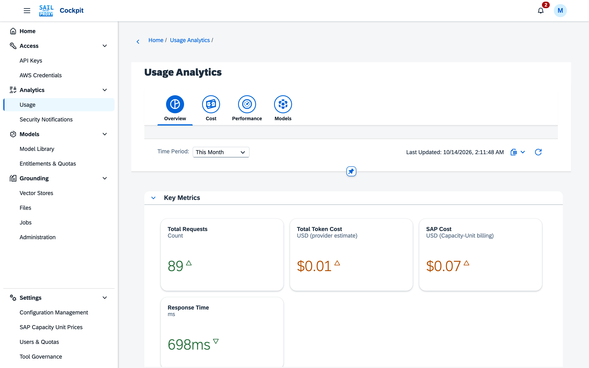
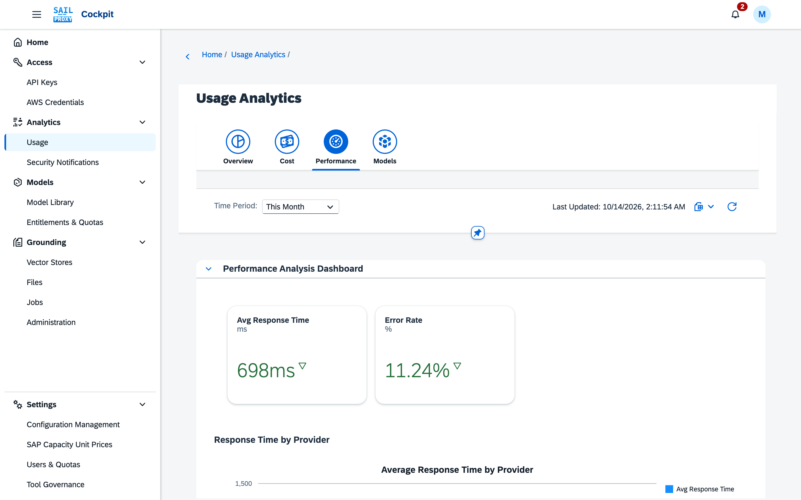
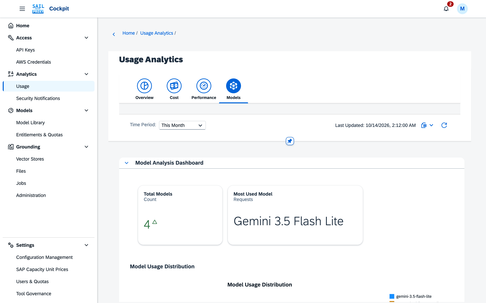
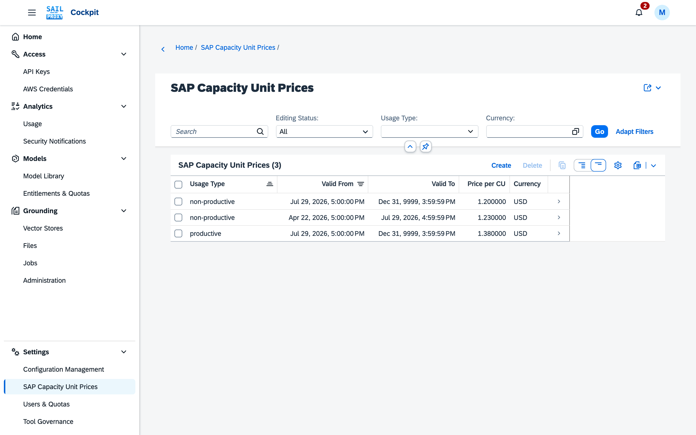

# Usage analytics

The **Usage Analytics** application (Analytics → Usage) reports what went through the gateway. A user sees their own usage; an administrator sees every user's. Choose the **Time Period** at the top (Today, This Week, This Month, This Quarter, This Year, Overall or a Custom Range).

*The Overview tab leads with the key metrics, followed by charts by provider and model.*

## Tabs

- **Overview**: key metrics (requests, tokens, token cost, SAP cost, response time), charts by provider and model, and the provider usage table. A Connections cost figure is shown apart from SAP cost.
- **Cost**: cost by provider and by model, the Connections cost figure and a Connections spend table with the spend per connection, the SAP billing breakdown by API key, and the top e-mail addresses, API keys and AWS credentials by cost.
- **Performance**: response time and success rate by provider.
- **Models**: usage distribution and per-model details.

*The Performance tab charts response time and success rate.*

*The Models tab shows how usage is distributed over the models.*

Broken down by provider and by model, the tables report:

- Total requests
- Input tokens
- Cache-create tokens and cache-read tokens
- Output tokens
- Average response time
- Error count
- Cost, where cost data is available

The **SAP Billing by API Key** table also lists **Image Output Tokens** (tokens from generated images,
priced at the image output rate entered in the [Model Library](/guide/cockpit/model-library) rather
than the ordinary output rate) and **Audio Input Tokens** and **Audio Output Tokens** (tokens from
realtime voice sessions, priced at the audio rates entered in the Model Library). In the per-key
tables, usage the Grounding cockpit caused on behalf of users shows as **Grounding cockpit (on behalf
of users)**; see [Grounding](/guide/cockpit/grounding#usage).

The SAP-RPT tabular prediction models (see [Tabular prediction](/guide/clients/tabular-prediction))
are metered in **cells** rather than tokens; a **Unit** column marks which of a model's figures are
cells and which are tokens.

## SAP Cost

**SAP Cost** is the SAP AI Core capacity-unit billing amount, built from the recorded token usage:
model tokens are converted into GenAI tokens with the per-model rates of the Model Library, GenAI
tokens into **Capacity Units** with the CU factor (`platform.billing.cuFactor`, 1.90385 by default),
and capacity units into SAP cost with the **Price per CU** that administrators maintain per usage
type and validity period under Settings → **SAP Capacity Unit Prices**.

*Each row is a price per capacity unit for a usage type and a validity period.*

## SAP Tenant

When the installation has more than one SAP AI Core tenant (saving a key creates its tenant; see [Connections](/guide/cockpit/connections#sap-ai-core)), the **SAP Tenant** filter appears and the SAP figures can be limited to one tenant. Without it, the SAP cost views show each tenant on its own row. The **Connection** filter appears whenever there is Connection spend and limits it to one connection (administrators see the connection titles, other users the names and only their own usage); Connection figures do not depend on the SAP tenant. Invoice reconciliation also works per tenant.

## Export

The **Export Data** menu exports the API key usage, the AWS credential usage or the model usage of the
selected period as **CSV**. The provider table's **Export to Excel** button also writes a CSV file.
