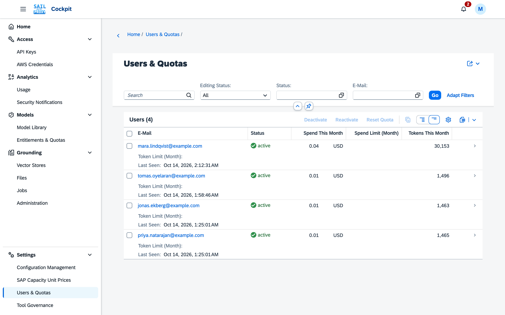

# Users and quotas

Administrators use the **Users & Quotas** application (Settings → Users & Quotas) to see and manage
every user's quota consumption and account status. A user appears here the first time they sign in
to the cockpit or use a key.

## The List

The list is sorted by last seen and shows e-mail, display name, status, roles (as last reported by
the identity provider), requests this minute, spend today, and tokens and spend this month against
the monthly limit. Spend figures and spend limits carry the currency of the SAP capacity
unit price and are shown with that currency's decimals. Spend counts SAP cost plus the cost of Connection models, in that currency. Select one or more rows and choose
**Deactivate**, **Reactivate** or **Reset Quota** to act on them together.

*Spend and tokens this month are shown per user beside their status.*

A token figure or token limit on this page always means input, output and cache-write tokens.
Cache-read tokens are priced — they count toward spend — but are never counted toward a token limit
or a token usage figure. If a token figure here reads lower than it used to for the same activity,
this is why.

## A User's Page

- **Constraints** — the user's own limits, grouped as *Requests*, *Tokens* and *Spend*. Under each
  field a **Default** line shows what applies while the field above it is empty, and where that value
  comes from — for example "(Standard profile)" when the assigned quota profile supplies it,
  "(platform)" when the platform-wide default supplies it, or "unlimited" when neither applies. An
  administrator can still set a user's own value above the assigned profile. Within tokens and within
  spend the windows have to be ordered — a day's limit cannot be higher than a week's, nor a week's
  higher than a month's — and a save that breaks the order is refused with a message naming the two
  fields.
- **Usage** — used and limit for each window (requests per minute; tokens and spend per day, week
  and month), with when each window resets. Below it, **Usage charts** draws a bullet chart for
  each budget window that has a limit (bar = used, marker = limit, colour as on the home card),
  followed by the time that window resets; a user without any limit sees a note instead of charts.
  The limit shown here is the same effective limit as under Constraints: the user's own constraint,
  else the assigned quota profile, else the platform default. The figures
  are kept as running counters and update within about a minute of a request; "requests" counts
  requests served by the gateway.
- **API Keys** and **AWS Credentials** — the user's credentials, read-only here: whether each is
  active or locked because the account was deactivated, and its own rate limits.
- **Entitlement** — the quota profile, the catalog and the tool policy assigned to the user, all
  read-only here. Change the quota profile from Entitlements & Quotas' *Quota profiles* mode,
  *Assignments* tab; change the catalog from its *Catalogs* mode, *Assignments* tab (see
  [Model library and entitlements](/guide/cockpit/model-library#entitlements-quotas)); change the
  tool policy in [Tool Governance](/guide/cockpit/tool-governance).
- **Tools used** — the user's own tool activity, per day and tool.
- **Record** — when the user was first and last seen, and when, by whom and why their status last
  changed.

## Actions

- **Deactivate** asks for a reason, then locks every active credential of the user and blocks new
  credentials from being created for them.
- **Reactivate** restores exactly the credentials that Deactivate locked.
- **Reset Quota** makes the user's usage before this moment stop counting toward their limits; the
  usage records themselves stay, so Usage Analytics still shows them. **Quota Reset At** under Usage
  shows when it happened.

A deactivated user cannot receive new credentials until the account is reactivated.
