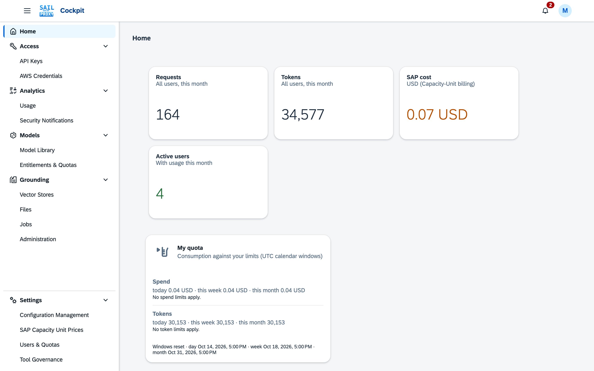

# Features

## Multi-Provider API Compatibility

sail-proxy accepts several AI API formats, so existing tools and code work without modification:

### OpenAI API Format
- **Endpoints**: `/openai/v1/chat/completions`, `/openai/v1/embeddings`, `/v1/models` (also
  `/openai/v1/models`). Every HTTP `/openai/v1/...` path is also served under `/openai/api/v1/...`.
- **Compatible with**: the OpenAI SDKs and most tools that take an OpenAI base URL
- **Example**:
```bash
curl -X POST http://localhost:3000/openai/v1/chat/completions \
  -H "Authorization: Bearer your-api-key" \
  -H "Content-Type: application/json" \
  -d '{
    "model": "gpt-5-mini",
    "messages": [{"role": "user", "content": "Hello!"}]
  }'
```

### OpenAI Responses API

- **Endpoint**: `/openai/v1/responses` (also mounted at `/openrouter/api/v1/responses`)
- **Models**: any model in the Model Library. A deployed GPT-5+ / o-series model (e.g. `gpt-5.3-codex--deployed`) is served natively; other catalogue models without such a deployment go through SAP orchestration. HTTP 400 `model_not_supported` is returned only for a model missing from the catalogue or a deployment that cannot serve the Responses API — use `/openai/v1/chat/completions` for those deployments.
- **Supported**: streaming, function tools, `reasoning`, `instructions`, `store: false`.
- **Hosted web search**: a hosted `{"type":"web_search"}` tool is emulated gateway-side through Perplexity `sonar-pro`. The search goes out under your SAP AI Core tenant, not from the user's machine, and carries only the query; Claude Code's Web Search tool takes the same path on `/anthropic`. The gateway runs the search itself and then calls the model again with the results, so the turn ends with the model's OWN answer written from what the search found: the client receives a `web_search_call` item recording the search, followed by the assistant's message. Streaming works the same way — the second call's frames are spliced into the same SSE stream, so the client still sees exactly one `response.created` and one `response.completed`. The number of searches per request is capped by `api_config.capabilities.web_search.max_searches_per_request` (default 3; a value outside 1–10 falls back to 3). Only when no follow-up call is possible (the cap is exhausted, or the call itself fails) does the gateway fall back to delivering the formatted results as the assistant's message.
- **Hosted file search**: upload documents through `/openai/v1/files`, group them in
  `/openai/v1/vector_stores`, and attach a `{"type":"file_search"}` tool naming the vector store;
  the gateway retrieves the matching passages itself before calling the model.
  The files and vector store endpoints follow OpenAI's API, so the OpenAI SDKs work against them:
  - Files are uploaded with purpose `assistants` or `user_data` (both can be added to a vector
    store; other purposes are refused with `400 invalid_purpose`). Uploaded files report
    `status: "processed"` at once, so the SDK's wait-for-processing helpers return immediately.
  - An upload can set an expiry as on OpenAI: `expires_after` with `anchor` `created_at` and
    `seconds` from 3600 (one hour) to 2592000 (30 days), sent as the form fields
    `expires_after[anchor]` and `expires_after[seconds]` (what the OpenAI SDKs send). Any other
    value is refused with `400 invalid_expires_after` naming the parameter. Such a file carries
    `expires_at`; once that time has passed the file is gone: it is no longer listed, returned,
    downloaded, searched or shown in its vector stores, attaching or deleting it answers as for a
    file that does not exist, and within a few minutes it is deleted as if you had deleted it, which
    also removes it from your vector stores. Files uploaded without `expires_after` never expire and have no `expires_at`.
  - A file can also be uploaded in parts through OpenAI's Uploads API (`/openai/v1/uploads`:
    create, add parts, complete, cancel), as the SDKs' `client.uploads` does. The completed upload
    is an ordinary file with the same rules as a direct upload: the same purposes, `expires_after`,
    and size limit (the installation's maximum file size, 32 MiB by default, instead of OpenAI's
    8 GB). The limits differ from OpenAI's:
    - **A part is at most 32 MiB** with the default file size limit (never more than 48 MiB),
      instead of OpenAI's 64 MB. A part above that limit but under 50 MB is refused with
      `413 part_too_large`, and the message names the limit. On the Docker and Kyma installations
      a request over 50 MB is refused earlier by the proxy in front of the gateway, also with status
      413 but without that JSON message. The Python SDK's `upload_file_chunked` sends 64 MB parts
      unless you pass a smaller `part_size`, so pass one of at most 32 MB, for example
      `part_size=16 * 1024 * 1024`.
    - An upload takes at most 1,000 parts, and its parts may not add up to more than the `bytes`
      it was created with.
    - You can have at most 10 uploads pending at once; complete or cancel one to start another. An
      upload that expired with parts still counts until the gateway cleans it up, within minutes.
    - Completing with `md5` checks the content; a mismatch is refused with `400 md5_mismatch` and
      the parts are kept, so you can complete again. Parts that do not add up to the declared
      `bytes` are refused the same way (`400 upload_size_mismatch`).
    - A pending upload expires one hour after it was created, as on OpenAI. Its parts are then
      deleted and it accepts no more parts, completion or cancel (`400 upload_not_pending`).
  - `GET /files` lists your files, up to 10,000 per page by default and at most (as on OpenAI);
    `?purpose=assistants` or `?purpose=user_data` lists only the files of that purpose (any other
    purpose lists none; an empty `purpose` lists all).
  - Deleting a file also removes it from every vector store it is attached to, as on OpenAI. Only a
    file that a vector store of another user still uses cannot be deleted (`409 file_in_use`).
  - A file batch takes `file_ids` with shared `attributes` and `chunking_strategy`, or `files`
    with each file's own (one of the two, not both), up to 2,000 files per batch; creating a vector
    store takes up to 500 `file_ids`. Both stay within the installation's limit of files per store.
  - `max_num_results` must be a whole number from 1 to 50, on a vector store search and on the
    `file_search` tool alike; any other value is refused with `400`.
  - Legacy Word files (`.doc`) are read on the Docker and Kyma installations, not in the npm
    standalone CLI (the Admin Cockpit's [Grounding](/guide/cockpit/grounding#files) pages list the supported file types).
  - A search takes `query` as one string or as a list of up to 10 strings of 8192 characters in
    total. The passages found for all of them are merged into one ranked list and re-ranked once
    (so a list costs one re-ranking, like a single query), and `search_query` lists every query.
  - `ranking_options.ranker` takes `"none"` (results without the re-ranking step: faster, and no
    re-ranking cost), `"auto"` or `"default-2024-11-15"` (re-ranked, as without `ranker`), and the
    Assistants API's `"default_2024_08_21"`, which works like `"auto"`. `null` counts as not set;
    any other value is refused with `400 invalid_ranker`.
  - `ranking_options.hybrid_search` accepts both `embedding_weight` / `text_weight` and
    `rrf_embedding_weight` / `rrf_text_weight` (not both spellings of one weight).
- **Client**: [Codex CLI](/guide/clients/codex)
- **Upgrading a distributed install**: an admin-activated configuration *replaces* the shipped `api_config.json` wholesale, so a configuration activated before this endpoint existed has no `responses` / `responses-stream` hook keys under `hooks.defaults.openai`. Because pseudonymization is force-enabled for the `openai` endpoint, the route then refuses requests with HTTP 503 `pseudonymization_hook_missing` rather than sending unmasked data upstream. Activate a configuration containing those keys before using the route.

```bash
curl -X POST http://localhost:3000/openai/v1/responses \
  -H "Content-Type: application/json" -H "Authorization: Bearer $API_KEY" \
  -d '{"model":"gpt-5.3-codex--deployed","input":"Say OK","max_output_tokens":30,"store":false}'
```

Reasoning items, encrypted reasoning content, tool calls and native SSE framing pass through unchanged. PII masking covers the whole Responses body — `instructions`, `input` items, tool-call arguments and tool output — as well as the streaming deltas coming back.

#### Using Codex CLI

Codex CLI speaks the Responses API natively: see [Codex CLI](/guide/clients/codex) for the setup, web search and sub-agents.

### OpenAI Images API

- **Endpoints**: `POST /openai/v1/images/generations` (JSON) and `POST /openai/v1/images/edits`
  (multipart form data), also mounted at `/openai/api/v1/images/generations` and `.../edits`.
- **Models**: a Gemini image model with a deployment (see the Gemini CLI client page), e.g. `gemini-3.1-flash-image`, bare or
  as its `--deployed` id. There is no default model.
- **Responses are always base64 PNG**: `response_format` accepts only `b64_json` and
  `output_format` only `png`; the image comes back as `data[0].b64_json`.

```bash
curl -X POST http://localhost:3000/openai/v1/images/generations \
  -H "Authorization: Bearer your-api-key" \
  -H "Content-Type: application/json" \
  -d '{
    "model": "gemini-3.1-flash-image",
    "prompt": "A watercolor painting of a lighthouse at sunset",
    "size": "1024x1024"
  }'

curl -X POST http://localhost:3000/openai/v1/images/edits \
  -H "Authorization: Bearer your-api-key" \
  -F "model=gemini-3.1-flash-image" \
  -F "prompt=Add a small sailboat near the horizon" \
  -F "image[]=@lighthouse.png"
```

```javascript
const response = await client.images.generate({
  model: 'gemini-3.1-flash-image',
  prompt: 'A watercolor painting of a lighthouse at sunset',
  size: '1024x1024',
});

const imageBase64 = response.data[0].b64_json;
```

| Field | Accepted | Notes |
|---|---|---|
| `model` | a Google image model with a deployment | no default |
| `prompt` | required | for edits, follows the uploaded image(s) |
| `n` | 1–4 (default 1) | one Gemini call per image, each counted as a request |
| `size` | `1024x1024`, `1536x1024`, `1024x1536`, `auto` | any other size (including DALL-E sizes) is refused with 400 |
| `quality` | `standard`, `low`, `medium`, `high`, `xhigh`, `max`, `auto` | `high` renders at 2K, `max` at 4K; the rest are accepted and ignored; `hd` is refused with 400 |
| `response_format` | `b64_json` only | `url` is refused with 400 — the gateway stores no images |
| `output_format` | `png` only | `jpeg`/`webp` refused with 400 |
| `image` / `image[]` (edits) | PNG, JPEG or WebP, ≤ 20 MB each | placed before the prompt, in upload order |
| `user` | accepted | ignored |
| `stream`, `partial_images`, `background`, `moderation` | only absent or at their default (`stream=false`, `partial_images=0`, `background=auto`, `moderation=auto`) | any other value is refused with 400 |
| `mask`, `style`, `input_fidelity`, `output_compression` | not supported | refused with 400 |

`n` issues one Gemini call per image, and each call is metered as its own request. An edit accepts
at most four `image` parts, each up to 20 MB, and a prompt of up to 32 KB.

**Data masking does not apply to images.** Pseudonymization rewrites text prompts; it is not
applied to image prompts or to uploaded images, which reach SAP AI Core as you sent them. Do not
put personal data in an image prompt or upload an image containing it.

A pricing note: generated-image tokens are priced from an image output rate an administrator enters
in the Admin Cockpit's [Model Library](/guide/cockpit/model-library).

### OpenAI Realtime API
- **Endpoint**: `ws://<gateway>/openai/v1/realtime` (WebSocket; also `/v1/realtime`)
- **Models**: SAP AI Core's deployed `gpt-realtime`; text and audio both work, every response is
  metered

### Anthropic API Format
- **Endpoints**: `/anthropic/v1/messages`, `/anthropic/v1/messages/count_tokens`, `/anthropic/v1/complete` (alias, Messages request shape)
- **Compatible with**: Anthropic SDK, Claude applications, Claude Code
- **Token Counting**: Local token estimation without API calls for pre-flight validation
- **Example**:
```bash
curl -X POST http://localhost:3000/anthropic/v1/messages \
  -H "x-api-key: your-api-key" \
  -H "Content-Type: application/json" \
  -d '{
    "model": "claude-sonnet-4-5-20250929",
    "max_tokens": 256,
    "messages": [{"role": "user", "content": "Hello!"}]
  }'
```

### AWS Bedrock Format
- **Endpoints**: `/aws-bedrock/model/{modelId}/invoke`, `.../invoke-with-response-stream`, `.../converse`, `.../converse-stream`
- **Authentication**: AWS SigV4 or API keys
- **Compatible with**: AWS CLI, Boto3, AWS SDKs

### OpenRouter Format
- **Endpoints**: `/openrouter/api/v1/chat/completions`, `/openrouter/api/v1/completions`, `/openrouter/api/v1/responses`, `/openrouter/api/v1/models`, plus `/openrouter/api/v1/files`, `/openrouter/api/v1/uploads` and `/openrouter/api/v1/vector_stores` for the hosted file search
- **Special feature**: GitHub Copilot compatibility (with patching)
- **Use case**: Connecting tools that expect OpenRouter's extended model list

### Ollama Compatibility
- **Service**: Optional Ollama service on port 11434
- **Endpoints**: `/api/chat`, `/api/generate`, `/api/tags`, OpenAI compatible endpoints `/v1/chat/completions`, `/v1/models`
- **Use case**: local development with Ollama-compatible tools, for example GitHub Copilot in VS Code.

### Google Gemini API Format
- **Endpoints**: `/google/v1beta/models/{model}:{method}`, `/google/v1/models/{model}:{method}` (`generateContent`, `streamGenerateContent`, `embedContent`)
- **Compatible with**: Gemini CLI, the `@google/genai` SDK, anything that takes a Gemini base URL
- **Coverage**: every model in the Model Library — a deployed Gemini model runs natively, everything else (including undeployed Gemini models) through the platform (see the Gemini CLI client page)

### Open WebUI (self-hosted chat UI)
Point a self-hosted Open WebUI at the `/openai/v1` base URL: see [Open WebUI](/guide/clients/open-webui).

## Authentication & Security

### API Key Management
- **Simple Setup**: Create and manage API keys through the CLI or the Admin Cockpit
- **Encrypted secrets**: stored AWS secret access keys are encrypted (AES-256, key from `AWS_SECRET_ENCRYPTION_KEY`); validation results cached in Valkey are encrypted with a key derived from the credential itself
- **Rate Limiting**: per-key requests per minute, hour and day (see Quotas and Account Status below)

### AWS Credentials Support
- **SigV4 Authentication**: Full AWS Signature Version 4 implementation
- **Credential Management**: create, rotate and revoke AWS-style access keys for the Bedrock-compatible route

### Quotas and Account Status

An administrator can constrain each user: requests per minute, spend per day, week and month, and
tokens per day, week and month. Platform-wide defaults apply to everyone; a quota profile assigned to
a user overrides them, and the user's own constraint overrides both. Every API key and AWS credential keeps its own rate limit as well, and a request has
to pass both. When a limit is reached the gateway answers `429` with a body that names the scope
(`user` or `key`), the dimension (`requests`, `tokens` or `spend`), the window, the limit, the usage
and when the window resets, plus `Retry-After` and `X-RateLimit-*` headers. Spend is the SAP cost of
the request plus, for Connection models, their list-price cost, in the installation currency. Spend and token quotas also apply to Grounding actions in the Admin Cockpit that start
paid work (see Usage under Grounding in the Admin Cockpit). An administrator can also deactivate an account: all of its credentials stop working at
once, no new credentials can be created for it, and reactivation restores exactly the credentials that
were locked. Each user sees their own consumption on the Admin Cockpit's home page and in the
profile menu.

### Tool Governance

An administrator can decide which tools — function tools, a provider's own hosted tools, and tools
reached through an MCP server — a user or one of their API keys may declare and invoke when calling
the gateway, including through the AWS Bedrock-compatible route and in a realtime voice session, and
can browse a live inventory of every tool the gateway has seen. A policy can
limit a single MCP server to named tools without affecting any other tool. A policy can also defend
against prompt injection: once a request carries output from a tool the policy calls an untrusted
source — a web search, a browser — the tools it calls sensitive, the ones that act on the world, are
withheld for the rest of the conversation, so content the assistant merely read cannot talk it into
running a shell or sending mail. The Admin Cockpit's [Tool Governance](/guide/cockpit/tool-governance) pages hold the policies, modes
and the inventory.

### PII Masking (Pseudonymization)
- **Detection and masking**: Personal data in an outgoing request is replaced with placeholder tokens and restored in the response; per-category toggles decide what is looked for
- **Enforced masking never falls back to unmasked**: where the configuration enforces masking for the endpoint or the model, a request that cannot be masked (an error while masking, no categories left to look for, or a request body masking cannot read, such as a Bedrock `prompt` body) is refused with HTTP 503 `pseudonymization_failed` instead of being sent unmasked. A request the active configuration would not run masking for is refused the same way with `pseudonymization_hook_missing`, and a request's own `masking` settings can add categories and patterns to enforced masking but never remove or exempt any, and a request that switches off every category it lists is refused. The one exception is a configuration that sets `allow_user_bypass: true`: there a request that asks for the bypass (header `x-sail-proxy-pseudonymization: off` or body field `pseudonymization_off: true`) is sent unmasked; the shipped configuration does not allow it
- **Never masked, by design**: embeddings (`/openai/v1/embeddings` and Gemini `embedContent` embed the text as sent, since a vector of a placeholder is useless), the contents of files, uploads, vector stores and grounding sources (stored and indexed as sent), and SAP-RPT inputs (RPT predicts rows from the real values, which placeholders would break) are never pseudonymized, even where masking is enforced
- **Precision tuning**: `min_confidence` sets how much evidence a value needs before it is masked (0.5 by default), and `thresholds` overrides that for one noisy category without touching the rest
- **Allow-list**: `allowlist.terms` (case-sensitive literals) and `allowlist.patterns` (regular expressions matched against the whole value) name what this deployment must never mask — a product, a system, a report title that reads like a person's name. A listed value is exempt whatever the confidence score says
- **Saturation warning**: above `saturation_warn` distinct masked values (40 by default) a request logs one warning naming the counts per category and the value *shapes* — letters as `X`, digits as `9`, never a value — and its usage SIEM event carries `saturated: true`. It is a report and nothing else: a request that trips it still masks every value it found

### Tabular Prediction (SAP-RPT)
- **Endpoint**: `POST /sap/v1/rpt/{model}/predict` — classification and regression over your own
  tabular data (rows in, predictions out), in-context, with no training step
- **Models**: SAP's `sap-rpt-*` family, bare or as the `--deployed` id, each needing its own
  deployment and entitlement
- **No masking**: this route carries no PII masking or any other request/response hook — the
  request and response pass through to SAP unchanged
- **Metered in cells**, not tokens — every cell sent plus every value predicted, shown as cells in
  the Admin Cockpit

### Enterprise Authentication (Docker and Kyma deployments)
- **Single Sign-On**: oauth2-proxy and Dex in front of the cockpit; `docker/setup-docker.js` configures a local login, GitHub, LDAP/Active Directory or Okta (SAML)
- **Roles**: identity-provider groups map to the admin and user roles (see [Roles](/guide/roles))

## Model Management

### Dynamic Model Mapping
Configure model renames per provider (**Substitute Models** in the configuration form) so that clients
can keep using familiar names:
```json
{
  "api_config": {
    "providers": {
      "openai": {
        "substitute_models": [{ "from": "gpt-4o-some-external-name", "to": "gpt-4o" }]
      },
      "anthropic": {
        "substitute_models": [{ "from": "claude-3-5-haiku-20241022", "to": "anthropic--claude-4.5-haiku" }]
      }
    }
  }
}
```
A request naming `from` is sent to the model `to`. Names match exactly, including case; the first
matching entry wins, and a renamed model is not renamed again. The response and the recorded usage
name the model that served the request (`to`). On the OpenAI-compatible chat completions and
responses endpoints the `openai` list is tried first, then the `perplexity` list.

### Streaming Support
- **Native Streaming**: Real-time response streaming for compatible models including abort controller
- **Streaming Emulation**: simulated streaming for the models listed in a provider's `emulate_streaming_for_models`
- **Tool Use**: Full support for OpenAI functions and Anthropic tools

### Model Discovery
- **Unified Endpoint**: `/v1/models` lists available models across all providers
- **Provider-Specific**: Each API format returns appropriate model lists
- **Refresh**: the gateway caches the model list; `GET /v1/models?refresh=true` fetches it again

## Usage Tracking & Analytics

### Comprehensive Monitoring
- **Request Tracking**: All API calls logged with metadata
- **Token Counting**: Input/output token usage per request
- **Pre-flight Token Estimation**: `/anthropic/v1/messages/count_tokens` endpoint for local token counting before inference
- **Cost Analysis**: Usage-based cost tracking and reporting
- **Performance Metrics**: response time and status code of every request
- **Payload logging**: enabled with the environment variable `PAYLOAD_LOGGING_ENABLED`

### Security Events
- **Authentication Failures**: requests with invalid or unknown keys
- **Limit violations**: rate limit and quota violations
- **Audit Trail**: every record keeps who changed it last and when
- **Notifications**: security events appear under [Security Notifications](/guide/cockpit/security-notifications) in the Admin Cockpit

## Plugin System

### Extensible Architecture
- **Request Hooks**: Modify requests before sending to SAP AI Core or deployment endpoint
- **Response Hooks**: Transform responses before returning to client
- **Streaming Hooks**: Real-time stream processing
- **Error Hooks**: Custom error handling and logging

- **Install without a rebuild**: administrators install, enable and remove plugins from a zip package in the [Plugins app](/guide/cockpit/plugins); the standalone CLI installs packages from a folder

### Example Plugin Use Cases
- **Content Filtering**: Remove sensitive data from requests/responses
- **Custom Logging**: Enhanced logging for compliance requirements
- **Response Enhancement**: Add metadata or formatting to responses
- **Integration Hooks**: Connect to external systems for monitoring
- **Cache**: the `awsBedrockResponseCache` plugin caches slow responses in memory; a repeated request waits for the first one to finish instead of running into a timeout
- **Enable beta features**: for example the 1-million-token context window of Claude Sonnet 4

## Admin Cockpit (Docker and Kyma deployments)


*The cockpit groups its applications under Access, Analytics, Models, Grounding and Settings.*

### Web-based Management
- **API Keys**: create, rotate, revoke and configure API keys
- **AWS Credentials**: create, rotate and revoke AWS-style credentials for the Bedrock-compatible route
- **Configuration Management**: edit and activate the gateway configuration; the gateway receives the activated configuration over the Valkey event bus and applies it without a restart
- **Models**: the Model Library, Entitlements & Quotas and SAP Capacity Unit Prices
- **Users & Quotas**: per-user constraints and account status
- **Tool Governance**: tool policies and the tool inventory
- **Grounding**: vector stores, files, jobs and their administration

### Analytics Dashboard
- **Usage Charts**: Visual representation of API usage over time
- **Cost Tracking**: Monitor usage costs by user, model, or time period
- **Security Notifications**: view security events
- **Performance Monitoring**: average response time, error rate and success rate per provider
- **Data Export**: Via .csv or Valkey event bus hook

## Integration Examples

### Claude Code Integration
```bash
# Set environment variables
export ANTHROPIC_API_KEY="your-sail-proxy-api-key"
export CLAUDE_CODE_DISABLE_NONESSENTIAL_TRAFFIC=1
export ANTHROPIC_BASE_URL="http://localhost:3000/anthropic"

# Claude Code now uses sail-proxy
claude --model claude-sonnet-4-5-20250929
```

### GitHub Copilot Integration (via OpenRouter endpoint)
GitHub Copilot connects either through the Ollama adapter or through the OpenRouter endpoint with the
patch in `cli-tools/patch-copilot-chat.js`.

### Custom Application Integration
```javascript
// OpenAI SDK example
import OpenAI from 'openai';

const client = new OpenAI({
  apiKey: 'your-sail-proxy-api-key',
  baseURL: 'http://localhost:3000/openai/v1'
});

const response = await client.chat.completions.create({
  model: 'gpt-5-mini',
  messages: [{ role: 'user', content: 'Hello from SAP AI Core!' }]
});
```

## Performance & Scalability

### Caching
- **Response cache**: the `awsBedrockResponseCache` plugin keeps slow responses in an in-memory LRU cache (one hour by default)
- **Validation cache**: Valkey holds encrypted credential validation results and carries cache invalidation events between services

### Monitoring Integration
- **Health Checks**: Built-in health endpoints for monitoring
- **Metrics Export**: Via hook in Valkey events
- **Logging**: per-component log levels (`LOG_LEVEL`, `api_config.platform.logging`)

Ready to get started? Follow the [Quick start](/guide/quick-start).
