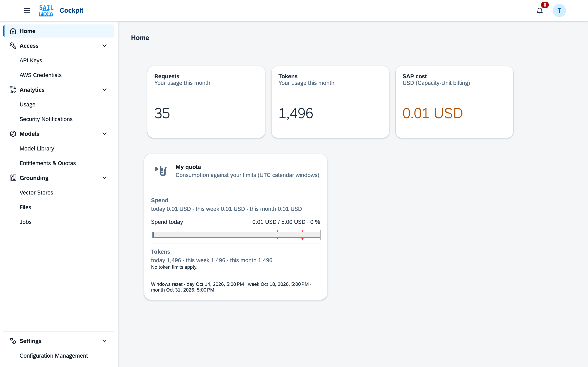
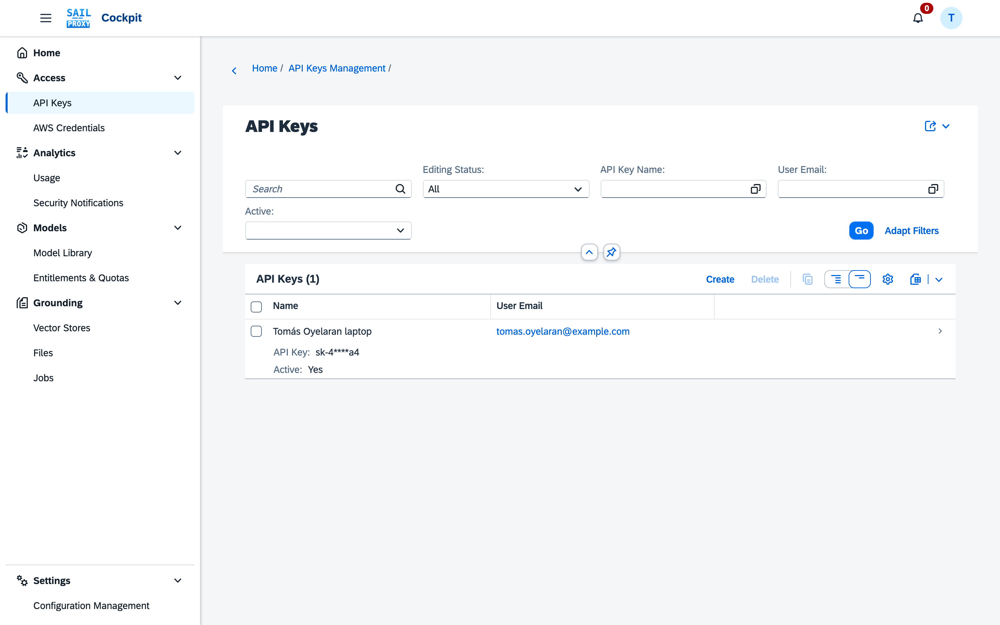

# Roles

The Admin Cockpit knows two roles: **admin** and **user**. Every signed-in person has one of them. The Docker and Kyma deployments enforce them; the npm CLI has no cockpit and no roles: whoever runs it manages its keys.

## How a role is assigned

Your identity provider decides the role through group membership. oauth2-proxy passes your email and groups to the cockpit in the `X-Auth-Request-Email` and `X-Auth-Request-Groups` headers, and the admin service maps each group to a role with `ROLE_MAPPING` (in `services/admin/.env`):

```bash
ROLE_MAPPING={"sap-llm-gateway-admin":"admin","sap-llm-gateway-user":"user"}
```

- The groups `admin` and `user` always map to the roles of the same name, in addition to the mapping above.
- A person whose groups map to no role gets the **user** role.
- With the local login (`IDENTITY_PROVIDER=local`) and no groups, the role comes from `LOCAL_USER_MAPPING`, a JSON map from email to role, for example `{"admin@example.com":"admin"}`. An email that is not in it gets the **user** role.

To make someone an admin, add them to the admin group in your identity provider (or to `LOCAL_USER_MAPPING` for the local login). The cockpit has no role editor.

## User

A user works with their own data only:

- **API keys**: create, rename, rotate and delete their own keys, and set the per-key rate limits (requests per minute, hour and day). Activating or deactivating a key and setting its expiry is for admins.
- **AWS credentials**: create, rotate and delete their own credentials for the Bedrock-compatible route. Enabling and disabling them is for admins.
- **Usage**: the usage and cost of their own keys and credentials, and their own quota consumption on the home page and in the profile menu.
- **Security notifications**: the notifications about their own keys and credentials; mark them seen, snooze, pin or dismiss them.
- **Models**: the models their entitlement allows; they can build their own model catalogs within it.
- **API calls**: any model their entitlement allows, within their quotas and the tool policies that apply to them.


*An ordinary user sees the home page with their own quota card.*


*The API Keys list shows only the user's own keys.*

## Admin

An admin can do everything a user can, for every user, and in addition:

- **Keys and credentials of all users**: activate, deactivate, set expiry or "never expires", and deactivate every key of one user at once.
- **Users & Quotas**: per-user constraints, quota profiles, deactivating and reactivating an account, resetting quotas.
- **Models**: the Model Library (prices, deployments, refresh), entitlement catalogs and their assignment to users, SAP Capacity Unit Prices.
- **Configuration Management**: create, validate, activate and roll back gateway configurations.
- **Tool Governance**: tool policies, their assignment to users and keys, and the tool inventory.
- **Grounding**: the Administration page of Grounding.
- **Security**: all security events, deleting notifications, cache invalidation.

## Permission summary

| Function | Admin | User |
|---|---|---|
| Create, rotate, delete own API keys and AWS credentials | ✅ | ✅ |
| Set rate limits on own keys and credentials | ✅ | ✅ |
| Activate, deactivate, set expiry of keys and credentials | ✅ | ❌ |
| See other users' keys, credentials and usage | ✅ | ❌ |
| See own usage and quota | ✅ | ✅ |
| Users & Quotas | ✅ | ❌ |
| Model Library, entitlement catalogs, SAP prices | ✅ | own catalogs only |
| Configuration Management | ✅ | ❌ |
| Tool Governance | ✅ | ❌ |
| Grounding administration | ✅ | ❌ |

## When access is denied

- Ask an admin to add you to the admin group in the identity provider if you need admin functions. The new role applies once oauth2-proxy passes the new group, which normally means signing in again.
- A deactivated account cannot use any of its keys or credentials, and cannot create new ones, until an admin reactivates it.
